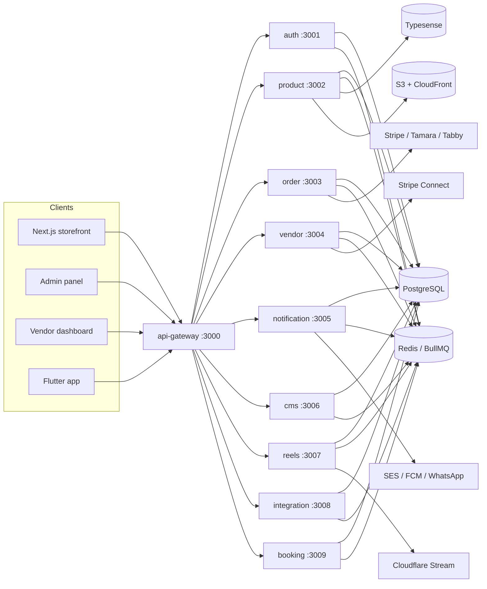
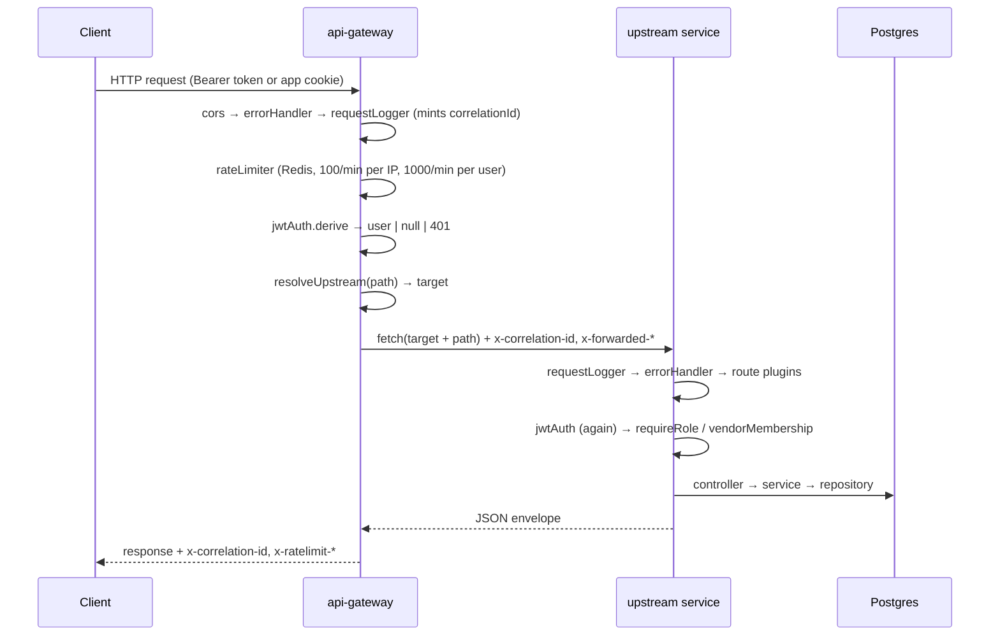

# 01 — Architecture

## What this system is

MaterialHub is a multi-vendor marketplace for the UAE. The backend is a **Bun** monorepo of ten
**ElysiaJS** HTTP services behind one gateway, sharing a single PostgreSQL database, a single
Redis instance, Typesense for search, and BullMQ for background work.

It is "microservices" in deployment shape only. All services share one database and read each
other's tables directly through the shared TypeORM entity library. Cross-service *writes* go
through HTTP (`/internal/*` routes) or BullMQ queues; cross-service *reads* are frequently
just a repository call against the same Postgres.

> **Know this before you change anything:** there is no per-service schema ownership. If you
> rename a column, grep the whole monorepo.

## Repository layout

```
backend/
├── apps/                       # deployable services (one Elysia app each)
│   ├── api-gateway/            # :3000 — the only public entry point
│   ├── auth-service/           # :3001
│   ├── product-service/        # :3002 — catalogue, search, inventory, media, bulk
│   ├── order-service/          # :3003 — cart, checkout, orders, money, shipping
│   ├── vendor-service/         # :3004 — vendors, members, KYC, Stripe Connect, affiliates
│   ├── notification-service/   # :3005
│   ├── cms-service/            # :3006 — pages, layouts, settings, support, audit
│   ├── reels-service/          # :3007 — short-form video commerce
│   ├── integration-service/    # :3008 — vendor webhooks + sales channels
│   └── booking-service/        # :3009 — services/appointments
├── libs/                       # shared workspace packages (@materialhub/*)
│   ├── database/               # TypeORM data source, 178 entities, enums, migrations
│   ├── dto/                    # TypeBox request/response schemas
│   ├── guards/                 # jwtAuth, requireRole, vendorMembership, permission matrix
│   ├── plugins/                # errorHandler, requestLogger, rateLimiter, auditPlugin, HttpError
│   ├── config/                 # one frozen config object read from env
│   ├── utils/                  # encryption, media/S3, email, WhatsApp, slug, pagination, phone
│   ├── bulk-jobs/              # the generic bulk import engine (parser → validate → write)
│   ├── integration-events/     # outbound event queue + payload schemas + inbound targets
│   └── integration-mapper/     # the JSON mapping DSL used by integration-service
├── docker/ , docker-compose*.yml
└── turbo.json                  # build/test/lint pipeline
```

Workspaces are declared in `backend/package.json` (`apps/*`, `libs/*`) and packages import each
other by name: `@materialhub/database`, `@materialhub/guards`, and so on.

## The ten services

| Service | Port | Owns | Key external deps |
|---|---|---|---|
| `api-gateway` | 3000 | Public HTTP surface, prefix routing, CORS, Swagger, global rate limit | — |
| `auth-service` | 3001 | `users`, `user_sessions`, addresses, 2FA, referrals | SES (email), WhatsApp OTP |
| `product-service` | 3002 | Catalogue, variants, inventory, media, search index, bulk jobs, gifting, service offerings | Typesense, S3/CloudFront, Google Drive, Gemini |
| `order-service` | 3003 | Cart, checkout, orders, payments, shipments, returns, disputes, reviews, commissions, payouts | Stripe, Tamara, Tabby, PostaPlus |
| `vendor-service` | 3004 | Vendors, KYC docs, members/roles, bank accounts, affiliates | Stripe Connect |
| `notification-service` | 3005 | Notifications, preferences, newsletter | SES, FCM, WhatsApp Cloud API |
| `cms-service` | 3006 | Pages, banners, layouts/sections, navigation, settings, support tickets, audit log | Slack, CloudFront invalidation |
| `reels-service` | 3007 | Reels, feed/ranking, social graph, creator commissions, licensing escrow | Cloudflare Stream |
| `integration-service` | 3008 | Vendor integrations (webhooks in/out), sales-channel feeds & conversions | Google/Meta/TikTok APIs |
| `booking-service` | 3009 | Availability, bookings, staff, calendars | (payments delegated to order-service) |

Ports and hostnames come from `libs/config/src/index.ts` (`config.port.*`, `config.serviceHost.*`)
and are overridable per environment.

## Runtime topology



## Request lifecycle

Every public request enters the gateway. The gateway itself performs auth verification and
rate limiting, then proxies to the owning service, which re-verifies auth locally.



Notes:

- The gateway verifies JWTs **and so does each service**. The gateway does not strip or rewrite
  the `Authorization` header; it forwards it verbatim. Auth is therefore enforced twice, and a
  service reached directly (bypassing the gateway, e.g. inside the Docker network) is still
  protected.
- The gateway is a dumb prefix router with **no path rewriting** — `upstreamPath` is the
  original pathname. A service's route paths are its full public paths.
- Request bodies are streamed (`duplex: "half"`), so large uploads pass through without buffering.

## The service skeleton

Every service follows the same four-file shape:

```
apps/<svc>/src/
├── index.ts        # boot: ensureDatabase() → permissionMatrix.load() → app.listen(port)
├── app.ts          # the Elysia app: plugins + .use(...) every route module
├── container.ts    # manual DI: repositories → services → controllers → decorate()
└── domain/…        # or controllers/ + services/ in the older services
    routes/…        # Elysia route modules
```

### `index.ts` — boot

```ts
await ensureDatabase();          // TypeORM DataSource.initialize(), idempotent
await permissionMatrix.load();   // SELECT role, permission FROM role_permissions
permissionMatrix.startPolling(); // re-reads when Redis `matrix_version` changes (≤30s)
app.listen(config.port.order);
```

`api-gateway` additionally passes `idleTimeout: 255` so long proxied requests are not cut off.

### `container.ts` — the DI pattern

There is no DI framework. `container.ts` is a module that runs top-to-bottom at import time:

1. `await ensureDatabase()`
2. Create shared clients — Redis, Stripe, `EncryptionService`, `MediaService`
3. `AppDataSource.getRepository(Entity)` for every entity the service touches
4. Construct services in dependency order, passing repositories positionally
5. Construct controllers from services
6. Create BullMQ queues, register schedulers, start workers
7. Export an Elysia plugin that `.decorate(...)`s each controller into the request context

```ts
export const container = new Elysia({ name: "order-service-container" })
  .decorate("cartController", cartController)
  .decorate("checkoutController", checkoutController)
  // …
```

Route modules then do `.use(container)` and destructure the controller out of the handler
context:

```ts
export const cartRoutes = new Elysia({ prefix: "/cart" })
  .use(container)
  .use(jwtAuth)
  .get("/", async ({ cartController, user }: any) => cartController.get(user));
```

Consequences worth knowing:

- **Construction order matters and is load-bearing.** `order-service/src/container.ts` has
  comments explaining why, e.g. `payoutService` is built before `orderStatusService` so a
  cancellation can invalidate a payout draft.
- **Importing `container.ts` starts workers.** Anything that imports a route module transitively
  boots queues and DB connections; this is why unit tests import services directly rather than
  routes.
- Handlers are typed `any` at the destructure site. Type safety lives in the DTO schemas
  (`{ body: SomeDto }`), which Elysia validates before the handler runs.

### Layering

```
routes/*.routes.ts     → HTTP shape: path, method, DTO schema, guards, response envelope
domain/**/*.controller → orchestration + auth-context mapping; thin
domain/**/*.service    → business logic; owns transactions; the interesting file
domain/**/*.job        → BullMQ queue accessor + worker factory + scheduler registration
domain/**/*.ts (pure)  → pure calculators, kept DB-free so they run without Postgres in CI
```

The pure-module convention is deliberate and widespread — `booking-policy.ts`,
`interval-math.ts`, `commission-cap.ts`, `shipping-contribution.ts`, `order-state-machine.ts`,
`unreleasable-claim.ts`, `dispute-reversal-calc.ts`. These never import `@materialhub/database`'s
barrel (it pulls in `reflect-metadata` and `AppDataSource`), so they are unit-testable with no
database.

## Response envelope

Successful responses are hand-built, not auto-wrapped:

```json
{ "statusCode": 200, "data": { }, "total": 42, "timestamp": "2026-08-05T…Z" }
```

Errors are produced by the shared `errorHandler` plugin:

```json
{ "statusCode": 404, "message": "Vendor not found", "error": "VENDOR_NOT_FOUND", "timestamp": "…" }
```

See [02 — Cross-cutting](02-cross-cutting.md#error-model).

## Data conventions

| Convention | Detail |
|---|---|
| Money | Integer **fils** (1 AED = 100 fils). Column names end in `_fils` in newer tables; older ones (`orders.grand_total`) are fils without the suffix. |
| VAT | Product prices are **VAT-inclusive** at the UAE 5% standard rate. `tax_total` on an order is the *extracted* VAT, informational, and is **not** added to `grand_total`. |
| Currency | `AED` base; `price_overrides` JSONB for others. |
| Soft delete | `deleted_at` on every table. TypeORM's repository methods filter it automatically — **raw SQL does not**, so raw queries in this codebase carry an explicit `AND deleted_at IS NULL`. |
| Snapshots | Anything the customer agreed to is snapshotted at the time of the deal: order item prices, commission rate, cancellation policy, gift box style. Later config changes never rewrite history. |
| Identifiers | UUID v4 primary keys. Human-facing references are sequence-backed: `FKS-YYYY-NNNNNN` (orders), `PAY-YYYY-NNNNNN` (payouts), `BK…` (bookings). |
| Timestamps | `timestamptz`, UTC. Business-day logic that needs local time uses `Asia/Dubai` explicitly. |

## Build, test, run

The scripts that actually exist, and where they live:

| Command | Run from | Notes |
|---|---|---|
| `docker compose up` | `backend/` | Postgres, Redis, Typesense + services |
| `bun run dev` | repo root | every workspace, `turbo run dev --concurrency 15` |
| `bun run dev:backend` | repo root | **only** gateway, auth, product, order, vendor, notification, cms — reels, integration and booking are missing from the filter |
| `bun run dev:web` · `dev:vendor` · `dev:admin` | repo root | one frontend |
| `turbo run build` · `test` · `typecheck` · `lint` | repo root or `backend/` | the pipeline is defined in `turbo.json` |
| `bun run migrate` · `migrate:generate` · `migrate:revert` · `seed` | `backend/libs/database` | TypeORM |
| `bun run dev` · `build` · `start` · `test` · `typecheck` | any `backend/apps/*` | per service |
| `bun run lint` · `lint:fix` · `format` | `backend/` | Biome |

> `CLAUDE.md` lists `bun run build`, `bun run test`, `bun run test:e2e`, `bun run migrate`,
> `bun run seed` and `bun run search:reindex` as root commands. **They do not exist at the root** —
> the root `package.json` only defines the `dev*` scripts. Use the table above; a full Typesense
> reindex is triggered through `POST /admin/search/reindex`, not a script.

Lint before pushing — CI fails on Biome errors:

```bash
cd backend && bunx --bun @biomejs/biome@1.9.4 check .
```

> **Gap:** CI runs backend checks only; the frontend test suites do not run in CI, so a green
> PR check says nothing about `apps/web`.
