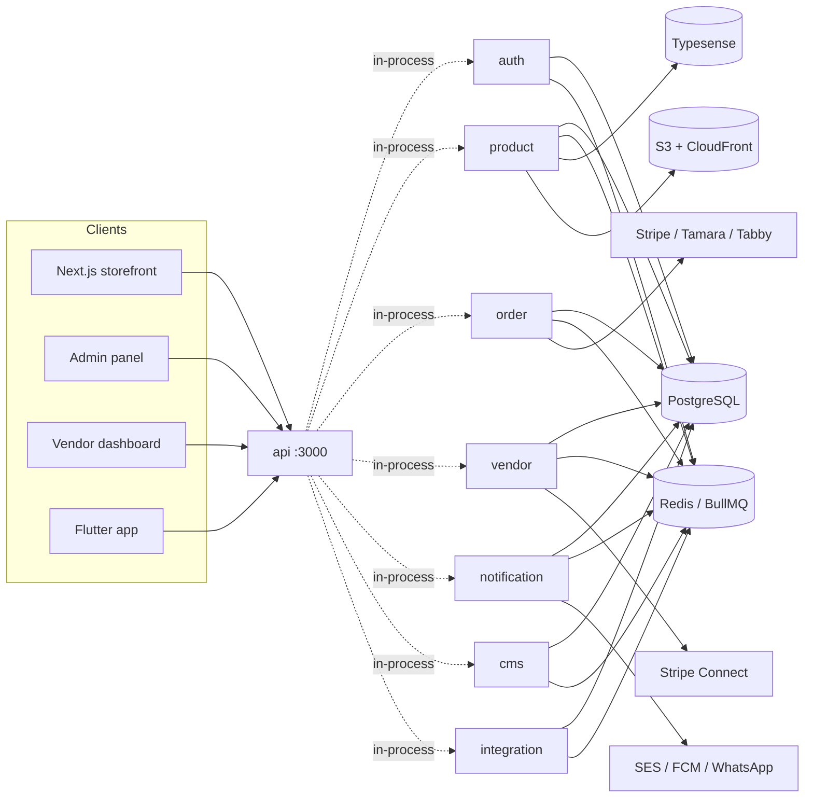
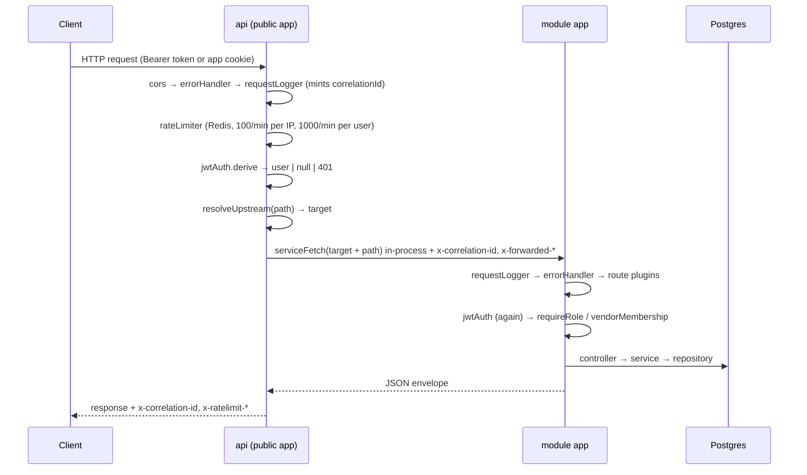

# 01 — Architecture

## What this system is

MaterialHub is a multi-vendor materials marketplace for the UAE. The backend is a **Bun** monorepo
that runs as **one process**: `backend/apps/api` boots the public **ElysiaJS** app (the former
gateway) and mounts seven modules (auth, product, order, vendor, notification, cms,
integration) in-process. They share a single PostgreSQL database, a single Redis instance,
Typesense for search, and BullMQ for background work. One Docker image
(`backend/apps/api/Dockerfile`), one container, one port (3000).

Each module is still its own Elysia app (plugins, error handling, route table) and was a
separate service until the monolith; module-to-module *writes* still go through HTTP-shaped
calls (`/internal/*` routes, via `serviceFetch`, which resolves them in-process) or BullMQ
queues; cross-module *reads* are frequently just a repository call against the same Postgres.

> **Know this before you change anything:** there is no per-service schema ownership. If you
> rename a column, grep the whole monorepo.

## Repository layout

```
backend/
├── apps/
│   ├── api/                    # :3000 — the process: public app + every module + all jobs
│   ├── auth-service/           # module (one Elysia app each, mounted by api)
│   ├── product-service/        # module — catalogue, search, inventory, media, bulk
│   ├── order-service/          # module — cart, checkout, orders, money, shipping
│   ├── vendor-service/         # module — vendors, members, KYC, Stripe Connect, warehouses
│   ├── notification-service/   # module
│   ├── cms-service/            # module — pages, layouts, settings, support, audit
│   └── integration-service/    # module — vendor webhooks + sales channels
├── libs/                       # shared workspace packages (@materialhub/*)
│   ├── database/               # TypeORM data source, ~120 entities, enums, migrations
│   ├── dto/                    # TypeBox request/response schemas
│   ├── guards/                 # jwtAuth, requireRole, vendorMembership, permission matrix
│   ├── plugins/                # errorHandler, requestLogger, rateLimiter, auditPlugin, HttpError
│   ├── config/                 # one frozen config object read from env
│   ├── utils/                  # encryption, media/S3, email, WhatsApp, slug, pagination, phone
│   ├── bulk-jobs/              # the generic bulk import engine (parser → validate → write)
│   ├── integration-events/     # outbound event queue + payload schemas + inbound targets
│   └── integration-mapper/     # the JSON mapping DSL used by integration-service
├── docker-compose*.yml          # api's image: apps/api/Dockerfile
└── turbo.json                  # build/test/lint pipeline
```

Workspaces are declared in `backend/package.json` (`apps/*`, `libs/*`) and packages import each
other by name: `@materialhub/database`, `@materialhub/guards`, and so on.

## The API and its modules

| App | Module origin | Owns | Key external deps |
|---|---|---|---|
| `api` | listens on 3000 | Public HTTP surface, prefix routing, CORS, Swagger, global rate limit; boots every module and job | — |
| `auth-service` | 3001 | `users`, `user_sessions`, addresses, 2FA | SES (email), WhatsApp OTP |
| `product-service` | 3002 | Catalogue, variants, inventory, media, search index, bulk jobs, collections, wishlist | Typesense, S3/CloudFront, Google Drive, Gemini |
| `order-service` | 3003 | Cart, checkout, orders, payments, shipments, returns, disputes, reviews, commissions, payouts | Stripe, Tamara, Tabby, PostaPlus |
| `vendor-service` | 3004 | Vendors, KYC docs, members/roles, bank accounts, warehouses, follows | Stripe Connect |
| `notification-service` | 3005 | Notifications, preferences, newsletter | SES, FCM, WhatsApp Cloud API |
| `cms-service` | 3006 | Pages, banners, layouts/sections, navigation, settings, support tickets, audit log | Slack, CloudFront invalidation |
| `integration-service` | 3008 | Vendor integrations (webhooks in/out), sales-channel feeds & conversions | Google/Meta/TikTok APIs |

Only the api listens (`GATEWAY_PORT`, default 3000). The module "ports" are the origins in
`config.serviceUrl.*` (`libs/config/src/index.ts`) that the api registers in-process
(`apps/api/src/modules.ts`, `serviceFetch` in `libs/utils/src/service-fetch.ts`); nothing listens
on them and they only need to be distinct. 3007 and 3009 are unused (they belonged to services
removed in the MaterialHub fork).

## Runtime topology



## Request lifecycle

Every public request enters the api's public app (the former gateway). It performs auth
verification and rate limiting, then dispatches the request in-process to the owning module's
Elysia app, which re-verifies auth locally.



Notes:

- The gateway verifies JWTs **and so does each service**. The gateway does not strip or rewrite
  the `Authorization` header; it forwards it verbatim. Auth is therefore enforced twice, and a
  service reached directly (bypassing the gateway, e.g. inside the Docker network) is still
  protected.
- The gateway is a dumb prefix router with **no path rewriting** — `upstreamPath` is the
  original pathname. A service's route paths are its full public paths.
- Request bodies are streamed (`duplex: "half"`), so large uploads pass through without buffering.

## The module skeleton

Every module follows the same shape (modules have no `index.ts`; `apps/api` boots them):

```
apps/<svc>/src/
├── jobs.ts         # start<X>Jobs(): timers, BullMQ workers/repeatables, called by apps/api/src/jobs.ts
├── app.ts          # the Elysia app: plugins + .use(...) every route module
├── container.ts    # manual DI: repositories → services → controllers → decorate()
└── domain/…        # or controllers/ + services/ in the older services
    routes/…        # Elysia route modules
```

### `apps/api/src/index.ts` — boot (once, for the whole backend)

```ts
await ensureDatabase();          // TypeORM DataSource.initialize(), idempotent
await permissionMatrix.load();   // SELECT role, permission FROM role_permissions
permissionMatrix.startPolling(); // re-reads when Redis `matrix_version` changes (≤30s)
registerModules();               // serve each module's origin in-process
await startAllJobs();            // every module's jobs.ts
app.listen({ port: config.port.gateway, idleTimeout: 255 });
```

Run it with `cd backend/apps/api && bun run src/index.ts` (or `bun run dev` there for watch mode).

### `container.ts` — the DI pattern

There is no DI framework. `container.ts` is a module that runs top-to-bottom at import time:

1. `await ensureDatabase()`
2. Create shared clients — Redis, Stripe, `EncryptionService`, `MediaService`
3. `AppDataSource.getRepository(Entity)` for every entity the service touches
4. Construct services in dependency order, passing repositories positionally
5. Construct controllers from services
6. Create BullMQ queues, register schedulers, start workers
7. Export an Elysia plugin that `.decorate(...)`s each controller into the request context

```ts
export const container = new Elysia({ name: "order-service-container" })
  .decorate("cartController", cartController)
  .decorate("checkoutController", checkoutController)
  // …
```

Route modules then do `.use(container)` and destructure the controller out of the handler
context:

```ts
export const cartRoutes = new Elysia({ prefix: "/cart" })
  .use(container)
  .use(jwtAuth)
  .get("/", async ({ cartController, user }: any) => cartController.get(user));
```

Consequences worth knowing:

- **Construction order matters and is load-bearing.** `order-service/src/container.ts` has
  comments explaining why, e.g. `payoutService` is built before `orderStatusService` so a
  cancellation can invalidate a payout draft.
- **Importing `container.ts` starts workers.** Anything that imports a route module transitively
  boots queues and DB connections; this is why unit tests import services directly rather than
  routes.
- Handlers are typed `any` at the destructure site. Type safety lives in the DTO schemas
  (`{ body: SomeDto }`), which Elysia validates before the handler runs.

### Layering

```
routes/*.routes.ts     → HTTP shape: path, method, DTO schema, guards, response envelope
domain/**/*.controller → orchestration + auth-context mapping; thin
domain/**/*.service    → business logic; owns transactions; the interesting file
domain/**/*.job        → BullMQ queue accessor + worker factory + scheduler registration
domain/**/*.ts (pure)  → pure calculators, kept DB-free so they run without Postgres in CI
```

The pure-module convention is deliberate and widespread — `commission-cap.ts`, `shipping-contribution.ts`, `order-state-machine.ts`,
`unreleasable-claim.ts`, `dispute-reversal-calc.ts`. These never import `@materialhub/database`'s
barrel (it pulls in `reflect-metadata` and `AppDataSource`), so they are unit-testable with no
database.

## Response envelope

Successful responses are hand-built, not auto-wrapped:

```json
{ "statusCode": 200, "data": { }, "total": 42, "timestamp": "2026-08-05T…Z" }
```

Errors are produced by the shared `errorHandler` plugin:

```json
{ "statusCode": 404, "message": "Vendor not found", "error": "VENDOR_NOT_FOUND", "timestamp": "…" }
```

See [02 — Cross-cutting](02-cross-cutting.md#error-model).

## Data conventions

| Convention | Detail |
|---|---|
| Money | Integer **fils** (1 AED = 100 fils). Column names end in `_fils` in newer tables; older ones (`orders.grand_total`) are fils without the suffix. |
| VAT | Product prices are **VAT-inclusive** at the UAE 5% standard rate. `tax_total` on an order is the *extracted* VAT, informational, and is **not** added to `grand_total`. |
| Currency | `AED` base; `price_overrides` JSONB for others. |
| Soft delete | `deleted_at` on every table. TypeORM's repository methods filter it automatically — **raw SQL does not**, so raw queries in this codebase carry an explicit `AND deleted_at IS NULL`. |
| Snapshots | Anything the customer agreed to is snapshotted at the time of the deal: order item prices, commission rate, cancellation policy. Later config changes never rewrite history. |
| Identifiers | UUID v4 primary keys. Human-facing references are sequence-backed: `FKS-YYYY-NNNNNN` (orders), `PAY-YYYY-NNNNNN` (payouts). |
| Timestamps | `timestamptz`, UTC. Business-day logic that needs local time uses `Asia/Dubai` explicitly. |

## Build, test, run

The scripts that actually exist, and where they live:

| Command | Run from | Notes |
|---|---|---|
| `docker compose up` | `backend/` | Postgres, Redis, Typesense + services |
| `bun run dev` | repo root | every workspace, `turbo run dev --concurrency 15` |
| `bun run dev:backend` | repo root | **only** gateway, auth, product, order, vendor, notification, cms — integration is missing from the filter |
| `bun run dev:web` · `dev:vendor` · `dev:admin` | repo root | one frontend |
| `turbo run build` · `test` · `typecheck` · `lint` | repo root or `backend/` | the pipeline is defined in `turbo.json` |
| `bun run migrate` · `migrate:generate` · `migrate:revert` · `seed` | `backend/libs/database` | TypeORM |
| `bun run dev` · `build` · `start` · `test` · `typecheck` | any `backend/apps/*` | per service |
| `bun run lint` · `lint:fix` · `format` | `backend/` | Biome |

> There are no root `build`, `test`, `migrate`, `seed` or `search:reindex` scripts — the root
> `package.json` only defines the `dev*` scripts. Use the table above; a full Typesense reindex is
> triggered through `POST /admin/search/reindex`, not a script.

Lint before pushing — CI fails on Biome errors:

```bash
cd backend && bunx --bun @biomejs/biome@1.9.4 check .
```

> **Gap:** CI runs backend checks only; the frontend test suites do not run in CI, so a green
> PR check says nothing about `apps/web`.
