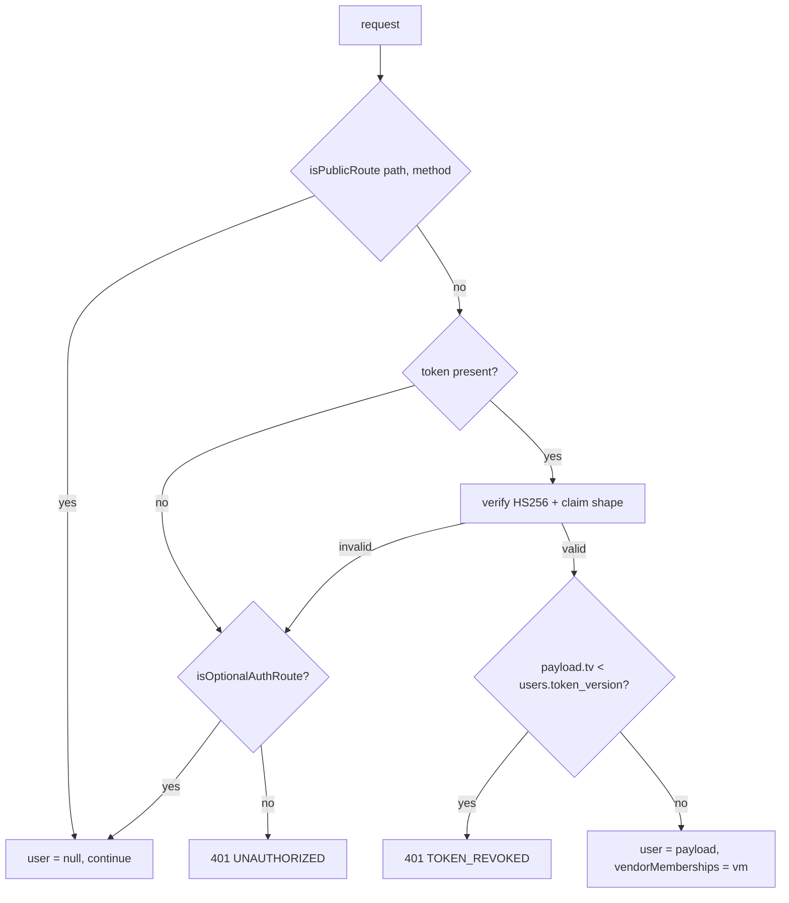
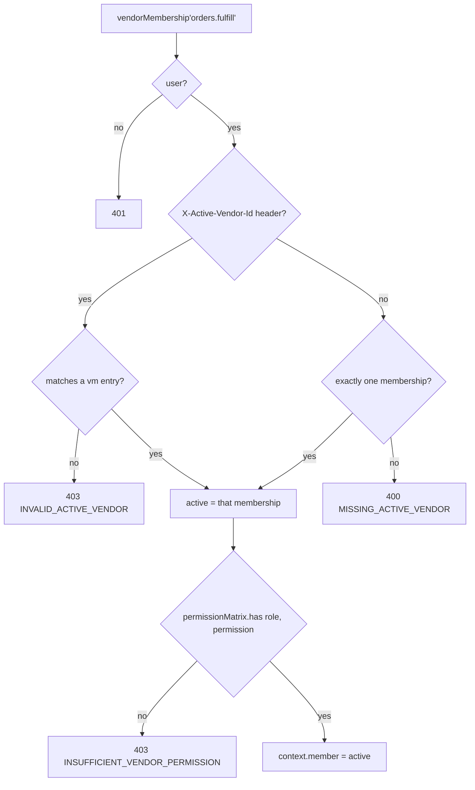

# 02 — Cross-cutting concerns

Everything in `libs/` plus the patterns every service shares. Read this once; the service
documents assume it.

---

## Authentication

### Token shapes

| Token | Lifetime | Storage | Signed with |
|---|---|---|---|
| Access JWT | 15 min | Bearer header **or** app-scoped cookie | `JWT_ACCESS_SECRET`, HS256 |
| Refresh token | 7 days | httpOnly cookie; **only a SHA hash** is stored in `user_sessions.refresh_token_hash` | not a JWT — an opaque UUID |

Access token payload (`libs/guards/src/token-helpers.ts`):

```jsonc
{
  "sub":   "<user uuid>",
  "email": "user@example.com",
  "role":  "super_admin | admin | customer | guest",
  "tv":    3,                                   // token_version — revocation counter
  "vm":    [{ "vid": "<vendor uuid>", "r": "owner" }]  // vendor memberships, omitted if none
}
```

Note there is **no `vendor` role**. Vendor identity is expressed entirely through the `vm`
claim — a user is a customer who happens to be an owner/manager/staff/viewer of one or more
vendors. Anything that assumes `role === "vendor"` is wrong.

### Cookie naming

`apps/auth-service/src/utils/auth-cookies.ts` prefixes cookies from the `X-Client-App` header so
the three Next.js apps can coexist on one domain:

| `X-Client-App` | Cookies |
|---|---|
| `web` | `web_access_token`, `web_refresh_token` |
| `admin` | `admin_access_token`, `admin_refresh_token` |
| `vendor` | `vendor_access_token`, `vendor_refresh_token` |
| absent | `access_token`, `refresh_token` (legacy) |

The cookie domain is derived from the request `Origin` — a non-localhost origin sets
`.<root-domain>` and forces `secure`. `config.isProduction` is only a fallback.

### `jwtAuth` — `libs/guards/src/jwt-auth.ts`

An Elysia plugin that `derive`s `{ user, vendorMemberships }` into every request context. Three
route classes:



- **Public routes** — an explicit `PUBLIC_ROUTES` set plus prefix/regex rules: the catalogue
  reads, `/categories/*`, `/brands*`, GET `/products…`, GET `/collections…`, GET `/services…`,
  `/gift/*`, vendor public profiles, section types, all `/webhooks/*`, the signed iCal feed,
  `/reels/featured`, `/navigation/header`, `/layouts/*`, Slack events.
- **Optional-auth routes** — a token populates `user`, its absence resolves to `user = null`
  instead of 401. Cart (guests use the `x-guest-session` header), reels feed/permalink/view/tap,
  public user profiles, newsletter subscribe/status, affiliate `POST /a/track`, support tickets.
  `/cart/merge` is deliberately **not** optional — merging needs a real user.
- Everything else requires a valid token.

### Token revocation

`libs/guards/src/token-version.ts` — `bumpTokenVersion(userId)` increments `users.token_version`.
Any access token carrying an older `tv` is rejected with `TOKEN_REVOKED`. Used on role changes,
vendor approval (so the new `vm` claim is picked up), password reset, and account suspension.

### Internal service auth

Two guards for service-to-service calls:

- `internalServiceAuth` (`libs/guards/src/internal-service-auth.ts`) — verifies a short-lived
  HS256 JWT signed with `INTERNAL_SERVICE_SECRET` whose `iss` is one of
  `integration-service`, `order-service`, `product-service`, `booking-service`. Mounted on
  `/internal/*` route groups.
- `internalAuth` (`libs/guards/src/internal-auth.ts`) — the simpler shared-secret header check.

---

## Authorization

Three layers, applied in this order.

### 1. Platform role — `requireRole(...)`

`libs/guards/src/index.ts`. A plugin factory that 401s without a user and 403s when
`user.role` is not in the allowed set. Roles: `super_admin`, `admin`, `customer`, `guest`.

```ts
.group("/admin/payouts", (app) => app.use(requireRole("admin", "super_admin")). … )
```

### 2. Vendor membership + permission — `vendorMembership(...)`

`libs/guards/src/vendor-membership.ts`. Resolves *which* vendor the caller is acting for and
whether their membership role holds at least one of the required permissions.



**Multi-vendor users must send `X-Active-Vendor-Id`.** A user with two memberships and no header
gets a 400, not a guess.

### 3. The permission matrix

Permissions are data, not code. `role_permissions(role, permission)` in Postgres maps a vendor
member role to permissions; `libs/guards/src/permission-matrix.ts` caches it in-process.

The fourteen permissions (`libs/guards/src/permissions.ts`):

```
products.read     products.write     products.publish
orders.read       orders.fulfill     orders.refund
inventory.write   vendor.profile.write
payouts.read      bank.read          bank.write
analytics.read    team.read          team.write
```

Vendor member roles: `owner`, `manager`, `staff`, `viewer`.

Propagation: an admin edits the matrix via `PUT /admin/role-permissions/:role` (vendor-service),
which calls `bumpMatrixVersion()` → `INCR matrix_version` in Redis. Every process polls that key
every 30 s (`startPolling`) and reloads on change. **A permission change therefore takes up to
30 seconds to take effect across the fleet**, and if Redis is down it never propagates until the
process restarts (the matrix itself is in Postgres; Redis is only the fan-out signal).

---

## Error model

`libs/plugins/src/index.ts` defines the typed error hierarchy and the handler.

| Class | Status | `error` code |
|---|---|---|
| `BadRequestError` | 400 | `BAD_REQUEST` |
| `UnauthorizedError` | 401 | `UNAUTHORIZED` |
| `ForbiddenError` | 403 | `FORBIDDEN` |
| `NotFoundError` | 404 | `NOT_FOUND` |
| `ConflictError` | 409 | `CONFLICT` |
| `UnprocessableEntityError` | 422 | `UNPROCESSABLE_ENTITY` |
| `TooManyRequestsError` | 429 | `TOO_MANY_REQUESTS` |
| `ServiceUnavailableError` | 503 | `SERVICE_UNAVAILABLE` |
| `HttpError` (base) | any | caller-supplied |

`HttpError` carries an optional `details` payload that is surfaced to the client.

`errorHandler` maps Elysia's own codes too: `VALIDATION` and `PARSE` → 400, `NOT_FOUND` → 404,
anything else → 500. **500s never leak internals** — the message is replaced with
`"Internal server error"` and the real message + stack are logged as JSON.

> Several services throw bare `Error` with an ad-hoc `.code` property (payout service:
> `PAYOUT_DUPLICATE`, `PAYOUT_NOT_DRAFT`, …) and rely on a controller-level translator to turn
> them into `HttpError`s. If you add a code, add it to that translator or it becomes a 500.

---

## Rate limiting

`libs/plugins/src/rate-limiter.ts`, mounted on the gateway only.

| Caller | Limit |
|---|---|
| Unauthenticated (per IP) | 100 requests / 60 s |
| Authenticated (per user id) | 1000 requests / 60 s |

Redis-backed with an atomic Lua `INCR` + `EXPIRE`. If Redis is unreachable it falls back to an
in-process `Map` (with a 60 s sweep) and retries Redis every 30 s. That fallback is **per
process**, so the effective limit multiplies by the replica count during a Redis outage.

Responses always carry `x-ratelimit-limit`, `x-ratelimit-remaining`, `x-ratelimit-reset`.

---

## Logging & correlation

`requestLogger` (`libs/plugins/src/index.ts`) derives a `correlationId` (UUID v4) per request,
logs one JSON line before the handler, and echoes `x-correlation-id` on the response. The
gateway forwards it to upstreams as a header, so one client request shares an id across services.

> **Gap:** logging is `console.log(JSON.stringify(...))`. The Winston/Sentry/CloudWatch stack
> described in `CLAUDE.md` is not wired — see the `TODO` at `libs/plugins/src/index.ts:81`.

---

## Audit log

`auditPlugin` (`libs/plugins/src/audit.ts`) writes `audit_log` rows after the handler, fire and
forget.

- **Auto-captures** every non-GET request whose path starts with `/admin`, `/vendor`, `/pages`,
  `/banners`, `/settings`, `/auth`, `/support`, `/bulk`.
- Action/entity are inferred from the path (`POST /admin/products/:id/approve` →
  `products.approve`, entity `products`, entity_id = the UUID in the path) unless the handler
  sets them.
- Handlers refine or force it through the injected `audit` context object:

```ts
audit.action = "payout.statement_downloaded";
audit.entity_type = "vendor_payout";
audit.entity_id = params.id;
audit.force = true;   // audit even though this is a GET
```

- `audit.skip = true` suppresses.

Money paths do **not** rely on the plugin — `PayoutService.writeAudit()` writes audit rows
directly, optionally on the caller's `EntityManager` so the audit row commits or rolls back with
the change it describes.

The audit log is exposed at `GET /admin/audit-log` (cms-service) and is partitioned; a weekly
maintenance job (`apps/cms-service/src/jobs/partition-maintenance.job.ts`, Sundays 03:00) creates
future partitions.

---

## Configuration

One frozen object: `libs/config/src/index.ts`, imported by every service.

- `requireEnv(name)` throws when a production secret is missing; development gets a default.
- The whole object is **eagerly evaluated at import**, so a `requireEnv` at construction time
  crashes *all ten services*, not just the consumer. The iCal feed secret was moved to a lazy
  getter for exactly this reason (`config.bookings.icalFeedSecret`) — follow that pattern for
  any new single-consumer secret.
- Regex-valued env vars (`CORS_PREVIEW_ORIGIN_PATTERN`) are compiled in try/catch and **fail
  closed** — an invalid pattern yields no extra allowed origin instead of crash-looping.

Key groups: `port`, `serviceHost`, `database`, `redis`, `jwt`, `aws`, `media`, `twoFa`,
`internal`, `stripe`, `tamara`, `whatsapp`, `vendor`, `encryption`, `bullmq`, `orders`,
`bookings`, `cache`, `typesense`, `cloudflareStream`, `google`, `urls`.

---

## Encryption

`libs/utils/src/encryption.service.ts` — AES-256-GCM, 16-byte IV, output format
`iv:authTag:ciphertext` (hex). `mask()` shows only the last four characters.

**There are two distinct keys and mixing them fails silently** (same algorithm, wrong key →
decrypt throws or garbage):

| Key | Env var | Encrypts |
|---|---|---|
| `config.vendor.encryptionKey` | `VENDOR_ENCRYPTION_KEY` | `vendor_bank_accounts` (written by vendor-service) |
| `config.encryption.key` | `ENCRYPTION_KEY` | integration secrets, carrier account credentials, sales-channel credentials |

`order-service/src/container.ts` constructs **two** `EncryptionService` instances for this
reason — the payout bank-reveal path uses the vendor key, everything else uses the general one.

---

## Media & S3

`libs/utils/src/media.service.ts`.

- Presigned `PutObject` URLs for direct browser upload; the server then processes.
- Images are validated by **magic bytes**, not by the client's content type or filename.
- Sharp generates four variants — `thumb` 150, `card` 320, `medium` 600, `large` 1200 px
  (`config.media.sizes`).
- Object keys are built by `buildAssetKey` from a whitelisted asset-type config; the client's
  filename never reaches the key verbatim (path-separator injection).
- CloudFront invalidation on delete.
- Limits: `config.media.maxFileSize` = 10 MB; allowed types `image/jpeg|png|webp`.

> **Gap:** no malware scanning — `TODO` at `libs/utils/src/media.service.ts:205`.

---

## Caching

Redis, cache-aside. TTLs from `config.cache`:

| Key space | TTL | Invalidated by |
|---|---|---|
| Category tree | 3600 s | category writes (`category-cache.service.ts`) |
| Product detail | 600 s | product update |
| Product list | 300 s | product update |
| Booking availability (per staff/day) | 300 s | working-hours, time-off, holiday and booking writes |

Redis is also the store for: carts (hash, 30 d TTL), rate limits, permission-matrix version,
booking slot holds, reels feed cohorts, notification pub/sub fan-out, and BullMQ itself.

---

## Background jobs

All queues are BullMQ on `config.bullmq.redisUrl`. Each job module exports the same trio:

```ts
export const XXX_QUEUE = "queue-name";
export function getXxxQueue(): Queue        // lazily constructed singleton
export function createXxxWorker(deps): Worker
export async function scheduleXxx(queue)    // upsertJobScheduler for cron jobs
```

`container.ts` calls these. Scheduler registration is deliberately fire-and-forget with an
explicit `.catch(console.error)` — awaiting it would make a momentarily-unreachable Redis fail
service boot, but a bare floating promise would silently leave a cron unregistered forever.

### Queue inventory

| Queue | Owner | Trigger | Purpose |
|---|---|---|---|
| `order-events` | order | on transition | fan-out bridge → auto-shipment + notification-events |
| `notification-events` | notification | produced by order/product/booking | domain event → notification dispatch |
| `notification-dispatch` (+ `-dlq`) | notification | from events | render + deliver per channel |
| `auto-shipment` | order | order paid / confirmed | book a carrier shipment |
| `order-invoices` | order | order placed | generate receipt PDF |
| `pending-order-reaper` | order | cron `*/5 * * * *` | cancel unpaid orders past `ORDER_PENDING_EXPIRY_MINUTES` (60) |
| `commission-settlement` | order | cron `5 * * * *` | promote matured `held` commissions → `pending` |
| `payout-draft-generation` | order | cron `30 2 * * *` | build reviewable payout drafts |
| `vendor-payouts` | order | admin action | execute/retry Stripe transfers |
| `postaplus-tracking-poll` | order | cron `0 */8 * * *` | poll carrier for tracking updates |
| `review-rating` | order | review approved | recompute product/vendor rating aggregates |
| `cart-abandonment-detection` | order | cron `*/15 * * * *` | detect abandoned carts |
| `cart-abandonment-reminder` | order | cron `*/30 * * * *` | send reminder emails |
| `cart-abandonment-purge` | order | cron `0 4 * * *` | purge old abandonment rows |
| `vendor-order-deadline` | order | scheduled | vendor processing-deadline checks |
| `search-sync` / `search-reindex` | product | product writes / admin | Typesense incremental + full reindex |
| `service-search-sync` / `service-search-reconcile` | product | offering writes / cron `15 3 * * *` Asia/Dubai | service-offering index |
| `bulk-import-parent` | product | job start | run a bulk import |
| `bulk-import-image-fetch` | product | bulk import follow-up | download & attach product images |
| `product-export` | product | export request | build CSV/XLSX export |
| `media-video` | product | video upload | transcode |
| `reservation-expiry` | product | every 60 s | release expired inventory reservations |
| `low-stock-alerts` | product | inventory write | notify vendor below threshold |
| `collection-membership-refresh` | product | cron `0 * * * *` | recompute dynamic collection membership |
| `recently-viewed-purge` | product | cron `0 3 * * *` | trim recently-viewed history |
| `saved-search-notify` | product | cron `0 */6 * * *` | notify on saved-search matches |
| `integration-events` | integration | domain emits | outbound vendor webhook dispatch |
| `channel-feed-build` | integration | cron `0 */2 * * *` | build sales-channel product feeds |
| `channel-delta-scan` / `channel-delta-push` | integration | cron `*/5 * * * *` | incremental channel updates |
| `channel-conversion-events` | integration | order paid | server-side conversion pixels |
| `integration-scrub-pii-cron` | integration | cron `0 4 * * *` | scrub PII from delivery logs |
| `integration-retention-delete-cron` | integration | cron `0 3 1 * *` | delete aged delivery rows |
| `booking-reaper` | booking | cron `*/5 * * * *` | expire unpaid `pending_payment` bookings |
| `booking-auth` | booking | scheduled per booking | off-session card authorization (prepay) |
| `booking-autocomplete` | booking | `ends_at + 24 h` | auto-complete and capture |
| `booking-reminder` | booking | T-24 h and T-1 h | reminders |
| `ical-import` | booking | cron `*/15 * * * *` | pull external staff calendars |
| `reels-ranking` | reels | interval | recompute reel ranking scores |
| `reels-cache-invalidation` | reels | on write | invalidate cohort feeds |
| `reels-commissions` | reels | order paid/delivered/refunded | creator commission lifecycle |
| `reels-nudges` | reels | order delivered | post-delivery UGC nudge |
| `reels-scheduled` | reels | cron | rollups (`15 2 * * *` UTC), tier graduation |
| `reels-brief-expiry` / `reels-license-expiry` | reels | cron | expire licensing briefs and offers |
| `reels-cloudflare-stream-recovery` | reels | cron | recover stuck video uploads |
| `affiliate-commissions` / `affiliate-scheduled` | vendor | order events / cron | affiliate commission lifecycle |
| `vendor-expire-pending-invites` | vendor | cron `0 3 * * *` | expire stale team invites |
| `audit-partition-maintenance` | cms | cron `0 3 * * 0` | create audit-log partitions |

---

## Integration events

`libs/integration-events/` is the outbound event bus for **vendor-owned** integrations.

```ts
await emitIfEnabled(integrationEventsQueue, siteSettingRepo, {
  event_type: IntegrationEventType.vendor_order_created,
  vendor_id, payload, source_ref, schema_version: 1,
});
```

`emitIfEnabled` (`apps/order-service/src/domain/integration/emit.ts`) checks the
`vendor_integrations_outbound_enabled` site setting first — a global kill switch. Emit failures
are always caught and logged; they must never fail the domain operation that produced them.

Payload schemas live in `libs/integration-events/src/schemas/`; inbound target handlers (what an
inbound webhook is allowed to do) in `libs/integration-events/src/inbound-targets/`.

---

## Idempotency patterns used in this codebase

Worth recognising, because they recur:

1. **Webhook event ledger** — `webhook_events(gateway, event_id)`; a row already `processed`
   short-circuits. Used for Stripe and Tamara.
2. **Conditional claim** — `UPDATE … SET status='processing' WHERE id=$1 AND status='pending' …
   RETURNING id`, then check the affected-row count. Used everywhere money moves. A claim that
   wins zero rows is a **no-op, not an error**.
3. **`ON CONFLICT … DO NOTHING` + re-select** — used where the operation runs inside a caller's
   transaction and a unique-violation would poison the whole transaction
   (`CommissionService.createForBookingInTx`).
4. **Deterministic BullMQ `jobId`** — `dispatch_vendor_new_order_<voId>_<userId>`,
   `invoice_<orderId>`. Re-adding an existing id is a no-op, so a retried producer does not
   duplicate the effect.
5. **Provider idempotency keys** — `payout-transfer-<payoutId>` for the approval path;
   `payout-retry-<payoutId>-<retryToken>` for retries, where the token is minted once per
   *operator* retry so BullMQ's own attempts share a key.

---

## Testing

- `bun test`; files are `*.test.ts` colocated with the code, plus `*.integration.test.ts` for
  route-level tests that boot an Elysia app with stub containers.
- Pure modules (no `@materialhub/database` barrel import) are the bulk of the unit tests — they run
  without Postgres.
- Several modules expose deliberate test seams: `__setMapForTests`, `__setRedisForTests`,
  `__setDataSourceForTests`. They are never called from production code.
