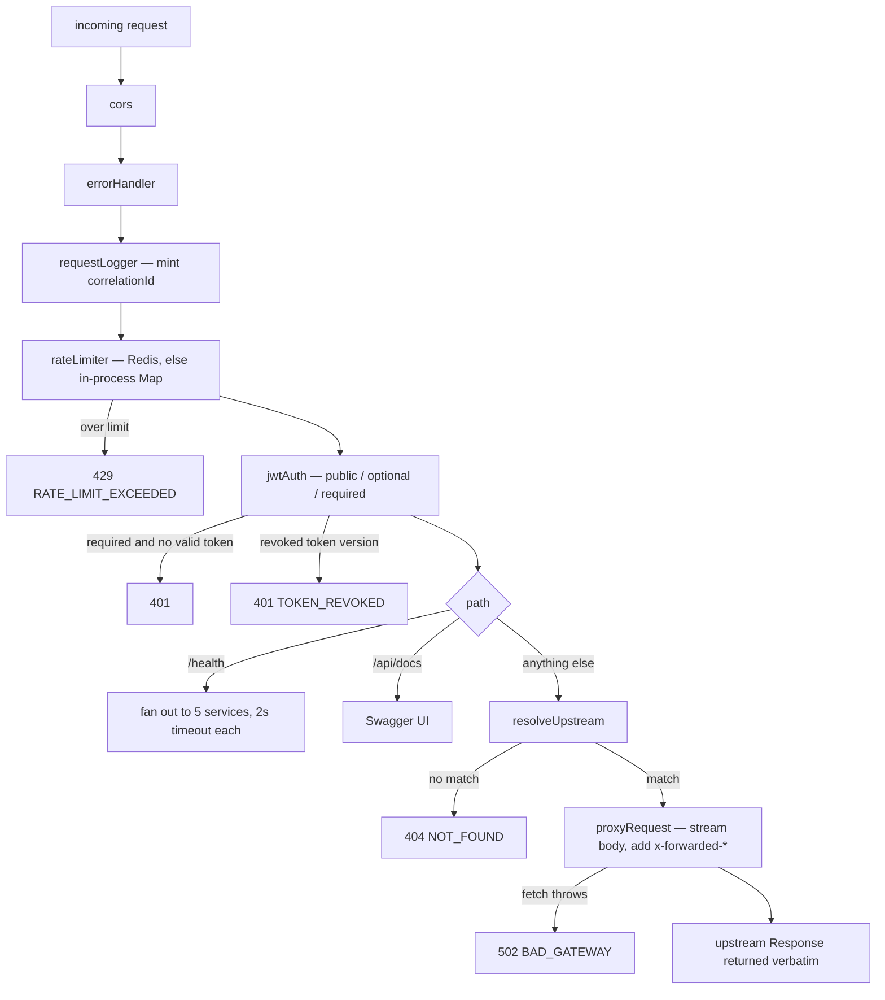

# 03 — api-gateway

Port **3000**. The only service exposed publicly. It is a thin reverse proxy: no business logic,
no database writes, no path rewriting.

## Files

| File | Role |
|---|---|
| `apps/api-gateway/src/index.ts` | Boot — `ensureDatabase()`, load the permission matrix, listen with `idleTimeout: 255` |
| `apps/api-gateway/src/app.ts` | The Elysia app: CORS, error handler, logger, rate limiter, Swagger, `jwtAuth`, `/health`, catch-all proxy |
| `apps/api-gateway/src/proxy.ts` | `serviceRoutes` prefix table, `resolveUpstream()`, `proxyRequest()` |

The gateway needs a database connection only because `permissionMatrix.load()` reads
`role_permissions`, and `jwtAuth`'s revocation check reads `users.token_version`.

## Plugin order

```ts
new Elysia()
  .use(cors({ origin: …, credentials: true }))
  .use(errorHandler)
  .use(requestLogger)      // mints correlationId
  .use(rateLimiter)        // Redis; per-IP or per-user
  .use(swagger({ path: "/api/docs" }))
  .use(jwtAuth)            // derives user / 401s
  .get("/health", …)
  .all("/*", proxy)
```

Order matters: `rateLimiter` runs before `jwtAuth`, so it classifies a request as anonymous
(100/min per IP) unless a *previous* plugin already populated `user`. In practice the gateway's
own rate limit is IP-based for the first request of a session.

## CORS

Production allows exactly four origins, from env with hard-coded fallbacks:

```
ADMIN_PANEL_URL      → https://admin.materialhubuae.com
VENDOR_DASHBOARD_URL → https://sellers.materialhubuae.com
WEB_URL              → https://materialhubuae.com
WEB_WWW_URL          → https://www.materialhubuae.com
```

Plus an optional `CORS_PREVIEW_ORIGIN_PATTERN` regex — **staging only**, for Vercel branch
previews. `previewOriginPatterns()` compiles it in a try/catch and returns `[]` on a malformed
pattern: it fails closed rather than crash-looping the gateway or falling back to allow-all
(`credentials: true` makes allow-all a real vulnerability).

Non-production sets `origin: true` (allow all).

## Request path through the gateway



## Routing

`resolveUpstream(path)` in `proxy.ts` is **first-match-wins** over an ordered array of
`{ prefix, target }` pairs. A route matches when `path === prefix || path.startsWith(prefix + "/")`.

Two consequences the file's comments belabour, and you should internalise:

1. **More specific prefixes must come first.** `/admin/products` is listed before `/products`,
   `/admin/shipping-rates` before `/shipping`, `/vendors/me/payouts` (order-service!) before
   `/vendors` (vendor-service).
2. **Sibling prefixes do not collide.** `/shipping-rates` never matches a `/shipping` entry,
   because the match requires an exact equality or a following `/`.

### Prefix → service map

<details>
<summary><b>auth-service</b></summary>

`/admin/users`, `/admin/auth`, `/auth`
</details>

<details>
<summary><b>product-service</b></summary>

`/admin/categories`, `/admin/brands`, `/admin/attributes`, `/admin/search`, `/admin/collections`,
`/admin/products`, `/admin/settings/ai`, `/attributes`, `/products`, `/categories`,
`/collections`, `/brands`, `/inventory`, `/media`, `/search/trending`, `/wishlist`,
`/recently-viewed`, `/me/recent-searches`, `/saved-searches`, `/recommendations`,
`/vendor/product-groups`, `/bulk`
</details>

<details>
<summary><b>order-service</b></summary>

`/admin/cart-abandonment`, `/admin/dashboard`, `/vendor/dashboard`, `/admin/orders`,
`/admin/reviews`, `/admin/returns`, `/admin/disputes`, `/admin/commissions`, `/admin/payouts`,
`/admin/payout-adjustments`, `/admin/payment-methods`,
`/admin/shipping-rates`, `/admin/shipping-contribution-tiers`, `/admin/shipping-providers`,
`/admin/shipments`, `/admin/vendor-orders`, `/admin/coupons`, `/admin/promotions`,
`/vendor/shipping-integrations`, `/vendor/warehouses`, `/vendor/coupons`, `/vendor/orders`,
`/vendor/returns`, `/vendors/me/payouts`, `/orders`, `/cart`, `/checkout`, `/buyer`, `/reviews`,
`/shipping`, `/disputes`, `/webhooks/stripe`, `/webhooks/tamara`, `/webhooks/carrier`,
`/webhooks/shipping`
</details>

<details>
<summary><b>vendor-service</b></summary>

`/admin/vendors`, `/vendors`, `/me/follows/vendors`, `/webhooks/stripe/connect`
</details>

<details>
<summary><b>integration-service</b></summary>

`/admin/sales-channels`, `/admin/integrations`, `/vendor/integrations`, `/integrations/inbound`
</details>

<details>
<summary><b>cms-service</b></summary>

`/admin/layouts`, `/vendor-layouts`, `/admin/section-types`, `/section-types`, `/admin/bids`,
`/vendor/bids`, `/admin/header-navigation`, `/navigation`, `/layouts`, `/admin/audit-log`,
`/pages`, `/banners`, `/settings`, `/support`
</details>

<details>
<summary><b>notification-service</b></summary>

`/notifications`, `/newsletter`, `/webhooks/whatsapp`
</details>

> **Trap:** `/vendors/me/payouts` is served by **order-service**, not vendor-service, because
> payouts live alongside commissions. Likewise `/vendor/warehouses` and
> `/vendor/shipping-integrations` go to **order-service** (shipping), not vendor-service.

## Proxying

`proxyRequest()`:

- Builds `target + originalPath + search` — no rewriting.
- Copies all inbound headers, then sets `x-correlation-id`, `x-forwarded-for`,
  `x-forwarded-host`, `x-forwarded-proto`.
- Streams the request body for non-GET/HEAD (`duplex: "half"`), so large uploads are not buffered.
- Returns the upstream `Response` object directly — status, headers and body pass through
  untouched.

Failure modes:

| Condition | Response |
|---|---|
| No prefix matches | `404 NOT_FOUND` — `"No service handles <path>"` |
| `fetch` throws (upstream down, DNS, timeout) | `502 BAD_GATEWAY` — `"Service unavailable"` |

There is **no retry, no circuit breaker and no upstream timeout** at the gateway. A hung
upstream holds the connection until Bun's `idleTimeout` (255 s).

## `GET /health`

Fans out to five services (`auth`, `product`, `order`, `vendor`, `notification`) at their
`/<plural>/health` route with a 2 s `AbortSignal.timeout`, and reports `up`/`down` per service.

```json
{
  "status": "ok",
  "service": "api-gateway",
  "timestamp": "…",
  "services": { "auth": "up", "product": "up", "order": "up", "vendor": "up", "notification": "down" }
}
```

> **Gap:** the health check does not cover `cms` or `integration`, and the
> top-level `status` is the hard-coded string `"ok"` regardless of what the fan-out found — an
> uptime monitor pointed at this endpoint will never fire.

## API documentation

Swagger UI at `/api/docs`, JSON at `/api/docs/json`, declaring a `bearerAuth` security scheme.
Because the gateway only proxies, **the generated spec describes the gateway's own routes
(`/health` and the catch-all), not the upstream services' endpoints.**
