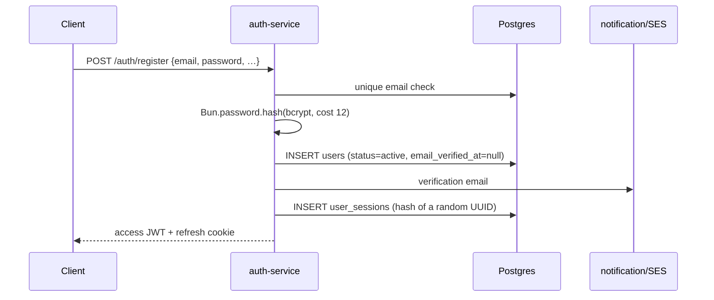
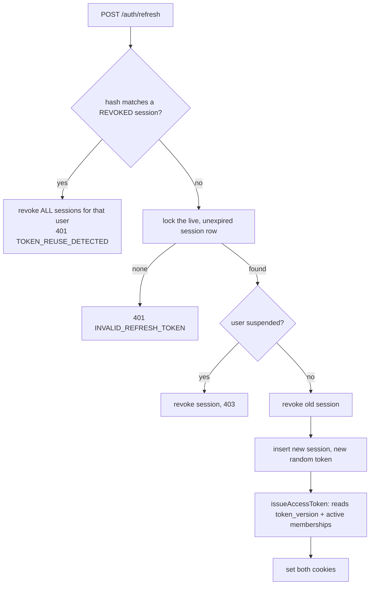

# 04 — auth-service

Port **3001**. Owns identity: users, sessions, passwords, OAuth, phone OTP, 2FA, addresses,
beauty profiles, referrals, and admin user management.

## Files

```
apps/auth-service/src/
├── app.ts, index.ts, container.ts
├── routes/
│   ├── auth.routes.ts               # register/login/refresh/logout/oauth/guest/me
│   ├── password.routes.ts           # forgot/reset/magic-link
│   ├── two-factor.routes.ts         # TOTP enable/verify/disable/login-verify/backup-verify
│   ├── address.routes.ts            # /auth/me/addresses + verified phones
│   ├── beauty-profile.routes.ts
│   ├── referral.routes.ts           # /ref/:code, /me/referral-code, /me/referrals
│   ├── admin-user.routes.ts         # /admin/users
│   └── admin-password.routes.ts     # /admin/auth/vendors/:id/(reset|set)-password
├── controllers/                     # thin HTTP orchestration
├── services/
│   ├── auth.service.ts              # register, login, sessions, refresh, OAuth, guest
│   ├── token-issuance.service.ts    # issueAccessToken() — reads token_version + memberships
│   ├── password.service.ts          # reset tokens, magic links, admin-set passwords
│   ├── phone-auth.service.ts        # OTP login/registration
│   ├── phone-verification-provider.ts, whatsapp-otp-store.ts, otp-cooldown.ts
│   ├── two-factor.service.ts        # TOTP + encrypted secret + backup codes
│   ├── address.service.ts, address-phone-verification.service.ts
│   ├── customer-beauty-profile.service.ts
│   ├── referral.service.ts
│   ├── user-admin.service.ts
│   └── token-cleanup.service.ts     # daily purge of expired tokens (7-day retention)
└── utils/auth-cookies.ts, password-generator.ts
```

## Endpoints

| Method | Path | Auth | Notes |
|---|---|---|---|
| GET | `/auth/health` | public | |
| POST | `/auth/register` | public | email + password; sends verification email |
| POST | `/auth/login` | public | may return a 2FA challenge instead of tokens |
| POST | `/auth/refresh` | public (cookie) | rotates the refresh token |
| POST | `/auth/logout` | public | revokes the session |
| POST | `/auth/verify-email` | public | consumes an email verification token |
| GET | `/auth/google` · `/auth/google/callback` | public | OAuth2 |
| GET | `/auth/apple` · POST `/auth/apple/callback` | public | Sign in with Apple (form_post) |
| POST | `/auth/guest` | public | issues a guest session token |
| POST | `/auth/guest/merge` | auth | merges guest data into the signed-in user |
| POST | `/auth/phone/start` · `/verify` · `/register` | public | OTP login / registration |
| POST | `/auth/forgot-password` · `/reset-password` | public | |
| POST | `/auth/magic-link` · `/magic-link/verify` | public | passwordless email login |
| POST | `/auth/2fa/enable` · `/verify` · `/disable` | auth | TOTP enrolment |
| POST | `/auth/2fa/login-verify` · `/backup-verify` | public | completes a 2FA login challenge |
| POST | `/auth/change-password` | auth | |
| GET | `/auth/me` | auth | current user |
| GET | `/auth/me/wallet` · `/wallet/transactions` | auth | store-credit wallet |
| GET/PUT | `/auth/me/beauty-profile` | auth | personalisation profile |
| GET/POST/PATCH/DELETE | `/auth/me/addresses[/:id]` | auth | address book |
| POST | `/auth/me/verified-phones/start` · `/confirm`, GET `/auth/me/verified-phones` | auth | phone ownership proof (WhatsApp notifications require it) |
| GET | `/ref/:code` | public | resolves a referral code |
| GET | `/me/referral-code` · `/me/referrals` | auth | |
| GET | `/admin/users` · `/admin/users/:id` | admin | |
| PATCH | `/admin/users/:id/status` · `/role` · `/creator-tier` | admin | |
| GET/PATCH/DELETE | `/admin/users/:id/addresses[/:addressId]` | admin | |
| POST | `/admin/auth/vendors/:vendorId/reset-password` · `/set-password` | admin | support tooling for vendor owners |

## Registration and login



`login()` (`auth.service.ts:151`) in order:

1. Normalise email, load user → generic `INVALID_CREDENTIALS` if absent (no user enumeration).
2. `403 ACCOUNT_SUSPENDED` if suspended.
3. `423 ACCOUNT_LOCKED` if `locked_until` is in the future, with minutes remaining.
4. Clear an expired lock.
5. Reject OAuth-only accounts (`password_hash` not a bcrypt `$2…` string) as
   `INVALID_CREDENTIALS`.
6. Verify with `Bun.password.verify`. On failure increment `login_attempts`; at
   **5 attempts** set `locked_until = now + 15 min` and throw `423`.
7. On success reset counters, stamp `last_login_at`.

If the user has 2FA enabled the controller returns a challenge rather than tokens; the client
completes it at `/auth/2fa/login-verify` or `/auth/2fa/backup-verify`.

## Sessions and refresh rotation

`user_sessions` stores a **hash** of the refresh token, never the token. Rotation runs in a
transaction with `SELECT … FOR UPDATE` on the session row.



**Reuse detection is the important part**: presenting an already-revoked refresh token revokes
every session for that user. That is the defence against a stolen refresh cookie.

`issueAccessToken()` (`token-issuance.service.ts`) reads `users.token_version` and
`loadActiveMemberships(userId)` on every issue, so a vendor approval or role change is reflected
on the next refresh without any cache to invalidate.

`TokenCleanupService` runs every 24 h and purges expired/revoked tokens older than 7 days.

## Phone (OTP) authentication

`phone-auth.service.ts`. Numbers are normalised to E.164 before anything else
(`phone-normalization.ts`).

- `start(phone)` → provider sends a code. The provider is pluggable
  (`phone-verification-provider.ts`); the WhatsApp implementation stores codes via
  `whatsapp-otp-store.ts` with a cooldown (`otp-cooldown.ts`).
- `verify(phone, code)` → two outcomes:
  - **Known customer** → logs in, stamps `phone_verified_at`, clears lockout, creates a session.
  - **Unknown phone** → returns a short-lived `registrationToken` (10 min) instead of a session.
- `register({phone, registrationToken, first_name, last_name, email})` consumes the token and
  creates the user. The account gets a **random UUID as its password**, bcrypt-hashed — it is a
  passwordless account until the user sets a password.

Non-customer roles are refused phone login (`403 PHONE_LOGIN_UNSUPPORTED`).

## Two-factor authentication

`two-factor.service.ts` implements TOTP from scratch (no library):

- Base32 (RFC 4648) encode/decode, HMAC-SHA1 TOTP, 30-second step.
- The shared secret is stored **encrypted** in `user_two_factor` with AES-256-GCM, keyed by
  `config.twoFa.encryptionKey` (`TWO_FA_ENCRYPTION_KEY`). A non-32-byte key is stretched with
  SHA-256, so a short dev key still works — but rotating the env var makes every enrolled secret
  undecryptable.
- Code comparison uses `timingSafeEqual`.
- `verifyAndEnable()` returns one-time **backup codes**; `verifyBackupCode()` consumes one.
- `disable(userId, code)` requires a valid current code.

## OAuth

- **Google** — `GET /auth/google` redirects; `/auth/google/callback` exchanges the code and calls
  `googleOAuth(profile)`, which links by email or creates a user with no password hash.
- **Apple** — `POST /auth/apple/callback` (Apple posts back a form), `appleSignIn(profile)`.

An OAuth-created user has no bcrypt hash, which is why `login()` explicitly rejects
non-`$2…` hashes rather than letting `verify` throw.

## Guest sessions

`createGuestSession()` issues a token for an anonymous shopper; the storefront also sends an
`x-guest-session` header that cart/support/affiliate endpoints use as an owner key.
`mergeGuestToUser(sessionToken, userId)` folds guest state into a real account at login —
`/cart/merge` (order-service) and `/wishlist/merge` (product-service) are the companion calls.

## Password reset & magic links

`password.service.ts` — both flows mint a random token, store only its hash with an expiry, and
email the raw value. `resetPassword()` also calls `bumpTokenVersion()` so existing access tokens
stop working immediately.

`setPasswordDirectly(userId)` generates a temporary password (`password-generator.ts`) and is
reachable only through the admin routes `POST /admin/auth/vendors/:vendorId/set-password` —
support tooling for locked-out vendor owners.

## Referrals

`referral.service.ts` — a user gets a referral code (`createReferralCode`), `GET /ref/:code`
resolves it, and `attributeSignup()` links a new user to the referrer. The **reward** side lives
in order-service (`domain/referral/referral-reward.service.ts`), because it needs order data.

## Admin user management

`user-admin.service.ts` — list/search users, view one, and change `status`, `role`, or
`creator_tier`. Role and status changes bump the user's token version so the change is enforced
on the next request rather than after 15 minutes.

## Gaps

- 2FA uses a hand-rolled TOTP implementation. It is correct as far as it goes but has no
  clock-skew window configuration surfaced and no rate limit on `/auth/2fa/login-verify` beyond
  the gateway's global one.
- `login()` counts failed attempts on the user row; there is no per-IP throttle, so the lockout
  is also a trivial denial-of-service against a known email address.
- OAuth callbacks and the referral resolve endpoint are public and unthrottled beyond the
  gateway's 100/min per IP.
