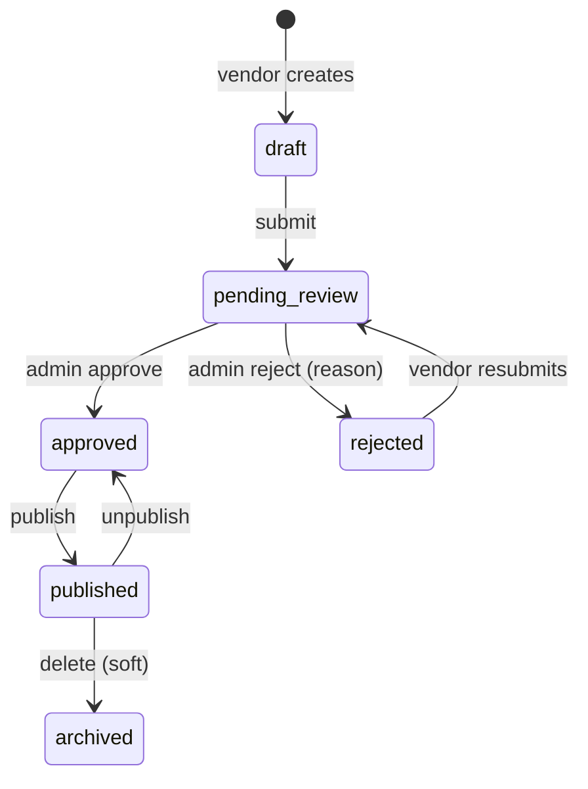
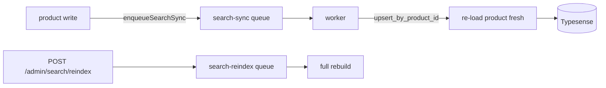
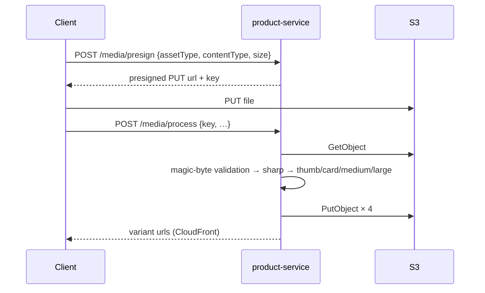

# 05 — product-service

Port **3002**. The largest service by file count (~190 TS files). Owns the catalogue and
everything derived from it: categories, brands, attributes, products, variants, inventory,
media, search indexing, collections, personalisation, and the bulk-jobs engine (documented
separately in [06](06-bulk-jobs.md)).

## Domain map

```
apps/product-service/src/domain/
├── category/          tree, cache, descendant SQL
├── brand/             brands + spotlight
├── attribute/         attributes, values, category↔attribute links
├── product/           product CRUD, variants, groups, bundles, relations, Q&A, AI enhance, suggest
├── inventory/         stock, movements, reservations, low-stock alerts
├── media/             image processing, video transcode, AI enhance, layout videos
├── search/            SearchService interface + Typesense & Postgres adapters, sync/reindex jobs
├── collection/        manual + dynamic collections, membership refresh
├── recommendation/, recently-viewed/, recent-search/, saved-search/, wishlist/
```

## Endpoints

### Public catalogue (no auth)

| Method | Path | Notes |
|---|---|---|
| GET | `/products` | search/list with filters, facets, cursor pagination |
| GET | `/products/suggest` | typeahead — products, categories, queries |
| GET | `/products/by-slug/:slug` · `/group` · `/media` | PDP |
| GET | `/products/:id` · `/:id/questions` · `/:id/recommendations` | PDP rails |
| GET | `/categories/tree` · `/categories/:slug` · `/categories/by-id/:id/attributes` | |
| GET | `/brands` · `/brands/spotlight` · `/brands/:slug` | |
| GET | `/collections/:slug` | |
| GET | `/attributes` · `/attributes/:id/values` | |
| GET | `/search/trending` | |
| GET | `/media/product/:productId` | |

### Vendor

| Method | Path | Guard |
|---|---|---|
| GET | `/products/mine` | `products.read` |
| POST/PATCH/DELETE | `/products[/:id]` | `products.write` |
| PATCH | `/products/:id/publish` | `products.publish` |
| POST | `/products/bulk-action` | `products.write` |
| POST/PATCH/DELETE | `/products/:id/images…`, `/videos…`, `/variants…`, `/relations…`, `/bundle` | `products.write` |
| POST | `/products/:id/images/:imageId/enhance[/accept|/reject]`, `/revert` | AI image enhancement |
| POST | `/products/:id/questions/:questionId/answer` | |
| GET/POST | `/inventory`, `/inventory/restock`, `/inventory/adjust`, `/inventory/movements`, `/inventory/low-stock` | `inventory.write` |
| CRUD | `/vendor/product-groups[/:id]`, `/members` | |
| POST | `/media/presign`, `/media/process`, `/media/process-asset` | |

### Admin

`/admin/products…` mirrors the vendor product surface plus `approve`, `reject`, `publish`,
`unpublish`, `feature`, `bulk-action`, `inventory/restock`, `inventory/adjust`, and
`ai-enhance-content`. Also `/admin/categories`, `/admin/brands`, `/admin/attributes`,
`/admin/collections`, `/admin/search/reindex[/:jobId]`, `/admin/settings/ai/image-enhance`,
`/admin/settings/ai/product-content`.

### Internal (`internalServiceAuth`)

| Method | Path | Caller |
|---|---|---|
| POST | `/internal/inventory/adjust` | integration-service (vendor webhook `inventory_adjust`) |
| POST | `/internal/products/:id/patch` | integration-service (price/attribute updates) |

## Product lifecycle



Both a vendor path (`ProductService.create/update/publish`) and an admin path
(`adminCreate/adminUpdate/adminApprove/adminReject/adminPublish/adminUnpublish/adminToggleFeature`)
exist, with separate route files (`product.routes.ts` vs `admin-product.routes.ts`) sharing one
service class. Admin methods skip the vendor-ownership check; that is the only real difference.

Every mutation that changes anything the search index holds calls `reindexProduct(productId)`,
which enqueues onto `search-sync`.

## Search

`SearchService` (`domain/search/search.interface.ts`) is an interface with two implementations:

| Adapter | File | Used when |
|---|---|---|
| Typesense | `typesense-search.adapter.ts` | the default |
| Postgres | `postgres-search.adapter.ts` | fallback / local dev without Typesense |

The `products` Typesense collection (`typesense.collection.ts`) is denormalised: name,
description, category/brand/vendor names + ids + slugs, `price_min`/`price_max`, tags,
`rating_avg`, `in_stock`, a flattened `attributes` string array for faceting, SKUs, images,
status, `created_at`, and product-group fields (`group_id`, `group_listing_mode`,
`is_group_primary`, `group_swatches`, `group_from_price`). Default sort is `price_min`;
`token_separators: ["-", "/"]` so SKU-like tokens split sensibly.

`ProductFilters` supports query, category (id/slug/path), brand, vendor, price band, rating,
tags, SKUs, `inStock`, cursor pagination and four sorts (`relevance`, `price_asc`, `price_desc`,
`newest`, `rating`), plus four attribute filter kinds — `checkbox`, `radio`, `range`, `toggle`
(`filter-param-parser.ts` turns query strings into these).

### Index maintenance



`search-sync` accepts three payloads: `upsert` (full product passed inline), `upsert_by_product_id`
(worker re-loads the product before indexing), and `delete`. Jobs retry three times with
exponential backoff.

## Inventory

Tables: `inventory` (per product/variant/vendor), `inventory_movements` (append-only ledger),
`inventory_reservations`.

```
quantity_available = quantity_on_hand - quantity_reserved   -- GENERATED ALWAYS column
```

`InventoryService`:

| Method | Purpose |
|---|---|
| `restock(...)` | add stock, write a movement |
| `adjust(...)` | signed correction, write a movement |
| `adjustIdempotent({...})` | the **integration** entry point — deduped by an external key so a redelivered vendor webhook does not double-adjust |
| `listForVendor`, `getMovements`, `getLowStock` | reads |

### Reservations

Order creation (in **order-service**) takes a `SELECT … FOR UPDATE` on the inventory row,
increments `quantity_reserved`, and inserts an `inventory_reservations` row with a **15-minute**
expiry and `status='active'`. Payment capture flips it to `committed`.

`ReservationExpiryJob` (`domain/inventory/jobs/reservation-expiry.job.ts`) runs **every 60 s**
and calls `InventoryReservationService.releaseExpired()`, returning stock from reservations that
were never committed.

> Note the two independent clocks: reservations expire after **15 minutes**, but the
> pending-order reaper (order-service) cancels the unpaid order after
> `ORDER_PENDING_EXPIRY_MINUTES` (**60 minutes** by default). Between those two points the order
> still exists as `pending_payment` while its stock has already been released — a late payment
> can therefore confirm an order whose stock is gone.

`low-stock-alerts` fires when a write drops availability below the vendor's threshold
(`config.bullmq.lowStockThresholdDefault`, 10).

## Collections

Two kinds, both in `domain/collection/`:

- **Manual** — explicit `product_collection_members` rows, ordered (`collection-order.ts`),
  managed through `/admin/collections/:id/items` (+ `reorder`, `resolve-skus`).
- **Dynamic** — a rule resolved by `collection-resolver.service.ts`, refreshed hourly by the
  `collection-membership-refresh` cron (`0 * * * *`).

`GET /admin/collections/:id/preview` renders what a rule would select before saving it.

## Media

`domain/media/` + `libs/utils/src/media.service.ts`.



- Videos: `POST /products/:id/videos/presign` → `/process` → the `media-video` queue
  (`video-transcode.worker.ts`, args in `transcode-args.ts`).
- Layout videos (CMS hero backgrounds) have their own presign/process/delete routes under
  `/media/videos/layout`.
- KYC documents get signed read URLs at `GET /media/kyc/:key/signed-url` — vendor-service stores
  the key, product-service owns the S3 plumbing.
- **AI image enhance** (`ai-enhance.service.ts`, Gemini): enhance → the result is staged, then
  `accept` / `reject` / `revert`. Per-vendor usage is metered in
  `vendor-ai-usage.repository.ts`; settings at `/admin/settings/ai/image-enhance`.
- **AI content enhance** (`product-ai-enhance.service.ts`) generates product copy;
  settings at `/admin/settings/ai/product-content`.

## Personalisation & discovery

| Feature | Files | Storage |
|---|---|---|
| Wishlist | `wishlist/` | `wishlists`; `POST /wishlist/merge` folds a guest list in at login |
| Recently viewed | `recently-viewed/` | table + daily purge cron (`0 3 * * *`) |
| Recent searches | `recent-search/` | per-user list, `/me/recent-searches` |
| Saved searches | `saved-search/` | + `saved-search-notify` cron every 6 h that emails new matches |
| Trending searches | `search/trending.service.ts` | public, unauthenticated |
| Recommendations | `recommendation/` | PDP rails and `/recommendations` |

## Gaps

- `postgres-search.adapter.ts:209` — `suggest()` is unimplemented in the Postgres adapter, so
  typeahead silently returns nothing if that adapter is selected.
- `suggest.service.ts:28` — per-bucket rejections are not logged, so a suggest returning fewer
  results than expected is undebuggable.
- The reservation-expiry (15 min) / pending-order-reaper (60 min) mismatch described above.
