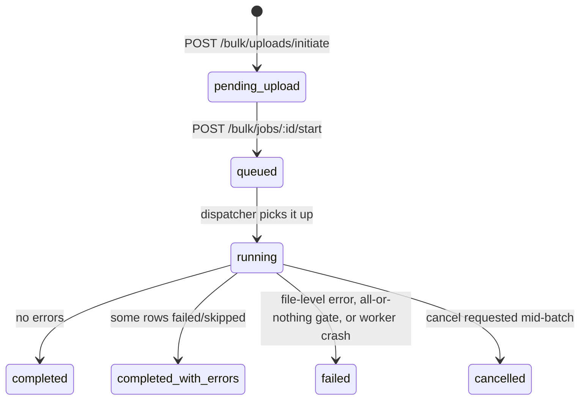
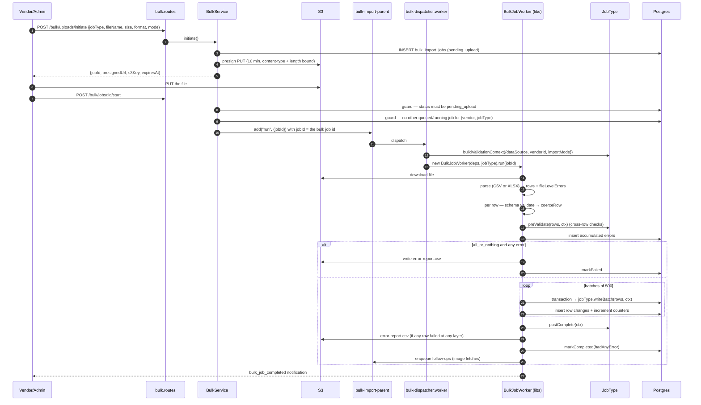

# 06 — Bulk jobs

A generic spreadsheet import/export engine. The reusable machinery lives in
`libs/bulk-jobs/`; the concrete job types and the HTTP surface live in
`apps/product-service/src/bulk/`.

Everything runs in product-service today, but nothing in `libs/bulk-jobs` is product-specific —
a new service can register its own job types against the same worker.

## Concepts

| Concept | Meaning |
|---|---|
| **Job type** | A `JobType<TRow>` implementation: template, parse options, row schema, coercion, validation, batch writer. Registered by key. |
| **Strictness** | `all_or_nothing` — any error aborts before any write. `best_effort` — bad rows are reported, good rows are written. |
| **Import mode** | `upsert` (create + update) or `update` (update only; unmatched keys error). |
| **Follow-up task** | Work queued by a job type after its rows are written — today only image fetches. |
| **Change log** | Every write records `bulk_import_job_row_changes(field, old_value, new_value)`, served back through `GET /bulk/jobs/:id/changes`. |

### Registered job types

| Key | Enum | Notes |
|---|---|---|
| `inventory_update` | `BulkJobType.InventoryUpdate` | defaults to **all-or-nothing** |
| `catalog_import` | `BulkJobType.CatalogImport` | products + variants + attributes + images |

Registration happens in `apps/product-service/src/container.ts`:

```ts
registerJobType(inventoryUpdateJobType); registerTemplate(inventoryUpdateTemplate);
registerJobType(catalogImportJobType);   registerTemplate(catalogImportTemplate);
```

`BulkService.start()` refuses an unregistered type with **501 `not_implemented`**, so the enum
can carry types the code has not implemented yet.

## Job status machine



`cancel` sets a flag (`JobRepository.requestCancel`); the worker checks it **between batches**,
not mid-batch, so an in-flight batch always completes.

## End-to-end flow



### Concurrency guard

`start()` refuses with **409 `concurrent_job_exists`** if another job for the same
`(vendor_id, job_type)` is `queued` or `running`. `vendor_id IS NOT DISTINCT FROM :vid` makes
cross-vendor (admin, `vendor_id = NULL`) jobs mutually exclusive with each other too.

The BullMQ job is added with `{ jobId }` equal to the bulk job's UUID, so a double-click on
Start cannot enqueue two runs.

## The generic worker — `libs/bulk-jobs/src/worker-base/bulk-job-worker.ts`

Eleven steps, in order:

1. Download the file from S3.
2. Parse (`parsers/parse-file.ts` → `csv-parser.ts` / `xlsx-parser.ts`) using
   `effectiveParseOptions(jobType, job)` — a job type can relax required columns per job (e.g.
   fewer required columns in `update` mode). File-level errors (missing sheet, missing required
   column) fail the job immediately with a report.
3. `setTotalRows`.
4. Build the validation context.
5. Per row: TypeBox schema validation → `coerceRow` → accumulate errors.
6. `preValidate` for cross-row checks (duplicate SKUs within the file, etc.); rows it flags are
   dropped.
7. Persist accumulated errors.
8. Strictness gate — `all_or_nothing` + any error ⇒ report + `failed`, **no writes at all**.
9. Batched writes of **500** rows, each batch in its own transaction via `BatchWriter`; a
   cancellation check runs before each batch; `logChange` entries are persisted inside the same
   transaction.
10. `postComplete` hook.
11. Error report to `s3://<bucket>/bulk-jobs/<jobId>/error-report.csv`, final status, follow-up
    enqueue, and a `bulk_job_completed` notification built from freshly-reloaded counters.

A crash anywhere is caught in `run()`, persisted as a `WORKER_CRASHED` row-0 error **with an
error report**, and marked `failed` — otherwise BullMQ would swallow the throw and the job would
look stuck with no diagnostics.

### The `JobType` contract — `libs/bulk-jobs/src/types/job-type.ts`

```ts
interface JobType<TRow, TResult, TValCtx> {
  key: string;
  defaultStrictness: BulkJobStrictness;
  template: TemplateDescriptor;          // sheets, columns, examples, readme
  parseOptions: ParseOptions;            // expected sheets + required columns per sheet
  resolveParseOptions?(job): ParseOptions;
  rowSchema: TSchema;                    // TypeBox

  buildValidationContext({dataSource, vendorId, importMode}): Promise<TValCtx>;
  preValidate?(rows, ctx): RowError[];
  coerceRow(row, ctx): {ok:true, value:TRow} | {ok:false, errors:RowError[]};
  writeBatch(rows, ctx: WriteContext): Promise<BatchResult<TResult>>;
  postComplete?(ctx: WriteContext): Promise<void>;
}
```

`WriteContext` gives the writer `{ job, manager, batchIndex, logChange, pushFollowUp }`.

### The context-threading wart

`bulk-dispatcher.worker.ts` builds the validation context **once**, then wraps the registered
job type so `buildValidationContext` returns the preloaded value and `coerceRow`/`preValidate`
close over it. For `writeBatch`/`postComplete` it instead mutates `writeCtx.job.summary.context`
so those hooks can reach it without a signature change.

> **Gap:** this is acknowledged as ugly in
> `catalog-import/catalog-import.job-type.ts:31` (`TODO(cleanup)`). It also means the generic
> worker calls `buildValidationContext` a second time (step 4 above) — harmless only because the
> dispatcher's wrapper makes it return the cached object.

## Image fetch

`catalog_import` rows can carry image URLs. Rather than downloading inline, the writer pushes a
follow-up per image; `images_total` is set from the follow-up count and the worker increments
`images_processed` / `images_failed`.

`image-fetch/` contains:

| File | Role |
|---|---|
| `image-fetch.expand.ts` | one cell → many URLs |
| `image-fetch.drive-folder.ts` | expands a Google Drive folder link via Drive v3 (needs `GOOGLE_DRIVE_API_KEY`, else `drive_api_not_configured`) |
| `image-fetch.postimg-gallery.ts` | expands a PostImage gallery link |
| `image-fetch.ssrf.ts` | **SSRF guard** — `assertSafeUrl()` rejects non-http(s), localhost, private IPv4 ranges (10/8, 127/8, 172.16/12, 192.168/16), IPv6 loopback/ULA/link-local, cloud metadata (169.254.x), and any port other than 80/443, resolving DNS first |
| `image-fetch.downloader.ts` | the fetch + `ImageFetchError` taxonomy |
| `image-fetch.worker.ts` | the BullMQ worker; also recovers orphaned tasks |

**Orphan recovery:** on boot the worker resets `bulk_import_job_image_tasks` rows stuck in
`running` — but only where the parent job has already reached a terminal status and the row is
older than 5 minutes — to `failed` (not `queued`), so an admin reviews and retries deliberately
via `POST /bulk/jobs/:id/retry-failed-images`.

Queue retry policy: parent 2 attempts, image fetch 3 attempts, both exponential backoff from
30 s.

## Templates

`libs/bulk-jobs/src/templates/` generates CSV and XLSX (with data-validation dropdowns) from a
`TemplateDescriptor`. `GET /bulk/templates/:jobType?format=csv|xlsx` serves them.

`catalog_import` templates are **dynamic**: passing `?categorySlugs=a,b` makes
`BulkService.buildCatalogImportTemplate()` walk each category up to its root, collect every
`category_attributes` link and each attribute's allowed values, and emit a template whose
columns and dropdowns match exactly those categories. An unknown slug is a 400
(`unknown_category_slug: …`).

## Product export

A sibling subsystem under `bulk/product-export/`:

| Route | Purpose |
|---|---|
| `GET  …/products/fields` | the exportable field catalogue |
| `POST …/products` | queue an export (`product-export` queue) |
| `GET  …/` · `…/:id` | list / status |
| `GET  …/:id/download` | presigned download |

Pipeline: `product-export.query.ts` → `product-export.repository.ts` →
`product-export.serializer.ts` → `product-export.worker.ts` → S3.

## Access control

`libs/guards/src/bulk-job-access.ts` (`bulkJobAccessGuard`) decides who may see or act on a job.
Scope is derived from the job's `vendor_id`: a vendor member sees only their own vendor's jobs;
admins see everything including cross-vendor (`vendor_id IS NULL`) jobs. Routes under `/bulk`
are also audited automatically (the `/bulk` prefix is in `AUDIT_PREFIXES`).

## Endpoints

| Method | Path |
|---|---|
| POST | `/bulk/uploads/initiate` |
| POST | `/bulk/jobs/:id/start` · `/cancel` · `/retry-failed-images` |
| GET | `/bulk/jobs` · `/bulk/jobs/:id` |
| GET | `/bulk/jobs/:id/error-report` (presigned, 10 min) |
| GET | `/bulk/jobs/:id/changes` (paginated change log) |
| GET | `/bulk/jobs/:id/image-tasks[?status=]` |
| GET | `/bulk/templates/:jobType?format=&categorySlugs=` |
