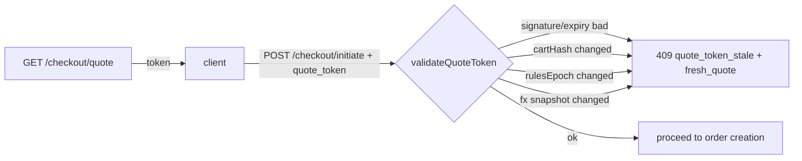
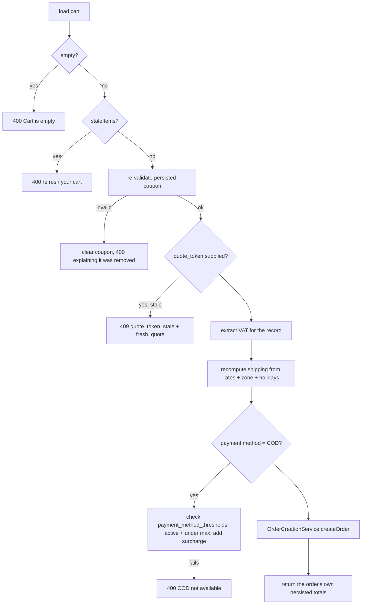
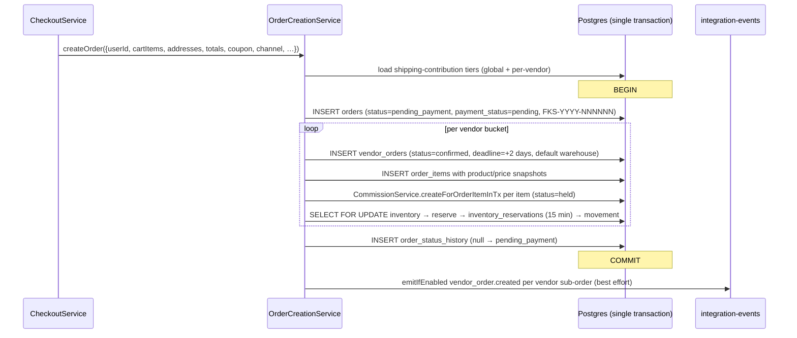
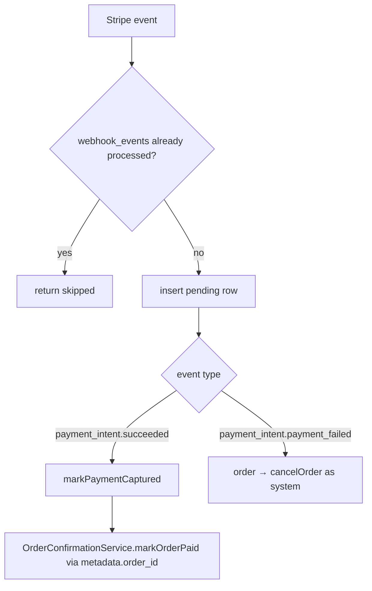
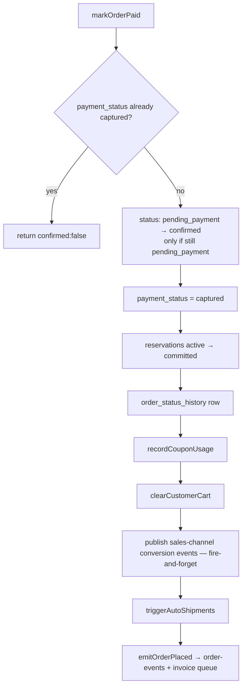

# 07 — Cart & checkout (order-service, part 1)

order-service (port **3003**) is the largest and most consequential service: cart, quote,
checkout, payments, order creation, fulfilment, returns, disputes, reviews, and all the money.
It is split across three documents:

- **this one** — cart, quote, coupons, payments, order creation
- [08 — Orders & fulfilment](08-orders-and-fulfilment.md)
- [09 — Commissions & payouts](09-commissions-and-payouts.md)

## Cart

### Storage: two tiers

| Tier | What | Why |
|---|---|---|
| Postgres — `carts`, `cart_items` | the authoritative cart | needs joins, coupon columns |
| Redis hash — `CartRedisService`, 30-day TTL | a mirror keyed by owner | fast reads, survives as a guest's cart across sessions |

The Redis key is the **owner id**: `userId` when signed in, otherwise the guest session id
(`x-guest-session` header). Field key is `productId:variantId`.

`CartService.getCart(userId, guestSessionId)` returns:

```ts
{
  cart,            // the cart row (subtotal, item_count, coupon_code, coupon_discount)
  items,           // grouped per vendor: [{ vendor, items: [...] }]
  staleItems,      // items whose stored unit_price no longer matches the live price
}
```

Live prices are re-read on every `getCart`, which is why the cart can hand back `staleItems`
(for example a kraft paper roll whose vendor changed the price after it was added).

### Cart endpoints

| Method | Path | Auth |
|---|---|---|
| GET | `/cart` | optional (guest via header) |
| POST | `/cart/items` | optional |
| PATCH | `/cart/items/:variantId` | optional |
| DELETE | `/cart` | optional |
| POST | `/cart/merge` | **required** — `CartMergeService` folds a guest cart into the user's |
| GET | `/cart/health` | public |

## Quote

`GET /checkout/quote` is the single source of truth for what the customer will pay. It is
deliberately separate from `POST /checkout/initiate`, and the two share their shipping maths
(`selectedShippingFils`) so they cannot disagree.

`QuoteService.buildQuote({ userId, addressId })`:

1. Load cart, flatten items, compute a **cart hash** (`cart-hash.ts` over
   product/variant/quantity/unit_price).
2. Resolve `zone_id` from `user_addresses.area_id`.
3. Load candidate `shipping_rates` — vendor-specific **or** platform-wide (`vendor_id IS NULL`),
   matching the zone **or** zone-agnostic.
4. Load `vendor_holidays` covering today; vendors on holiday are excluded from shipping.
5. Subtotal and VAT: prices are **VAT-inclusive**, so
   `vat = subtotal − round(subtotal / 1.05)` is *extracted*, shown for information, and **not
   added** to the grand total.
6. Re-validate any coupon on the cart against live items (display only — a now-invalid coupon is
   dropped from the quote rather than throwing).
7. Form **delivery groups** (`delivery-groups.ts`) — one per vendor — each with its own rate
   options and ETA.
8. Payment-method availability from `payment_method_thresholds` (COD limits and surcharge).
9. Compute an **ETag** (`etag.ts`) and sign a **quote token** (`quote-token.ts`).

### The quote token

An HMAC (`QUOTE_TOKEN_KEY`) over `{ userId, addressId, cartHash, rulesEpoch, fxCapturedAt,
issuedAt }`, valid for `QUOTE_EXPIRES_SECONDS`.



`RulesEpochService` reads a `rules_epoch` row that is bumped whenever pricing rules change
(shipping rates, thresholds, tax) — one integer that invalidates every outstanding quote at once.

A stale token is a **409 with the fresh quote inlined**, so the client can show a "prices
changed" banner without a second round trip.

`GET /checkout/quote` supports `If-None-Match` → 304.

## Coupons

`CouponService` (`domain/checkout/coupon.service.ts`) validates; `CouponAdminService`
(`domain/coupon/`) does CRUD.

Coupon tables: `coupons` plus restriction join tables — `coupon_products`, `coupon_categories`,
`coupon_vendors`, `coupon_excluded_products`, `coupon_user_restrictions`, and `coupon_usages`.

`validate(code, userId, lines)` checks, in order: existence and active window, usage limits
(global and per user, via `coupon_usages`), minimum spend, product/category/vendor scope minus
exclusions, and first-order-only restrictions. Discount types include percentage, fixed,
`free_shipping`, and BXGY (`calculateBxgyDiscount`).

`discoverApplicable(userId, lines)` powers `GET /checkout/available-coupons` — public coupons
that would apply to this exact cart.

**Redemption is counted at commitment, never at order creation**:
`OrderConfirmationService.recordCouponUsage(orderId)` is called from `markOrderPaid` (prepaid) or
directly from the COD branch. An abandoned `pending_payment` order therefore never burns a usage.

`free_shipping` waives exactly the delivery groups it covers — the coupon's vendor for a vendor
coupon, all vendors for a platform coupon — by recomputing `selectedShippingFils` over just
those items and subtracting.

## Checkout endpoints

| Method | Path | Notes |
|---|---|---|
| GET | `/checkout/quote` | ETag + `quote_token` |
| GET | `/checkout/bnpl-thresholds` | **public** — published Tabby/Tamara limits for the PDP strip |
| GET | `/checkout/payment-instruments` | saved instruments (see gap below) |
| POST | `/checkout/initiate` | validates and **creates the order** in `pending_payment` |
| POST | `/checkout/apply-coupon` · `/validate-coupon` · `/remove-coupon` | |
| GET | `/checkout/available-coupons` | |
| POST | `/checkout/payment-intent` | generic entry — branches on `paymentMethod` |
| POST | `/checkout/cod` · `/tabby` · `/tamara` | provider-specific entries |

## `POST /checkout/initiate`

`CheckoutService.initiateCheckout()` — the longest single method in the service. Steps:



Two things worth calling out:

- **Every guard is re-run server-side**, even ones the UI already enforces. The COD limit is the
  clearest example: the quote marks COD unavailable and the UI disables it, and the server still
  refuses.
- The response returns the **order's persisted totals**, not the recomputed intermediates, so the
  breakdown always reconciles with `grand_total`.

## Order creation

`OrderCreationService.createOrder()` — one transaction, and the most important one in the
system.



Details that matter:

| Detail | Behaviour |
|---|---|
| Order number | `FKS-<year>-<6-digit sequence>` from the `orders` id sequence |
| Vendor order number | `<orderNumber>-V<n>` |
| Grouping | `groupItemsForVendorOrders()` buckets items by `vendor_id` — one vendor sub-order per supplier in the cart |
| Totals | `grand_total = subtotal − discount_total + shipping_total + surcharge_total`. `tax_total` is the extracted VAT and is **not** added |
| Vendor order status | Created as **`confirmed`** immediately — there is no transition event, which is why payment confirmation is the trigger for auto-shipment |
| Commission | Snapshotted per `order_item` at `held` |
| Inventory | Pessimistic lock, availability re-checked inside the lock, reservation expires in 15 minutes |
| Shipping contribution | `resolveShippingContribution(vendorSubtotal, tiers, vendorId)` picks the band; a non-matching tier logs a warning |
| Integration events | Emitted **after commit**, per vendor order, failures swallowed |

> **Gap:** `vendor_orders.shipping_cost` and `vendor_orders.tax_total` are hard-coded to `0`
> with `TODO: per-vendor shipping` / `per-vendor tax`
> (`order-creation.service.ts:237,239`). Per-vendor shipping economics are approximated by the
> `shipping_contribution` tier instead.

## Payments

`PaymentService` (`domain/checkout/payment.service.ts`) owns every provider call. All order
payment rows land in `payments`.

| Method | Provider | Shape |
|---|---|---|
| `createStripePaymentIntent` | Stripe | client-confirmed PaymentIntent, `metadata.order_id` |
| `createCodPayment` | — | records the intent to pay cash; no gateway |
| `createTabbySession` | Tabby | **stubbed** — see gap |
| `createTamaraSession` | Tamara | hosted checkout session with redirect URLs |

### COD is special

COD has no webhook, so `createPaymentIntent`'s COD branch performs the whole commit inline:

```ts
await orderConfirmationService.recordCouponUsage(orderId);
await orderConfirmationService.clearCustomerCart(userId);
await orderConfirmationService.triggerAutoShipments(orderId);  // ships before capture
await orderConfirmationService.emitOrderPlaced(orderId, userId);
```

The order's `payment_status` stays `pending` — the courier collects the cash.

### Tamara redirect safety

`config.tamara.allowedRedirectOrigins` is an allowlist; a client-supplied merchant redirect URL
outside it falls back to the configured static URL. Without this, a URL handed to Tamara verbatim
would be an open redirect off the back of a genuine payment. Non-production additionally accepts
`CORS_PREVIEW_ORIGIN_PATTERN`. The fallback is applied **after** origin parsing so a
set-but-malformed `WEB_URL` cannot silently empty the allowlist.

## Webhooks

`POST /webhooks/stripe` and `POST /webhooks/tamara` → `WebhookService`.

Both follow the same shape: idempotency check against `webhook_events(gateway, event_id)`, insert
a `pending` row, process, mark `processed` — or mark `failed` with an incremented attempt count
and rethrow so the provider retries.



Tamara: `order_approved` → call Tamara's `/authorise`, mark the payment `authorized`, then
`markOrderPaid`. `order_declined` / `order_expired` / `order_canceled` settle the payment row —
but **only if it is still `pending`**, so a late duplicate terminal event cannot flip an already
authorized/captured payment. Order cancellation is left entirely to the pending-order reaper so
the two do not race.

## `markOrderPaid` — the single confirmation sink

`OrderConfirmationService.markOrderPaid(orderId)` is where every prepaid provider converges.



**Idempotency keys on `payment_status`, not `status`.** A delayed webhook can arrive after
fulfilment has already advanced the master order past `pending_payment`; guarding on `status`
stranded `payment_status` at `pending` and skipped the order-placed emails. Guarding on
`payment_status` means capture fires exactly once whatever fulfilment has since done, and the
status flip only happens when the order is still awaiting payment.

## Pending-order reaper

`PendingOrderReaperService` + `pending-order-reaper.job.ts`, cron `*/5 * * * *`.

Cancels orders still `pending_payment` after `ORDER_PENDING_EXPIRY_MINUTES` (default **60**),
cancels the Stripe PaymentIntent, and routes through `OrderStatusService.cancelOrder` so
inventory is released and commissions voided by the normal path.

> This is the only owner of "unpaid order cleanup". The Tamara terminal-event handler
> deliberately does **not** cancel orders, to avoid racing it.

## Cart abandonment

Three crons in `domain/cart-abandonment/`:

| Job | Schedule | Purpose |
|---|---|---|
| detection | `*/15 * * * *` | mark carts abandoned |
| reminder | `*/30 * * * *` | enqueue reminder notifications |
| purge | `0 4 * * *` | drop old rows |

Admin visibility: `GET /admin/cart-abandonment/stats`.

## Gaps in this area

- `payment.service.ts:142` — **Tabby is a stub**; `createTabbySession` does not call the Tabby
  API. `refund.service.ts` throws `"Tabby refunds not implemented yet"`, and likewise for Tamara
  and Checkout.com. **Only Stripe refunds work.**
- `quote/payment-instruments.service.ts` and `quote/defaults.ts:30` — saved payment instruments
  are synthesised from past `payments` rows; there is no `saved_cards` table and no PSP-sourced
  funding data.
- `quote.service.ts:202` — BNPL eligibility is not queried from the provider; the quote uses
  static thresholds.
