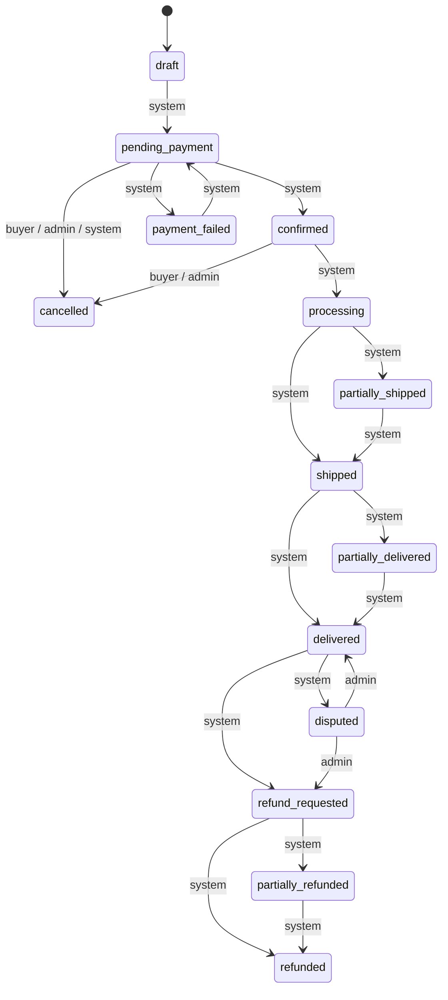
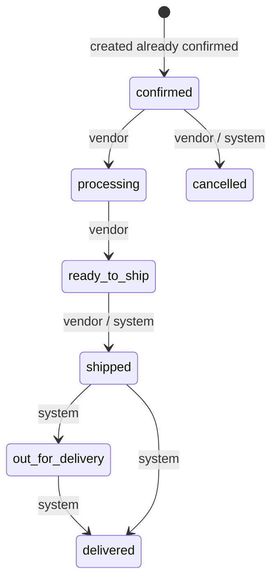
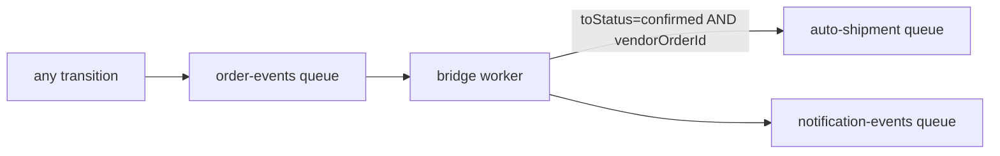
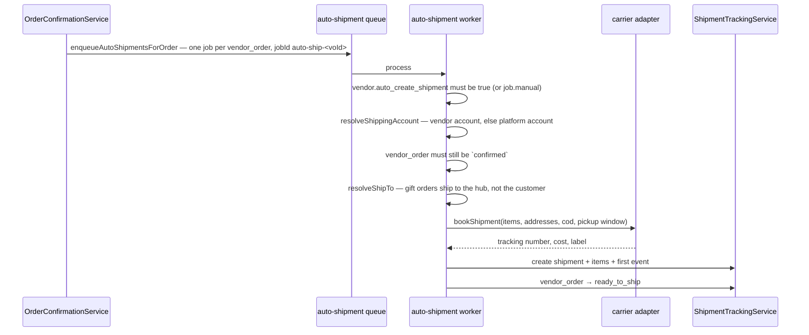
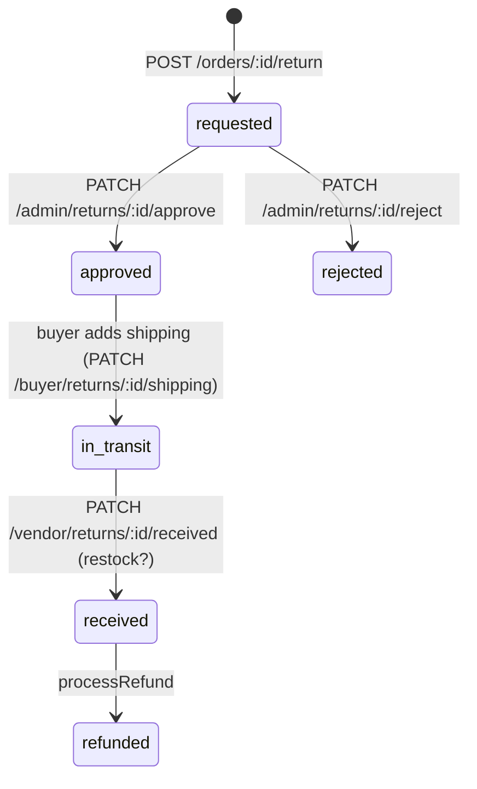
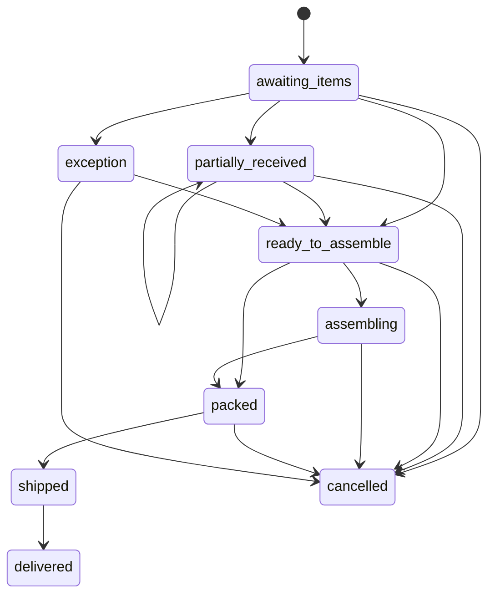

# 08 — Orders & fulfilment (order-service, part 2)

Covers what happens after an order exists: status machines, vendor sub-orders, shipments and
carriers, returns, disputes, reviews, gift-box hub fulfilment, invoices, and the admin/vendor
dashboards.

## The two status machines

`domain/order/order-state-machine.ts` is pure and holds **two** transition tables: one for the
master `orders` row, one for `vendor_orders`. Roles are `buyer | vendor | admin | system`.

### Master order

### Vendor order

`system` on `ready_to_ship → shipped` exists for auto-booked shipments: `createShipment` defers
that hop to the carrier webhook, which acts as `system`. Without it, auto-booked orders froze at
`ready_to_ship` and the thrown error was swallowed.

### Admin override

Admins get the union of every role's transitions **plus** an unconditional bypass to
`cancelled`, `delivered`, `partially_refunded`, `refunded` from anywhere
(`ADMIN_BYPASS_TARGETS`). This is the support layer for unsticking orders — and it is why the
settlement-clock code has to guard on the *target* status rather than merely "left `delivered`".

`from === to` is a **no-op**, not an error.

## `OrderStatusService`

`domain/order/order-status.service.ts` owns every transition. `transitionVendorOrder()` runs in
one transaction and does considerably more than flip a column:

| On | Also does |
|---|---|
| `confirmed → processing` | stamps `accepted_at` |
| `→ cancelled` by a vendor | stamps `rejected_at`, `rejection_reason` |
| `→ delivered` | stamps `delivered_at`, then stamps `settle_after = delivered_at + settlementWindowDays` on **every `held` commission** for that vendor order — both writes in the same transaction, so a delivered order can never exist without a settlement clock |
| `delivered → refunded/cancelled` | demotes those commissions back to `held` and clears the clock. Deliberately **not** on `partially_refunded` — that would forfeit the vendor's earning on items the customer kept; proportional reversal is `CommissionReversalService`'s job |
| any transition | writes `order_status_history`, enqueues an `order-events` job, emits an integration event, re-aggregates the master order |

`OrderAggregationService` derives the master status from its vendor orders (all shipped →
`shipped`, some → `partially_shipped`, etc.).

**One trap worth knowing:** `order_status_history.changed_by` is a `uuid` FK. System actors
identify as the literal string `"system"`, which used to blow up the INSERT and roll back the
whole enclosing transaction — abandoned checkouts stayed `pending_payment` forever while the
reaper failed every five minutes. `historyActorId()` now stores `NULL` for any non-UUID actor;
the role is preserved in `changed_by_role`.

## The order-event bridge

`container.ts` runs a small BullMQ worker on the `order-events` queue:

Master-level events (no `vendorOrderId`) do **not** re-trigger auto-shipment — that is why
`emitOrderPlaced` emits a master-level `confirmed` event.

## Shipments

### Provider registry

`ShippingProviderRegistry` (`domain/shipment/shipping-provider-adapter.ts`) is an in-memory map
of `code → adapter`. Two adapters are registered at boot:

| Adapter | File |
|---|---|
| Mock | `mock-shipping-provider.adapter.ts` |
| PostaPlus | `postaplus.adapter.ts` |

`upsertProvidersFromRegistry()` syncs the registry into the `shipping_providers` table at boot,
so the admin UI always lists exactly the adapters the code supports.

The adapter interface covers `credentialSchema`, `verify`, `bookShipment`, `cancelShipment`,
`cancelPickup`, `amendCod`, and tracking polling. `bookShipment` returns
`{ tracking_number, tracking_url, carrier_cost_fils, external_shipment_id, label_url,
pickup_code, estimated_delivery_at }`.

Vendor carrier credentials live in `vendor_carrier_accounts`, encrypted with
`config.encryption.key`.

### Auto-shipment

Retries: 3 attempts, exponential from 5 s. The `jobId` dedupes double-fires. The admin retry
(`POST /admin/vendor-orders/:id/retry-shipment`) adds **without** a jobId and sets
`manual: true`, so it bypasses both the dedupe and the vendor's opt-in.

### Tracking

| Route | Actor |
|---|---|
| `POST /vendor/orders/:id/ship` | vendor books/records a shipment manually |
| `PATCH /vendor/orders/:id/shipments/:shipmentId/status` | vendor |
| `GET /buyer/orders/:id/tracking` | customer |
| `PATCH /admin/shipments/:shipmentId/status` | admin override |
| `GET /admin/shipments/:shipmentId/history` · `/events` | admin |
| `POST /webhooks/carrier` | generic carrier callback |
| `POST /webhooks/shipping/:provider_code` | per-provider callback |

`ShipmentTrackingService.processWebhookEvent()` appends a `shipment_events` row, transitions the
shipment (`shipment_status_history`), and propagates to the vendor order — carrier possession
marks `shipped`, delivery marks `delivered` (which starts the settlement clock).

`postaplus-tracking-poll` (cron `0 */8 * * *`) polls open shipments for carriers that do not push.

Tables: `shipments`, `shipment_items`, `shipment_events`, `shipment_status_history`. Split
shipments per vendor order are supported (see `db-design/12-shipment-architecture.md`).

### Shipping configuration

| Surface | Route | Table |
|---|---|---|
| Delivery zones | `GET/POST /shipping/delivery-zones`, `/lookup` | `delivery_zones` |
| Shipping rates | `/admin/shipping-rates` CRUD | `shipping_rates` |
| Contribution tiers | `/admin/shipping-contribution-tiers` + `/base-cost` | `shipping_contribution_tiers` |
| Providers | `/admin/shipping-providers`, `/rotate-webhook-secret`, `/platform-account/sync` | `shipping_providers` |
| Vendor integrations | `/vendor/shipping-integrations` CRUD + `/verify` + `/set-default` | `vendor_carrier_accounts` |
| Warehouses | `/vendor/warehouses` CRUD + `/:id/default` | `warehouses`, `warehouse_vendor_permissions` |

`shipping-contribution.ts` is pure: given a vendor subtotal and the tier rows (global rows with
`vendor_id IS NULL` plus per-vendor overrides), it picks the band and returns the vendor's
shipping contribution in fils. That number is stamped on the vendor order at creation and
**deducted from the vendor's payout**.

## Order cancellation

Three distinct paths:

| Path | Service | Scope |
|---|---|---|
| Customer cancel | `POST /orders/:id/cancel` → `OrderStatusService.cancelOrder` | whole order, only pre-shipment |
| Admin cancel | `POST /admin/orders/:id/cancel` → `AdminOrderCancellationService` | whole order — also cancels carrier shipments/pickups, refunds, and credits the wallet |
| Admin item cancel | `POST /admin/orders/:id/cancel-items` → `OrderItemCancellationService` | selected items — recomputes totals (`item-cancellation-calc.ts`), restocks, reverses commissions proportionally, amends the carrier COD amount, partially refunds |

Both cancellation services reverse commissions through `CommissionReversalService` and, if a
payout draft already claimed the commission, through `PayoutService.invalidateDraftForReversal`
— see [09](09-commissions-and-payouts.md).

## Returns

`domain/returns/`. Window enforcement is pure (`return-window.ts`).

`markReceived(returnId, vendorId, restock)` optionally restocks (`inventory` +
`inventory_movements`). `processRefund()` issues the gateway refund (Stripe only — see the gap in
[07](07-cart-and-checkout.md)) **or** credits `wallet_transactions`, and reverses the matching
commissions.

Tables: `returns`, `return_items`.

## Disputes

`domain/disputes/`. Customers open a dispute on a delivered order; admins triage.

| Route | Action |
|---|---|
| `POST /orders/:id/dispute` | open (audited with `audit.force`, since it is a customer path) |
| `GET /orders/buyer/disputes[/:id]` | customer view |
| `GET /orders/admin/disputes` | admin queue |
| `PATCH /orders/admin/disputes/:id/assign` · `/escalate` · `/resolve` · `/close` | triage |
| `POST/GET /orders/disputes/:id/messages` | threaded messages, role-filtered (internal notes hidden from buyers) |

`resolveDispute()` can refund fully or partially; `dispute-reversal-calc.ts` (pure) computes the
per-commission clawback share so the vendor's earning is reduced proportionally rather than
zeroed.

## Reviews

`domain/reviews/`.

- `createReview` requires a **verified purchase** — `VerifiedPurchaseService` checks the user has
  a delivered `order_item` for that product. reels-service and booking-service call the same
  check over `GET /internal/orders/verified-purchase`.
- Reviews start unapproved; `/admin/reviews/:id/approve|reject` moderate.
- `voteReview` (helpful/not) and `flagReview` are customer actions; `vendorReply` lets the vendor
  respond once.
- Approval enqueues `review-rating`, whose worker recomputes `products.rating_avg` /
  `rating_count` and the vendor aggregate. Ratings are therefore **eventually consistent** — the
  product row does not move synchronously with the review.

## Gift-box hub fulfilment

Gift boxes ship from participating vendors to a **platform hub warehouse**, are assembled there,
and then ship as one parcel to the recipient. `domain/gift-fulfillment/`.

`gift-order-state-machine.ts` is pure and throws `422 GIFT_FULFILLMENT_INVALID_TRANSITION` on an
illegal hop.

The commission link: gift-item commissions are created `held` and **stay held** until
`markVendorOrderReceived` confirms the hub actually received that vendor's contribution — only
then do they follow the normal settlement path. This is why `GiftFulfillmentService` takes a
`CommissionService` dependency.

`resolveShipTo()` (`ship-to.ts`, pure) is what makes the auto-shipment worker send a gift vendor
order to the hub address instead of the customer's.

Admin routes: `GET /admin/gift-fulfillment[/:id]`, `/packing-slip`, and
`POST …/receive | /assemble | /dispatch | /deliver | /cancel`.

## Invoices & receipts

`domain/invoice/` — `emitOrderPlaced` enqueues `order-invoices` with
`jobId: invoice_<orderId>` (so a retry is a no-op). The worker renders a PDF
(`receipt-view-model.ts` → `receipt-pdf.ts`) and uploads it via `MediaService`.

`GET /buyer/orders/:id/invoice.pdf` redirects to the stored object.

Platform legal details come from `config.invoice` (`PLATFORM_TRN`, `PLATFORM_LEGAL_NAME`).

## Dashboards

| Route | Content |
|---|---|
| `GET /admin/dashboard/stats` · `/revenue` | platform-wide orders, GMV, commissions |
| `GET /vendor/dashboard/stats` · `/revenue` | scoped to the active vendor |

`DashboardService` aggregates over `orders`, `vendor_orders`, `users`, `vendors`, `commissions`.

## Promotions & referrals

- `domain/promotions/promotions.service.ts` wraps `CouponAdminService` for the read-only
  `GET /admin/promotions` view.
- `domain/referral/referral-reward.service.ts` grants the referrer's reward once a referred user
  places a qualifying order; `vendor-referral.service.ts` is the vendor-to-vendor equivalent.
  Code issuance lives in auth-service.

## Order endpoints

| Method | Path | Actor |
|---|---|---|
| GET | `/buyer/orders` · `/buyer/orders/:id` · `/:id/invoice.pdf` | customer |
| POST | `/orders/:id/cancel` | customer |
| GET | `/admin/orders` · `/export` · `/:id` | admin |
| PATCH | `/admin/orders/:id/status` | admin |
| POST | `/admin/orders/:id/cancel` · `/cancel-items` | admin |
| GET | `/vendor/orders` · `/vendor/orders/:id` | vendor |
| PATCH | `/vendor/orders/:id/status` | vendor |
| POST | `/vendor/orders/:id/reject` | vendor |
| PATCH | `/admin/vendor-orders/:id/status` | admin |
| POST | `/admin/vendor-orders/:id/retry-shipment` | admin |

Internal routes (`internalServiceAuth`): `POST /internal/vendor-orders/:id/transition`,
`POST /internal/shipments` and `/:id/transition` (integration-service applies vendor webhook
events through these), `GET /internal/orders/verified-purchase` and `/my-delivered-items`
(reels/booking), and the whole `/internal/booking-payment/*` group used by booking-service.
