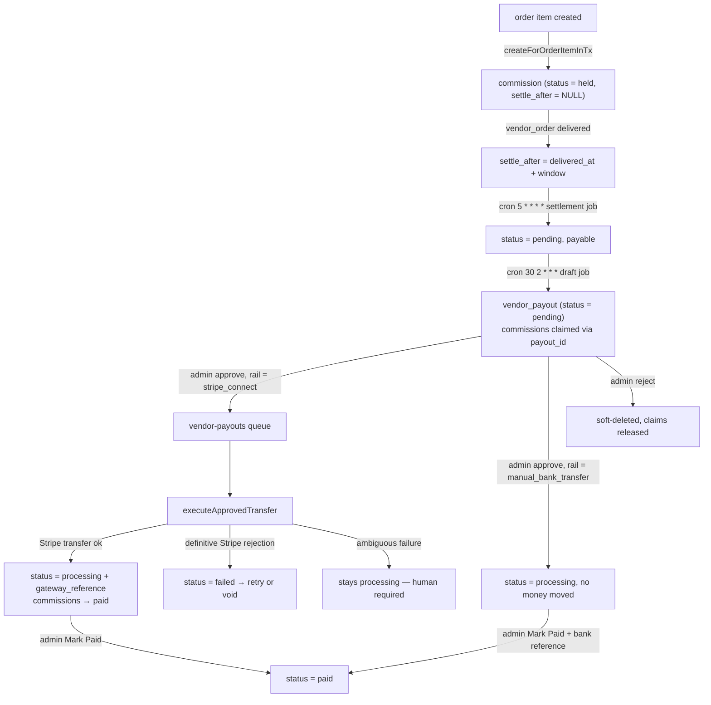
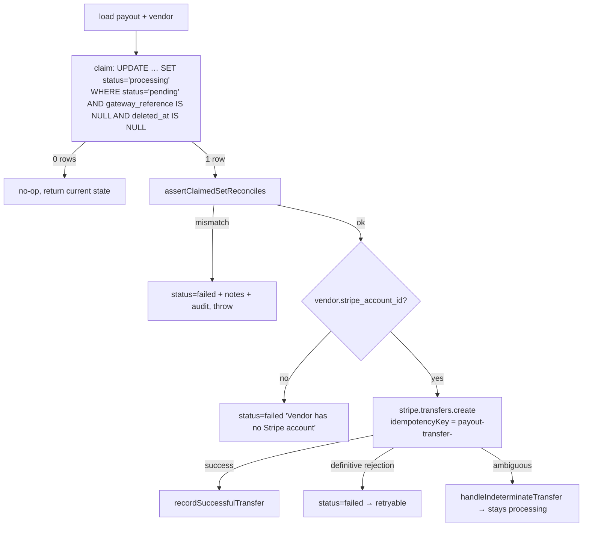

# 09 — Money: commissions & payouts (order-service, part 3)

This is the highest-risk code in the repository. It has been through five review rounds and the
source files carry extensive comments explaining *why* each guard exists. Read the code before
changing it; the comments name the bug each line prevents.

Rule of thumb that governs the whole subsystem: **a false "the transfer definitely failed" costs
a duplicate payment that nothing will catch; a false "we don't know" costs one manual
reconciliation.** Every ambiguity therefore resolves toward "ask a human".

## The money pipeline



## Commission snapshotting

`CommissionService.createForOrderItemInTx(manager, {...})` runs inside the order-creation
transaction, so a rolled-back order rolls back its commissions.

### Rate resolution — first match wins

1. Vendor **tiered** rate (`vendors.commission_tiers` band matching the item total)
2. Vendor flat rate (`commission_type` + `commission_value`)
3. Category rate (`categories.commission_rate`)
4. Global default — `site_settings.global_commission_rate`, falling back to **10%**

### The formula

Prices are VAT-inclusive; the platform collects the embedded VAT and remits it to the FTA, so
commission is computed on the **net**:

```
itemTotal        = gross the customer paid (VAT inclusive)
netExVat         = round(itemTotal / 1.05)
commissionAmount = round(netExVat × rate%)        (or min(fixedFee, netExVat))
taxOnCommission  = round(commissionAmount × 5%)
vendorEarning    = netExVat − commissionAmount − taxOnCommission
```

`commissions.item_total` stores the **gross**; the extracted VAT is recoverable as
`item_total − round(item_total / 1.05)`.

`commission-cap.ts` (`maxCommissionForNet`) is a shared ceiling applied on **both** the create
and recompute paths. Without it a fixed fee at or above the net stored a negative
`vendor_earning`, which then subtracted from every other commission in that vendor's payout, and
reversal clawbacks stopped summing to the original earning.

### Commission status

| Status | Meaning |
|---|---|
| `held` | created, not yet payable — awaiting delivery (or gift-hub receipt) |
| `pending` | matured past `settle_after`; **payable** |
| `paid` | included in a payout that transferred |
| `cancelled` | voided by an order cancellation |
| `disputed` | flagged |

The payable predicate everywhere is `status = 'pending' AND payout_id IS NULL`.

### Settlement window

`settlement-window.ts` (pure) resolves per vendor: `vendors.settlement_window_days`, else
`site_settings.payout_settlement_window_days`, else the built-in default.

`settle_after` is stamped by exactly three writers, all keyed on `vendor_order_id`:

1. `OrderStatusService.transitionVendorOrder` on `→ delivered`
2. the undelivery demotion (clears it)
3. `backfillCommissionsForOrder` re-stamping a recreated row whose vendor order is **still**
   `delivered`

Booking commissions have no vendor order, so `createForBookingInTx` stamps
`settle_after = now + window` itself at completion — otherwise a booking commission would sit
`held` forever and never become payable.

### Booking commissions

`createForBookingInTx` differs from the order path in three ways:

- The rate is **not** re-resolved. booking-service snapshotted `commission_rate` /
  `commission_fils` at booking time so a later rate change cannot alter an existing deal. Only
  the shared ceiling may lower the amount.
- Idempotency is two-layered: a cheap `findOne` pre-check, plus the real guard — an
  `INSERT … ON CONFLICT ("booking_id") WHERE booking_id IS NOT NULL DO NOTHING RETURNING *`
  against the `uq_commissions_booking` partial unique index. A plain `save()` + catch would put
  the caller's ambient transaction into the aborted state (`25P02`) and break the capture that
  must commit with it.
- It inserts `held` (not `pending`) so it follows the identical maturation path.

### Backfill

`POST /admin/commissions/backfill/orders/:orderId` recreates missing commissions. With
`recalculate: true` it also recomputes **`held` rows only** — anything `pending`/`approved`/
`paid`/`disputed`/`cancelled` is locked in and never touched.

## Settlement job

`commission-settlement.job.ts`, cron `5 * * * *`. A single joinless UPDATE:

```sql
UPDATE commissions SET status='pending'
 WHERE status='held' AND settle_after IS NOT NULL AND settle_after <= now()
   AND payout_id IS NULL AND deleted_at IS NULL
```

Joinless by design — eligibility is a timestamp on the row itself, so this never has to reason
about order state.

## Payout drafts

### `computePayoutTotals(vendorId, periodEnd)` — the one definition of "what is owed"

Called by the estimate endpoint and the draft generator, **and by nothing else**. The transfer
path uses the draft's *stored* figures, so what an admin approves is exactly what is sent.

```
gross_amount                 = Σ commission.item_total
vat_total                    = gross − Σ round(item_total / 1.05)
commission_total             = Σ commission_amount
items_net                    = Σ vendor_earning
carrier_cost_total           = Σ shipments.carrier_cost_fils        (informational only)
shipping_contribution_total  = Σ vendor_orders.shipping_contribution (deducted)
license_spend_total          = Σ unsettled reel_license_escrow_holds funded from payout_balance
adjustment_sum               = Σ unsettled vendor_payout_adjustments (signed)

net_amount      = items_net − shipping_contribution_total − license_spend_total + adjustment_sum
adjustment_total = adjustment_sum − license_spend_total
```

`carrier_cost_total` comes from `shipments`, **not** `vendor_orders.carrier_cost` — the PostaPlus
adapter hardcodes 0 there, so that column was always zero in production. It is summed per
shipment because a vendor order shipping in two parcels genuinely costs twice.

### `createDraft(...)` — moves no money

Preconditions: the vendor exists and has a **primary bank account** (`is_primary`). Then:

- Duplicate-period guard (application-level check plus the partial unique index
  `uq_vendor_payouts_vendor_period_active`).
- Nothing payable ⇒ return `null`. "Nothing payable" means *zero commissions **and** zero
  unsettled adjustments* — a closed shop owed a credit must still get a draft.
- `net_amount <= 0` ⇒ return `null`, leaving everything unclaimed to net against a future period.
- Below `vendors.minimum_payout` ⇒ `PAYOUT_BELOW_MINIMUM` unless `force`.
- Insert the draft, then **claim** its inputs in one transaction.

The claim is the critical part:

```sql
UPDATE commissions SET payout_id = $1
 WHERE id = ANY($2) AND payout_id IS NULL AND status = 'pending'
 RETURNING id
```

…and the affected-row count **must equal** what was read, or the whole transaction rolls back
with a "claim raced" error. The same shape applies to `vendor_payout_adjustments` and
`reel_license_escrow_holds`, each repeating its read predicate in full. Claiming stamps
`payout_id` and leaves `status` alone — it removes the row from the payable pool without
asserting it has been paid.

> Note the Stripe-account requirement is **not** checked here. A draft is rail-agnostic; checking
> it at generation time stopped bank-transfer vendors from ever having a payout drafted.

### The draft cron

`payout-draft.job.ts`, cron `30 2 * * *`. Iterates every **approved** vendor (`VendorStatus.approved`
— the `Vendor` entity has no `is_active` column) and, for each, asks `closedPeriodFor(schedule, now)`
whether a period closed today.

Supported schedules (`payout-period.ts`, pure UTC date math): `daily`, `weekly` (Mondays),
`biweekly`, `monthly`. An **unsupported** schedule string is audited as
`payout.draft_creation_failed` against the vendor — that vendor would otherwise never be drafted
and the skip would be indistinguishable from an ordinary non-closing day.

One vendor failing never stops the rest. Failures route through `executeCreateAndAudit`, which
writes a `payout.draft_creation_failed` audit row anchored on the **vendor** (there is no payout
row to anchor on), so "why has this vendor not been paid for three cycles" is a query rather
than a guess.

## Rails

`approveDraft(payoutId, adminUserId, rail)` — the rail is a **per-payment** decision, not a
vendor property.

| Rail | Behaviour |
|---|---|
| `stripe_connect` | requires `vendors.stripe_account_id`; enqueues a `transfer` job; row stays `pending` until the worker claims it |
| `manual_bank_transfer` | **moves no money**; runs `assertClaimedSetReconciles` immediately, stamps the rail and moves the row to `processing`, then waits for the operator to return with a bank reference |

Reconciliation runs on the manual rail *here* because that rail's drift window is however long
the operator takes to reach their banking portal — hours or days — whereas the Stripe rail is
covered downstream, milliseconds before the transfer.

The manual rail's `UPDATE … WHERE status='pending'` **is** its mutual-exclusion guard (it moves
the row to `processing`). The Stripe rail's equivalent claim leaves `status='pending'`, so two
concurrent approvals can both pass it — the real guard for that rail is in
`executeApprovedTransfer`.

## Executing a transfer

`executeApprovedTransfer(payoutId)` — the worker path.



### Why the claim is outside a transaction

It commits immediately and independently, so a BullMQ retry of the same job — or a second
concurrent approver — sees zero rows claimed and no-ops, **even if the earlier attempt's
post-transfer DB write never landed**.

### `assertClaimedSetReconciles`

Runs immediately before every transfer on both money paths. It recomputes the claimed set's
current earning and compares against a value derived from the draft's own stored columns:

```
claimed_commission_earnings  ==  net_amount + shipping_contribution_total − adjustment_total
```

That identity is exact for any legitimately-built draft (substituting
`adjustment_total = adjustment_sum − license_spend_total` eliminates `license_spend_total`
entirely), so it trips **only** when the claimed set has actually drifted. `cancelled`
commissions are excluded from the sum — cancelling changes only `status`, so an unfiltered SUM
would be byte-identical before and after and the backstop could never fire. `paid` rows are
deliberately still counted, so a legitimate retry is not blocked.

On mismatch: fail the payout, audit `payout.reconciliation_failed`, throw
`PAYOUT_RECONCILIATION_FAILED` — **before** Stripe is called.

### Definitive vs indeterminate failures

`isIndeterminateStripeError(err)`:

- HTTP **5xx** from Stripe, or any transport-level failure → **indeterminate**.
- A recognised definitive type (`StripeInvalidRequestError`, `StripeAuthenticationError`,
  `StripePermissionError`, `StripeCardError`, `StripeRateLimitError`, `StripeIdempotencyError`
  and their snake_case forms) → **definitive**.
- **Anything unrecognised → indeterminate.** Fail-closed.

`handleIndeterminateTransfer` leaves the row `processing` with **no** `gateway_reference` — the
one state from which nothing moves money on its own (`retry()` requires `failed`, both claim
UPDATEs require `pending`/`failed`, and the draft job cannot touch a non-deleted payout's
claims). It explicitly re-sets `status = 'processing'` on the in-memory entity before saving,
because that entity still carries the pre-claim status and saving it unset would hand the row
straight back to the approver.

The note it writes names the exact remedy: check the Stripe dashboard for a transfer carrying
`metadata.payout_id = <id>`.

### `recordSuccessfulTransfer`

One transaction: set `status='processing'` + `gateway_reference`, and bulk-update
`commissions SET status='paid' WHERE payout_id = :id AND status = 'pending'`.

- Scoped to `status='pending'` so a commission voided since being claimed is **not** resurrected
  to `paid`.
- The affected-row count is compared to the pre-transfer `pendingCount`. A mismatch **does not
  throw** — the money has already gone — it audits `payout.commission_mark_paid_mismatch` and
  logs loudly for human reconciliation.

Note that nothing automatically promotes `processing → paid`; there is **no Stripe transfer
webhook anywhere in this repo**. An admin clicks Mark Paid.

## Retry

`retry(payoutId, adminUserId)` refuses when: status is not `failed`; the rail is
`manual_bank_transfer` (nothing to retry — void it instead); or a `gateway_reference` exists
(money already left).

It mints a **`retryToken` (UUID) per operator retry** and puts it in the job payload. The Stripe
idempotency key is `payout-retry-<payoutId>-<retryToken>`:

- every BullMQ attempt of one job shares the key, so an attempt that throws after Stripe already
  accepted cannot send twice;
- a genuinely new admin retry gets a fresh key, so Stripe does not replay a cached failure.

Anchoring on anything mutable (the row's `updated_at`) was the original bug: the catch block
rewrote the row, bumping `updated_at`, so attempt 2 computed a different key and sent the money
again, fully automatically.

`executeRetryAndAudit` additionally calls **`findExistingTransferForPayout`** before sending: it
lists Stripe transfers for the vendor's connected account since the payout's creation (minus a
day of slack) and looks for one with `metadata.payout_id === payout.id`. If found, it **adopts**
that transfer instead of sending a second one. This is the load-bearing duplicate guard, because
every other protection is a statement about our own row and all of them are wrong in exactly the
"Stripe accepted, we never learned" scenario. If the lookup itself fails (or the injected client
has no `list`), it degrades to the previous behaviour and audits
`payout.stripe_transfer_lookup_failed`.

## Invalidation & reversals

`claimDraftForInvalidation` is the shared compare-and-set:

```sql
UPDATE vendor_payouts SET deleted_at = now(), notes = $2
 WHERE id = $1 AND status IN ('pending','failed')
   AND gateway_reference IS NULL AND deleted_at IS NULL
 RETURNING id
```

The safety condition is **not** the status but whether a transfer exists —
`gateway_reference IS NULL` means Stripe was never successfully called, so releasing is safe.
`failed` is included because otherwise a failed payout's commissions were claimed forever with
no release path.

Only the caller that **wins** the CAS may call `releaseClaims()` (which nulls `payout_id`,
`settled_payout_id` on adjustments, and `settled_payout_id` on license holds). Taking the
`vendor_payouts` row lock first normalises the lock order everywhere:
`vendor_payouts → commissions → adjustments → holds`.

Three callers:

| Caller | Route |
|---|---|
| `rejectDraft` | `POST /admin/payouts/:id/reject` |
| `voidFailedPayout` | `POST /admin/payouts/:id/void` — only `failed` + no `gateway_reference` |
| `invalidateDraftForReversal` | `CommissionReversalService` and `OrderStatusService.cancelOrder` — runs on the **caller's** `EntityManager`, never opening its own transaction, because `reverseForItems` is sometimes called from inside an open transaction and a second one could deadlock |

### When the claim cannot be released

`recordUnreleasableClaim` is the single sink, and `unreleasable-claim.ts` (pure) decides:

1. A clawback adjustment is written **only** when the payout actually sent money
   (`processing`/`paid`). For `failed` — the common case, where nothing left the platform —
   charging the vendor would take the same money twice.
2. A **zero** clawback is never saved: `vendor_payout_adjustments` carries
   `CHECK (amount_fils <> 0)`, and a zero delta is reachable in ordinary operation.
3. The audit row (`commission_reversal.unreleasable_claim`) is written either way.

## Adjustments

Two kinds, and the difference matters:

| Kind | Written by | `settled_payout_id` | Lands in |
|---|---|---|---|
| Vendor-scoped | `POST /admin/payout-adjustments`, `PayoutAdjustmentService` | NULL until a draft claims it | the **next** draft |
| Draft-scoped | `POST /admin/payouts/:id/adjustments`, `addDraftAdjustment` | set at creation | **this** draft only |

`addDraftAdjustment` moves `net_amount` and `adjustment_total` by the *same* delta, which keeps
the reconciliation identity intact so an adjusted draft still passes the pre-transfer check.

It writes with a **column-targeted `repo.update()`**, never `repo.save(entity)` — `save()`
re-diffs the whole entity against the current row and would carry a stale `status` /
`payout_rail` / `gateway_reference` / `deleted_at` back over a concurrent write, potentially
resurrecting a soft-deleted payout whose commissions were already released.

> **Deliberately unfixed:** `addDraftAdjustment` is a read-then-write, not a CAS. Two races are
> known and were explicitly accepted by a human decision: an adjust racing an approve, and two
> concurrent adjustments desynchronising the payout's stored `adjustment_total` from the (always
> correct) ledger rows. The source comment says not to "fix" this.

## Statements

`getStatementData(payoutId, lineCap)` loads the payout with the vendor, the bank account
`withDeleted` (a vendor who replaced their bank details must not turn this payout's own statement
into a 404), the claimed commissions with their order/item relations, and the adjustments.
Commissions use `findAndCount` so an over-cap statement can honestly say "showing the first N
of TOTAL".

Only **masked** bank values leave this method — a statement gets forwarded by email.
`POST /admin/payouts/:id/reveal-bank` is the single audited place a full IBAN can be seen, and it
uses the **vendor** encryption key.

`GET /admin/payouts/:id/statement` returns the PDF as an attachment and is audited with
`audit.force = true` (auditPlugin skips GETs by default, and "who pulled this vendor's earnings
statement" is exactly the question asked after a figure is disputed).

## Endpoints

### Admin payouts

| Method | Path |
|---|---|
| GET | `/admin/payouts` (filters: vendor, status, period, reference, min/max net) |
| GET | `/admin/payouts/summary` · `/estimate?vendorId&periodEnd` |
| GET | `/admin/payouts/:id` (`withDeleted` — a rejected draft must stay inspectable) |
| GET | `/admin/payouts/:id/commissions` · `/adjustments` · `/timeline` · `/statement` |
| POST | `/admin/payouts/generate` |
| POST | `/admin/payouts/:id/approve` (body: rail) · `/reject` · `/void` · `/retry` · `/notes` · `/adjustments` · `/reveal-bank` |
| PATCH | `/admin/payouts/:id/status` (Mark Paid / Mark Failed) |
| GET/POST | `/admin/payout-adjustments` |

The admin **list** is deliberately scoped to live rows — a soft-deleted draft keeps
`status='pending'`, so listing it would show a dead draft as approvable money.

### Commissions

| Method | Path |
|---|---|
| GET | `/admin/commissions` · `/config` · `/global-rate` |
| PATCH | `/admin/commissions/global-rate` · `/vendors/:vendorId/rate` |
| POST | `/admin/commissions/backfill/orders/:orderId` |

### Vendor-facing

| Method | Path |
|---|---|
| GET | `/vendors/me/payouts` · `/vendors/me/payouts/estimate` |

(Both served by **order-service**, despite the `/vendors` prefix — see
[03](03-api-gateway.md#routing).)

## Operational notes

- Staging vendors typically have **no bank accounts**, so `createDraft` refuses with
  "Vendor has no primary bank account". `hasPrimaryBankAccount()` exists so the Generate dialog
  can say so before the operator fills in a period.
- `getAdminSummary().total_pending_fils` counts `status='pending' AND payout_id IS NULL` — the
  same payable predicate as everything else, so it does not double-count money already locked
  into an open draft that the same screen shows as that draft's `net_amount`.
- `markPaid` also flips any still-`pending` claimed commissions to `paid`. That update usually
  affects zero rows; it exists for the case where the worker died between the Stripe call and its
  bookkeeping, or the operator settled out of band.
