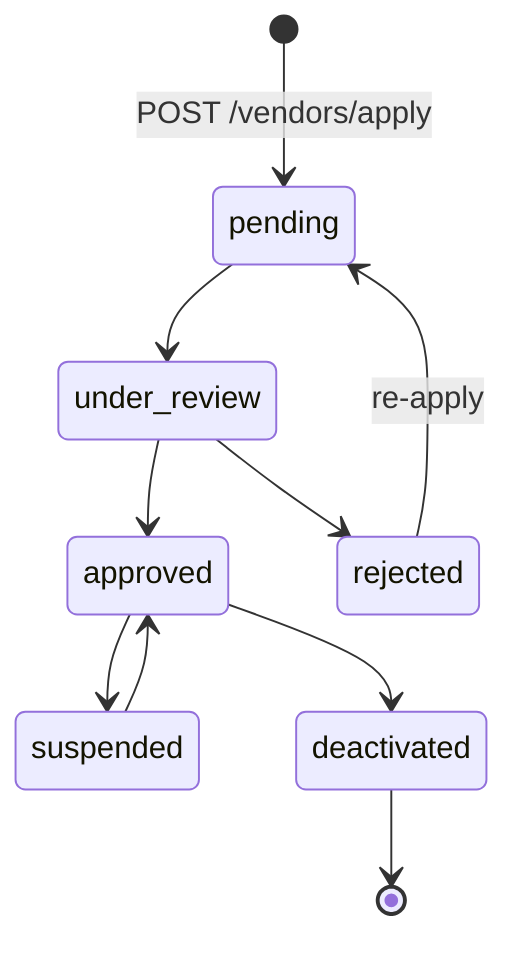
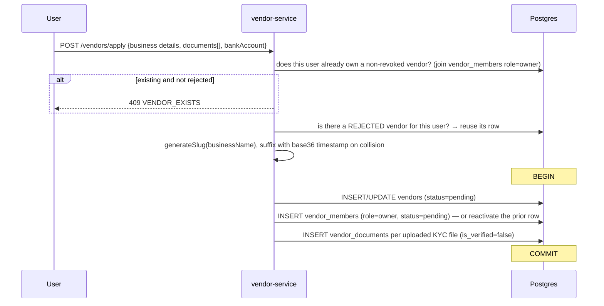
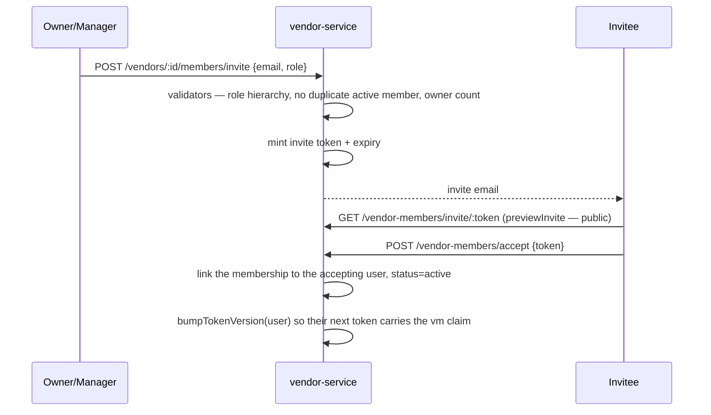
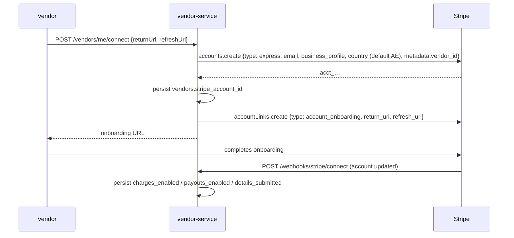

# 10 — vendor-service

Port **3004**. Owns the vendor entity and everything about *being* a vendor: application and KYC,
team membership and permissions, bank accounts, Stripe Connect onboarding, holidays, and the
vendor follow graph.

It does **not** own vendor payouts (order-service) or vendor products (product-service).

## Files

```
apps/vendor-service/src/
├── app.ts, index.ts, container.ts
├── domain/types.ts                    # VENDOR_TRANSITIONS + isValidTransition (pure)
├── controllers/vendor.controller.ts, vendor-follow.controller.ts
├── providers/payment/
│   ├── payment-provider.interface.ts  # PaymentProviderAdapter
│   └── stripe-connect.adapter.ts
├── services/
│   ├── vendor.service.ts              # apply, transition, admin CRUD, Connect
│   ├── vendor-member.service.ts       # invite/accept/decline/role/remove/transfer-ownership
│   ├── vendor-member.validators.ts
│   ├── vendor-bank-account.service.ts # encrypted; primary flag
│   ├── vendor-document.service.ts     # KYC upload/verify/reject
│   ├── vendor-settings.service.ts
│   └── vendor-follow.service.ts
├── routes/                            # vendor, vendor-admin, vendor-members, vendor-invites,
│                                      # vendor-follow, vendor-webhook, role-permissions-admin
└── jobs/
    └── expire-pending-invites.job.ts   # cron 0 3 * * *
```

## Vendor lifecycle

`domain/types.ts` (pure):



An invalid hop is `422 INVALID_TRANSITION`.

### Application — `VendorService.apply()`



**Applicant identity lives on `vendor_members`, not on `vendors`.** There is no
`vendors.user_id` column since "Phase 3b"; `findOwnerUserId(vendorId)` reads the owner membership
row. Anything reaching for `vendor.user_id` is stale.

### Approval — `VendorService.transition(id, "approved")`

1. Validate the transition.
2. Stamp `verified_at`.
3. `UPDATE vendor_members SET status='active', accepted_at=now() WHERE role='owner'` — returns
   the owner's `user_id`; a missing owner row is a hard `404 OWNER_MEMBERSHIP_MISSING`.
4. **`bumpTokenVersion(ownerUserId)`** so the owner's next token carries the `vm` claim and the
   vendor dashboard actually works.
5. Create a **default warehouse** (`WH-<first 8 of vendor id>`) from the application address if
   one does not exist — order-service stamps this as the fulfilment origin on every vendor order.

Rejection stores `rejection_reason`.

## Team members & permissions

`vendor_members(vendor_id, user_id, email, role, status, …)`. Roles: `owner`, `manager`, `staff`,
`viewer`. Statuses: `pending`, `active`, `revoked`.



- `POST /vendor-members/decline` and `POST /vendors/:id/members/:memberId/resend` complete the
  flow.
- `changeRole` and `remove` are guarded by `vendor-member.validators.ts` — you cannot demote or
  remove the last owner.
- `POST /vendors/:id/members/transfer-ownership` moves the owner role atomically.
- `expire-pending-invites.job.ts` (cron `0 3 * * *`) revokes stale pending invites.

Both a vendor-scoped surface (`/vendors/:id/members/*`) and an admin surface
(`/admin/vendors/:id/members/*`) exist over the same service.

### Role → permission matrix

Owned here: `GET /admin/role-permissions`, `PUT /admin/role-permissions/:role`. The write calls
`bumpMatrixVersion()` → Redis `INCR matrix_version`, and every service picks the change up within
30 s. See [02](02-cross-cutting.md#3-the-permission-matrix).

## KYC documents

`vendor_documents` — `type`, `file_url` (an S3 key), `file_name`, `is_verified`.

| Route | Actor |
|---|---|
| `POST /vendors/me/documents` · `GET /vendors/me/documents` | vendor |
| `GET /admin/vendors/:id/documents` | admin |
| `POST /admin/vendors/:id/documents` | admin uploads on the vendor's behalf |
| `PATCH …/documents/:docId/verify` · `/reject` · `PATCH`/`DELETE …/:docId` | admin |

The files themselves are in S3; a signed read URL comes from **product-service**
(`GET /media/kyc/:key/signed-url`), which owns the S3 plumbing.

## Bank accounts

`vendor_bank_accounts`, **encrypted at rest** with `config.vendor.encryptionKey`
(`VENDOR_ENCRYPTION_KEY` — a *different* key from the general `ENCRYPTION_KEY`; see
[02](02-cross-cutting.md#encryption)).

- `create`, `list` (masked), `update`, `setPrimary`, `remove`.
- Exactly one account per vendor carries `is_primary`, and `PayoutService.createDraft` refuses to
  build a draft without it.
- Full values are revealed only through order-service's audited
  `POST /admin/payouts/:id/reveal-bank`, which constructs its own `EncryptionService` with the
  vendor key.

Routes: `/vendors/me/bank-accounts` (vendor) and `/admin/vendors/:id/bank-accounts` (admin),
both with a `/primary` sub-route.

## Stripe Connect

`providers/payment/` defines a `PaymentProviderAdapter` interface with one implementation,
`StripeConnectAdapter`.



`GET /vendors/me/connect/status` reads the stored flags. The webhook is verified with
`config.stripe.connectWebhookSecret`; events other than `account.updated` are ignored.

`stripe_account_id` is what order-service's payout Stripe rail requires — a vendor without one
can still be paid by `manual_bank_transfer`.

## Vendor settings, holidays, deactivation

| Route | Effect |
|---|---|
| `GET /vendors/me` | the vendor's own record |
| `PATCH /vendors/me/settings` | profile, commission-visible fields, `auto_create_shipment` |
| `POST /vendors/me/deactivate` | self-service `approved → deactivated` |
| `POST/GET/DELETE /vendors/me/holidays[/:id]` | `vendor_holidays` |
| `PATCH /admin/vendors/:id/use-platform-shipping` | flips the vendor onto the platform carrier account |

**Vendor holidays are read by order-service** — a vendor whose holiday covers today is excluded
from the shipping computation in both the quote and checkout.

## Public vendor surface

| Route | Notes |
|---|---|
| `GET /vendors/by-slug/:slug` · `GET /vendors/:id/profile` | public (in `isPublicRoute`) |
| `GET/POST/DELETE /me/follows/vendors/:vendorId` · `GET /me/follows/vendors/recent` | the follow graph |

## Admin vendor surface

`/admin/vendors` — list, detail, create, update, `approve`, `reject`, `suspend`,
`use-platform-shipping`, plus the nested documents / bank-accounts / members routes above.

`listForAdmin` uses `withDeleted()`, so soft-deleted vendors remain visible to admins.

## Gaps

- `VendorApplyData` declares a required `bankAccount` block, but `apply()` never persists it —
  only documents are written. The vendor must add a bank account separately before a payout can
  be drafted, and nothing in the application flow tells them so.
- Vendor status has both `suspended` and `deactivated` terminal-ish states; only `suspended` can
  return to `approved`. `deactivated` is a dead end with no admin route to reverse it.
