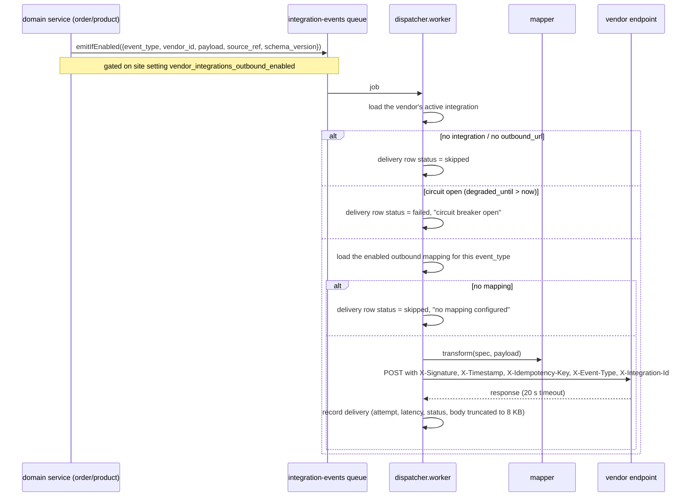
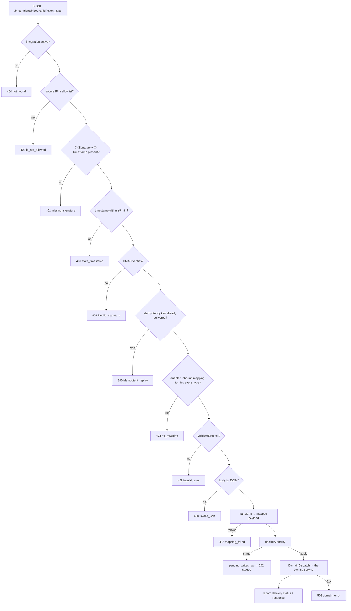
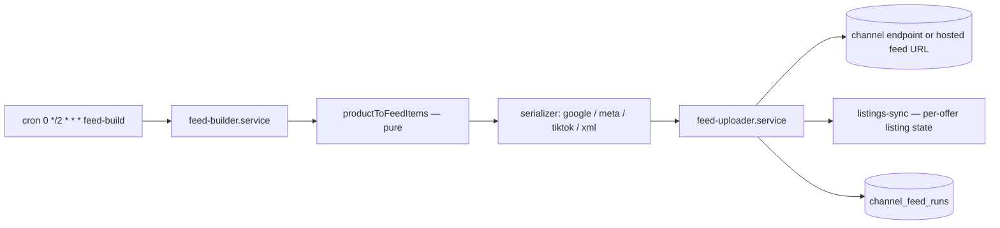

# 11 — integration-service

Port **3008**. Two largely independent subsystems live here:

1. **Vendor integrations** — a vendor connects their own ERP/OMS. MaterialHub pushes signed webhooks
   out, and accepts signed webhooks in that mutate orders, shipments, inventory and prices.
2. **Sales channels** — product feeds and server-side conversion events for Google, Meta,
   TikTok and Google Ads.

## Files

```
apps/integration-service/src/
├── app.ts, index.ts, container.ts
├── routes/  vendor-integrations · vendor-mappings · inbound · source-schemas
│            admin-pending-writes · channels-admin · replay · health
└── domain/
    ├── integration/    integration.service.ts (CRUD, secrets, test-fire)
    ├── mapping/        mapping.service.ts (spec upsert + validation)
    ├── dispatcher/     dispatcher.service.ts, dispatcher.worker.ts, signer.ts, circuit-breaker.ts
    ├── inbound/        inbound.service.ts, authority-gate.ts, idempotency.ts, domain-dispatch.ts
    ├── pending-writes/ pending-writes.service.ts
    ├── retention/      scrub-pii.cron.ts, retention-delete.cron.ts
    └── channels/       channel.service.ts, category-map.service.ts, credentials.ts
        ├── adapters/     google, google-ads, meta, tiktok
        ├── serializers/  google, meta, tiktok, xml
        ├── feed/         feed-builder, feed-uploader, listings-sync, feed-build.cron
        ├── delta/        delta.worker, delta-scan.cron
        └── conversions/  conversion.worker, conversion-event, pii-hash
```

Shared libraries: `@materialhub/integration-events` (queue + payload schemas + inbound targets) and
`@materialhub/integration-mapper` (the mapping DSL).

---

# Part 1 — Vendor integrations

## The entity

`vendor_integrations` — one per vendor:

| Column | Purpose |
|---|---|
| `outbound_url`, `outbound_secret_encrypted` | where we POST, and the HMAC key |
| `inbound_secret_encrypted` | the HMAC key we verify inbound requests with |
| `inbound_ip_allowlist` | optional source-IP restriction |
| `inventory_authority`, `pricing_authority` | `authoritative` or `advisory` |
| `degraded_until` | circuit-breaker state |
| `last_outbound_success_at`, `last_inbound_success_at` | health |
| `is_active` | kill switch |

Secrets are encrypted with `config.encryption.key`.

## The mapping DSL — `@materialhub/integration-mapper`

Vendors do not have to match our payload shape. A `MappingSpec` describes the translation:

```jsonc
{
  "version": 1,
  "constants": { "source": "materialhub" },
  "fields": [
    { "target": "order.ref",     "source": "vendor_order.vendor_order_number" },
    { "target": "order.status",  "source": "vendor_order.status",
      "value_map": { "confirmed": "NEW", "shipped": "DISPATCHED" }, "default": "UNKNOWN" },
    { "target": "order.total",   "expression": "divide(vendor_order.vendor_total, 100)" },
    { "target": "order.placed",  "expression": "formatDate(order.created_at, 'yyyy-MM-dd')" }
  ]
}
```

Per field, in order: `source` (dotted path) → `value_map` → `default` → or an `expression`.

Supported expression functions (`expressions.ts`) — **single call, no nesting**:
`formatDate(v, fmt)`, `concat(...[, sep])`, `multiply(v, n)`, `divide(v, n)`,
`default(v, fallback)`, `toUpper(v)`, `toLower(v)`. Arguments are either quoted literals, numbers,
or dotted source paths.

`validateSpec(spec)` is called before any mapping is saved **and** again at inbound time — a spec
that stopped validating yields `422 invalid_spec` rather than a mangled write.

`GET /vendor/integrations/:id/source-schema/:event_type` returns the shape of our payload for
that event, so a vendor can author a mapping against something concrete.

## Outbound



- Signature: `X-Signature: sha256=<HMAC(secret, timestamp + body)>` (`signer.ts`).
- Retryable statuses: **408, 429, 500, 502, 503, 504**, and any transport error. The worker
  rethrows so BullMQ retries; after the final attempt the delivery row is marked `dlq`.
- **Circuit breaker** (`circuit-breaker.ts` + a Redis sorted set of failure timestamps): **20
  failures in 5 minutes** sets `degraded_until`, and every subsequent job short-circuits to a
  `failed` delivery row until it expires. A successful delivery clears both the failure set and
  `degraded_until`.

`POST /vendor/integrations/:id/test-fire` sends a synthetic event so a vendor can verify their
endpoint. `POST /admin/integrations/:id/replay-bulk` re-sends past deliveries — those jobs carry
a `prebuiltBody`, which the worker passes through **verbatim**, skipping the mapping lookup so a
replay reproduces exactly what was originally sent.

## Inbound

`POST /integrations/inbound/:id/:event_type` — public at the JWT layer (the whole `/webhooks/`
family is), authenticated by HMAC inside the handler.



The idempotency key is the caller's `X-Idempotency-Key` if present, else a hash of the raw body
(`idempotency.ts`). Request headers are stored on the delivery row with `authorization` and
`x-signature` **redacted**.

### The authority gate

`authority-gate.ts` (pure) decides whether an inbound event applies directly or is **staged for
admin approval**.

Only three event types are gated (`inventory_adjust`, `product_update_price`,
`product_update_attribute`); everything else applies.

| Authority | Behaviour |
|---|---|
| `authoritative` | always apply |
| `advisory` + change within threshold | apply, flagged `autoApplied` |
| `advisory` + change beyond threshold | **stage**, flagged `thresholdBreached` |
| `advisory` + no threshold configured | stage |

Thresholds are percentage deltas (`inventoryDeltaPct` against current stock, `pricePct` against
the current price).

### Pending writes

Staged rows land in `vendor_integration_pending_writes`:

| Route | Action |
|---|---|
| `GET /admin/integrations/:id/pending-writes` | queue, filterable by status |
| `POST /admin/integrations/pending-writes/:id/approve` | approve → applied |
| `POST /admin/integrations/pending-writes/:id/reject` | reject |

### DomainDispatch — how an inbound event becomes a write

`domain-dispatch.ts` maps event type → an `/internal/*` call, signing a **1-minute** HS256 JWT
with `iss: "integration-service"` (verified by `internalServiceAuth` on the other side).

| Event type | Target |
|---|---|
| `order.accept` | `POST order-service /internal/vendor-orders/:id/transition` (action `accept`) |
| `order.reject` | same route, action `reject` |
| `shipment.create` | `POST order-service /internal/shipments` |
| `shipment.update_status` | `POST order-service /internal/shipments/:id/transition` |
| `inventory.adjust` | `POST product-service /internal/inventory/adjust` |
| `product.update_price` | `POST product-service /internal/products/:id/patch` |
| `product.update_attribute` | same route |

An unknown event type is a 400 before any network call.

**This is the only path by which an external system mutates MaterialHub's domain data**, and every
hop is authenticated: HMAC at the edge, then a signed internal JWT, then the target service's own
guard.

## Retention

Two crons scrub the delivery log, which stores full request/response bodies:

| Cron | Schedule | Action |
|---|---|---|
| `scrub-pii.cron.ts` | `0 4 * * *` | strip PII from stored bodies |
| `retention-delete.cron.ts` | `0 3 1 * *` (monthly) | delete aged delivery rows |

## Vendor-integration endpoints

| Method | Path |
|---|---|
| GET | `/vendor/integrations` · `/:id` · `/:id/deliveries` |
| POST | `/vendor/integrations` · `/:id/rotate-secret` · `/:id/test-fire` |
| PATCH/DELETE | `/vendor/integrations/:id` |
| GET | `/vendor/integrations/:id/mappings` |
| POST | `/vendor/integrations/:id/mappings/:direction/:event_type` |
| GET | `/vendor/integrations/:id/source-schema/:event_type` |
| POST | `/integrations/inbound/:id/:event_type` (HMAC) |
| GET/POST | `/admin/integrations/:id/pending-writes`, `/pending-writes/:id/(approve\|reject)` |
| POST | `/admin/integrations/:id/replay-bulk` |
| GET | `/health` |

---

# Part 2 — Sales channels

`sales_channels` rows (one per channel code) carry `is_enabled`, `config`, `feed_url`,
`feed_format`, `delta_enabled`, `credentials_encrypted`, and health columns
(`last_full_feed_at`, `last_full_feed_status`, `last_delta_success_at`, `degraded_until`).

Credentials never leave the service — `ChannelView` exposes only `has_credentials: boolean`.

## Feed build



`productToFeedItems(product, ctx)` is pure and encodes the eligibility policy:

- **Silently dropped** (not counted): digital products, age-restricted products, products whose
  vendor is not `approved`, and vendors with `exclude_from_channel_feeds`.
- **Excluded** (counted): offer ids on the channel's admin exclusion list — exclusion takes
  priority over data-quality skips.
- **Skipped** (counted): no primary image, price ≤ 0, or no description.

Each item carries `offer_id` (product or variant id), `item_group_id` for variant grouping,
title, description, link (`<web>/en/product/<slug>`), image, price/sale price, availability
(respecting `track_inventory` and `allow_backorder`), brand, GTIN/MPN, and the mapped channel
category.

Category mapping is admin-managed:
`GET/PUT /admin/sales-channels/:code/category-mappings`,
`DELETE /admin/sales-channels/category-mappings/:id`.

## Delta push

`delta-scan.cron.ts` (cron `*/5 * * * *`) finds products changed since the last successful delta
and enqueues `channel-delta-push`; `delta.worker.ts` sends incremental updates through the
channel adapter. Only channels with `delta_enabled` participate.

## Conversions

`publishOrderPaidForChannels(orderId)` in order-service enqueues onto
`channel-conversion-events`. `conversion.worker.ts` builds a `ConversionEvent` and posts it to
the channel's server-side API (Meta CAPI, TikTok Events, Google Ads).

Buyer identifiers are hashed before leaving the platform — `pii-hash.ts`.

## Sales-channel endpoints (admin)

| Method | Path |
|---|---|
| GET | `/admin/sales-channels` · `/:code` · `/:code/runs` · `/:code/deliveries` · `/:code/stats` |
| PATCH | `/admin/sales-channels/:code` |
| PUT | `/admin/sales-channels/:code/credentials` · `/:code/category-mappings` |
| DELETE | `/admin/sales-channels/category-mappings/:id` |
| POST | `/admin/sales-channels/:code/rebuild` |

`stats24h` reports feed-run outcomes (ok/fail/skipped) and delivery success rate.

See also `docs/runbooks/sales-channels.md`.

## Gaps

- `index.ts:59,83` — the cron wiring duplicates dependency construction from `container.ts`
  (`TODO Phase 4`). Two independent constructions of the same repositories and clients.
- The circuit breaker's failure set is keyed per integration in Redis but the threshold (20/5 min)
  is a module constant, not configurable per vendor.
