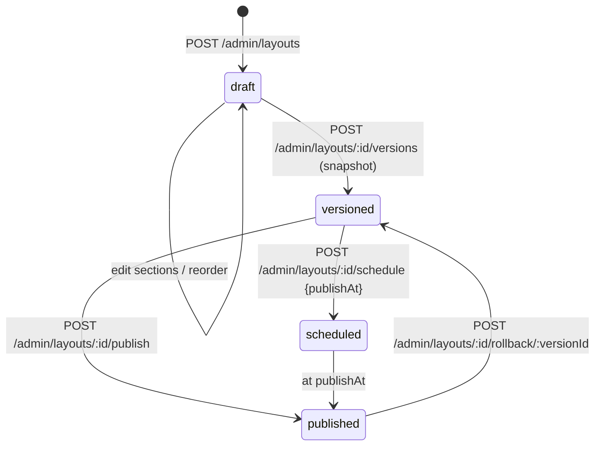
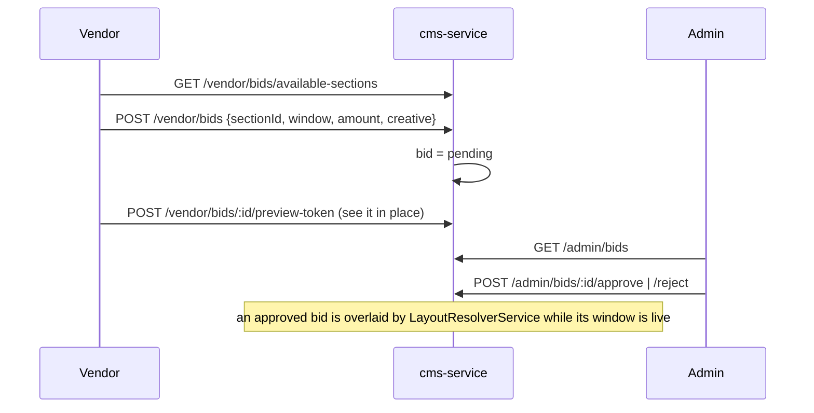
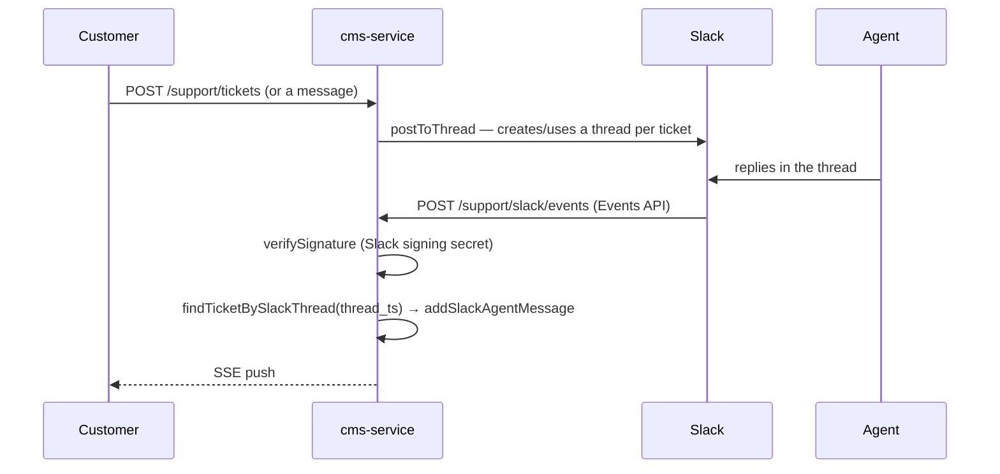

# 12 — cms-service

Port **3006**. Everything editorial and operational that is not catalogue: static pages, banners,
the composable page-layout system, vendor storefront layouts, header navigation, section bidding,
site settings, the customer-support desk (with Slack relay), and the platform audit log.

## Files

```
apps/cms-service/src/domain/
├── page/               static pages (slug + published state)
├── banner/             banners with an active window
├── layout/             page layouts, versions, sections, section types, resolver, vendor init
├── header-navigation/  draft/published mega-menu + CloudFront purge
├── bid/                vendors bid for placement in a layout section
├── setting/            site_settings (public + admin)
├── support/            tickets, messages, SSE stream, Slack relay + settings
└── audit/              /admin/audit-log reader
apps/cms-service/src/jobs/partition-maintenance.job.ts   # cron 0 3 * * 0
apps/cms-service/src/lib/ticket-events.ts                # in-process SSE fan-out
```

## Pages & banners

| Method | Path | Auth |
|---|---|---|
| GET | `/pages/published` · `/pages/:slug` | public |
| GET/POST/PUT/DELETE | `/pages[/:id]` | admin |
| GET | `/banners/active` | public-ish |
| GET/POST/PUT/DELETE | `/banners[/:id]` | admin |

Slugs are validated with `^[a-z0-9]+(?:-[a-z0-9]+)*$` at the DTO layer.

## Site settings

`site_settings(key, value, value_type, group, description)` — a typed key/value store used far
beyond CMS. Order-service reads `global_commission_rate`, `payout_settlement_window_days`,
`vendor_integrations_outbound_enabled` and `shipping.base_carrier_cost_fils`.

| Method | Path |
|---|---|
| GET | `/settings/public` (public subset) |
| GET | `/settings` (admin, everything) |
| PUT | `/settings/:key` (admin) |

## The layout system

The storefront's home page and other composable pages are assembled from **layouts** made of
ordered **sections**, each of a registered **section type**.

```
page_layouts ──< layout_sections >── section_types
     │                  │
     │                  └──< section_bids (vendor paid placement)
     └──< layout_versions (snapshots for rollback)
```

### Section types

A registry of what a section can be, with a settings schema. Public read
(`GET /section-types`) so the storefront knows how to render; admin CRUD at
`/admin/section-types`. Names are validated `^[a-z][a-z0-9_]*$`.

### Section data sources

`layout_sections.source_mode` decides where a section's content comes from:

| Mode | Content |
|---|---|
| manual | explicit blocks stored on the section |
| collection / query | resolved live from product-service via `data_source.query` |

Only the **collection slug** is exposed to the storefront (so "View all" can link correctly); the
rest of `data_source` stays server-side because it carries internal query shapes.

### Layout lifecycle



`POST /admin/layouts/:id/preview-token` mints a token so an editor can view an unpublished
layout on the live storefront.

Deleting a layout or a section cancels any bids attached to it
(`BidService.cancelBidsForLayout` / `cancelBidsForSection`, run on the caller's
`EntityManager`).

### Resolution

`GET /layouts/:slug/resolve` (**public**) → `LayoutResolverService.resolve()`, which:

1. loads the published layout and its sections in position order;
2. for each section, resolves manual blocks or executes the data source;
3. overlays any **approved section bid** whose window covers now;
4. attaches the vendor context (`id`, `slug`, `name`, `logo_url`, `banner_url`) for vendor
   layouts;
5. returns `{ id, type, position, settings, source_mode, collection_slug?, data }` per section.

### Vendor storefront layouts

Each vendor gets their own layout, initialised by `vendor-layout-init.service.ts`:

| Method | Path |
|---|---|
| POST | `/vendor-layouts/me/init` |
| GET | `/vendor-layouts/me` · `/vendor-layouts/:id` |
| POST | `/vendor-layouts/:id/sections` · `/preview-token` · `/schedule` · `/publish` |
| PUT | `/vendor-layouts/:id/sections/reorder` · `/sections/:sectionId` |
| DELETE | `/vendor-layouts/:id/sections/:sectionId` |

Same machinery as admin layouts, scoped to the vendor.

## Section bidding

Vendors bid for placement in specific layout sections (a paid-merchandising surface).



Vendors can `PUT /vendor/bids/:id` and `DELETE /vendor/bids/:id` (cancel) while pending.

## Header navigation

A single draft/published pair driving the storefront mega-menu.

| Method | Path | Auth |
|---|---|---|
| GET/PUT | `/admin/header-navigation/draft` | admin |
| POST | `/admin/header-navigation/publish` | admin |
| GET | `/navigation/header` | **public** |

`upsertDraft` validates the whole tree (`validate` / `validateTab`) before saving. `publish`
copies draft → published and triggers a **CloudFront invalidation**
(`header-navigation/cloudfront-purge.ts`), because the public navigation response is cached at
the edge.

## Customer support

Tickets are the one CMS surface open to unauthenticated users: guests are identified by the
`x-guest-session` header, signed-in users by `user_id` (`SupportService.ownerWhere`).

| Method | Path | Auth |
|---|---|---|
| POST | `/support/tickets` | optional |
| GET | `/support/tickets` · `/support/tickets/:id` | optional |
| POST | `/support/tickets/:id/messages` | optional |
| GET | `/support/tickets/:id/stream` | optional — **SSE** |
| GET | `/support/admin/tickets` · `/:id` | admin |
| PUT | `/support/admin/tickets/:id` | admin |
| POST | `/support/admin/tickets/:id/messages` | admin |

### Live ticket stream

`lib/ticket-events.ts` implements the SSE fan-out over **Redis pub/sub**, on the channel
`support:ticket:<ticketId>`:

- `publishTicketMessage(ticketId, payload)` uses one shared, lazily-connected publisher. It is
  **best-effort** — a failed publish resets the connection and is swallowed, because the message
  is already persisted and the client will see it on its next fetch or reconnect.
- `subscribeTicket(ticketId, onMessage)` opens a **dedicated** connection (Redis requires one per
  connection in subscribe mode) and returns a cleanup function that unsubscribes and quits.

`GET /support/tickets/:id/stream` authorises first (`getUserTicket` throws 404 if the caller does
not own the ticket), registers the abort handler **before** opening the Redis connection so a
disconnect mid-subscribe still cleans up, then streams messages plus a heartbeat. Guests are
identified by the `x-guest-session` header or a `?guest_session=` query parameter, since not every
SSE client can set headers.

`markSlackEventSeen(eventId, ttl)` deduplicates Slack Events API redeliveries with `SET NX EX`,
and **fails open** — if Redis is unavailable it returns `true` so a real event is never dropped,
at the cost of a possible duplicate during an outage.

### Slack relay



`/support/slack/events` is in `isPublicRoute` — it is authenticated by the **Slack request
signature**, not a JWT.

Settings: `GET/PUT /support/admin/slack-settings`, `POST /support/admin/slack-settings/test`
(`testConnection()` returns the Slack team name or an error).

## Audit log

`GET /admin/audit-log` reads `audit_log`, filterable by `entity_type`, `entity_id`, `action`,
`actor_id` and date range. This is the reader for rows written by `auditPlugin` **and** by
services that write audit rows directly (notably `PayoutService.writeAudit`).

The table is partitioned; `jobs/partition-maintenance.job.ts` (cron `0 3 * * 0`, Sundays 03:00)
creates upcoming partitions. If that job stops running, inserts eventually fail for want of a
partition.

## Public vs gated routes

Public (via `isPublicRoute`): `/layouts/*`, `/section-types*`, `/navigation/header*`,
`/support/slack/events`. Optional-auth: the customer `/support/tickets*` family.
Everything under `/admin/*` and `/vendor/*` is gated.
