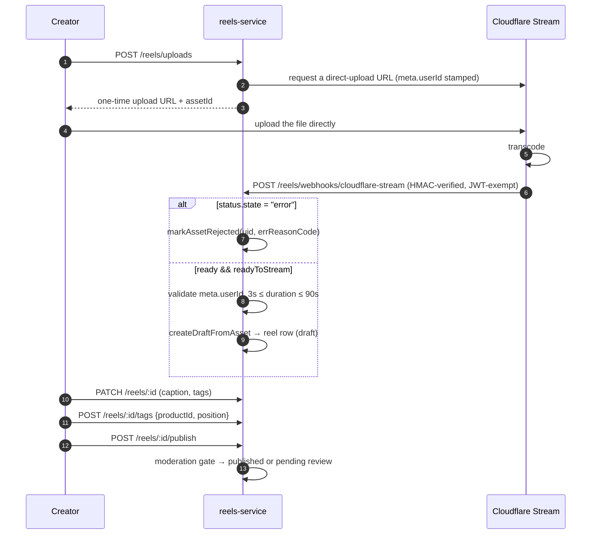
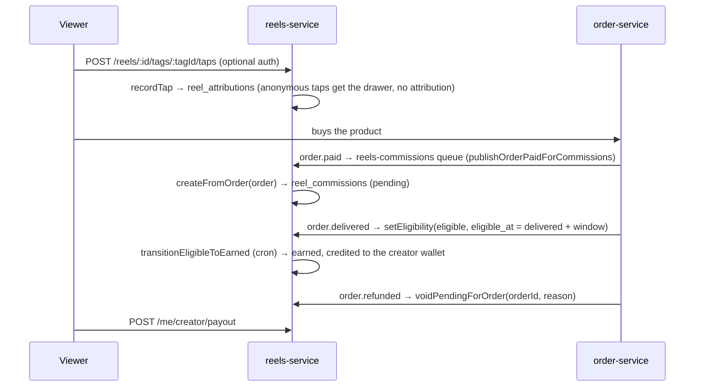
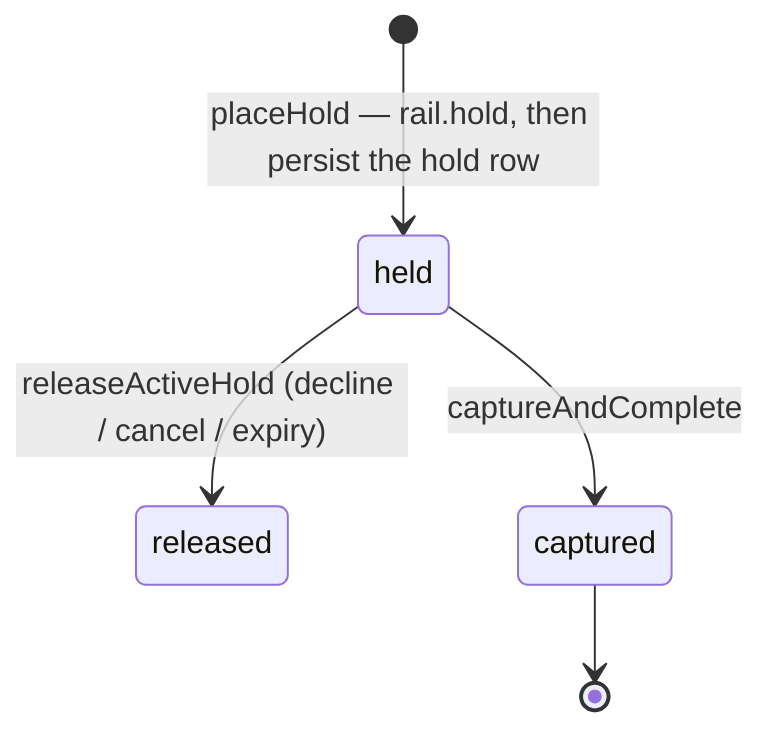
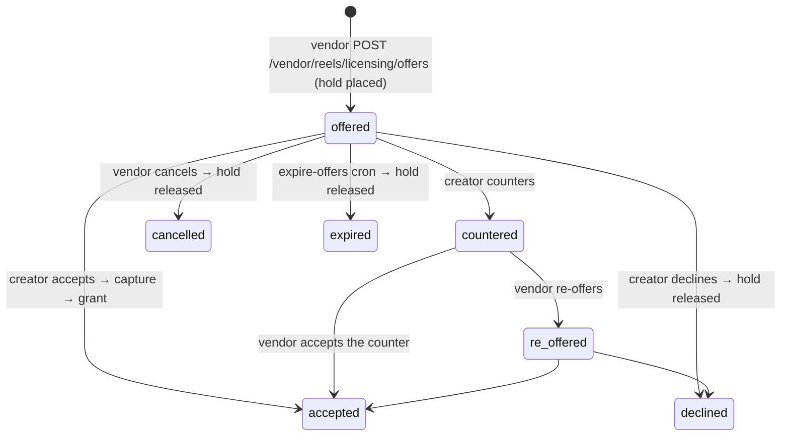

# 13 — reels-service

Port **3007**. Short-form video commerce: creators upload reels, tag products, earn commission on
attributed purchases, and license their footage to vendors. It also owns the **public user
profile and follow graph** (`/users/*`).

Video hosting is Cloudflare Stream; reels-service never handles the video bytes.

## Domain map

```
apps/reels-service/src/domain/
├── upload/          cloudflare-stream.client, webhook.handler, recovery job
├── reels/           reels.service (draft→publish), reel-tag.service, taggable-products, active-vendor
├── moderation/      moderation queue, tagging permissions
├── feed/            feed.service, ranking.service, cohort cache + invalidation, hot categories
├── social/          like, save, share, view, follow
├── commerce/        attribution, commission, creator wallet, payout
├── creator-tier/    creator applications, trust, graduation/veto
├── licensing/       offers, counters, briefs & bids, escrow engine, funding rails, rights
├── analytics/       daily rollups, admin + vendor analytics, CSV export
└── nudge/           post-delivery "make a reel" prompt
```

## Upload → publish



Webhook payload shape: Cloudflare puts the video object at the **top level** — there is no
`{eventType, data}` wrapper. Rejection reasons recorded today: `transcode_failed`,
`missing_user_id`, `duration_too_short`, and a max-duration rejection at 90 s.

`cloudflare-stream-recovery.job.ts` (queue `reels-cloudflare-stream-recovery`) polls for assets
whose webhook never arrived — the webhook is the only completion signal, so without this a lost
delivery would strand a reel in limbo forever.

## Product tagging

`reel_tags` bind a reel to a product with a position. Who may tag what is constrained:

- `taggable-products.service.ts` + `taggable-products.fetchers.ts` call product-service's
  internal routes (`GET /internal/products/by-vendor`, `/by-permission`).
- `verified-purchase.guard.ts` calls order-service's
  `GET /internal/orders/verified-purchase` — a creator may tag a product they actually bought.
- `tagging-permissions.service.ts` + `/admin/reels/tagging-permissions` let admins grant explicit
  tagging rights.
- `active-vendor.ts` resolves which vendor a tag is attributed to.

`GET /me/reels/taggable-products` is what the composer calls.

## Moderation

| Route | Action |
|---|---|
| `GET /admin/reels/queue` | pending queue |
| `POST /admin/reels/:id/approve` · `/reject` · `/flag` | decisions |

## Feed & ranking

`RankingService.computeScore` is pure — a Hacker-News-style gravity decay:

```
numerator   = likes×1 + saves×2 + shares×3 + tapes×3 + attributedPurchases×10
denominator = (ageHours + 2) ^ 1.5
score       = numerator / denominator      (0 when the numerator is 0)
```

An attributed purchase is worth ten likes: the feed optimises for commerce, not engagement.

Feeds are precomputed into **cohorts** (roughly: category slices) and cached in Redis
(`feed-cache.client.ts`). Four jobs maintain them:

| Job | Trigger |
|---|---|
| `recompute-ranking.job` | interval — rescore reels |
| `recompute-cohort-feeds.job` | interval — rebuild cohort lists |
| `refresh-hot-categories.job` | interval — which cohorts are hot |
| `invalidate-category-cohort.job` | on write, via `category-cohort-invalidator.ts` |

`GET /reels/feed` is **optional-auth**: a signed-in viewer gets personalised de-duplication
against their watch history; anonymous viewers get the raw cohort.

`hydrate-feed-tags.ts` attaches product-tag payloads to feed items so the drawer renders without
a second call.

## Social

| Route | Notes |
|---|---|
| `POST /reels/:id/like` · `/save` · `/share` | authenticated |
| `POST /reels/:id/views` | **optional-auth** — anonymous posts are no-ops |
| `POST /users/:userId/follow` · `GET /users/:userId/followers` · `/following` | follow graph |
| `GET /me/reels/saved` · `/watch-history` | |
| `GET /users/:userId` | **optional-auth** public profile; a signed-in viewer gets `isSelf` |

## Commerce: attribution → commission → payout



- Anonymous viewers can open the product drawer but earn no attribution
  (`attribution.routes.ts` is optional-auth for exactly this reason).
- `attribution-merge.service.ts` + `POST /reels/attributions/merge` fold a guest session's
  attributions into a user account at sign-in.
- `creator-wallet.service.ts` holds the balance; `payout.service.ts` pays it out.
- Creator-facing: `GET /me/creator/summary` · `/commissions`, `POST /me/creator/payout`.

## Creator tiers

- `POST /me/creator/apply`, `GET /me/creator/application`.
- Admin review: `GET /admin/creators/applications[/:id]`,
  `POST …/approve | /reject | /request-info`.
- `trust.service.ts` — `isTrusted(userId)` gates auto-publication.
- `graduation.service.ts` — creators auto-graduate to a higher tier after a window, with an
  admin **veto** window: `GET /admin/creators/pending-veto`, `POST /admin/creators/:userId/veto`.
- Tier can also be set directly by an admin via auth-service
  (`PATCH /admin/users/:id/creator-tier`).

## Licensing & escrow

Vendors pay creators to license reel footage for their own marketing. This is real money moving
between two non-platform parties, so it uses an escrow model.

### Entities

`reel_license_offers`, `reel_license_offer_events`, `reel_license_grants`,
`reel_license_escrow_holds`, `reel_license_briefs`, brief bids, and grant "features"
(where the licensed reel is displayed).

### Funding rails

`funding-rail.ts` defines a `FundingRail` interface — `hold` / `capture` / `release` — with two
implementations:

| Rail | File | Mechanism |
|---|---|---|
| `payout_balance` | `payout-balance-rail.ts` | reserves against the vendor's unpaid earnings; the hold is later deducted by order-service's `computePayoutTotals` as `license_spend_total` |
| `stripe_charge` | `stripe-charge-rail.ts` | a manual-capture Stripe PaymentIntent against a vendor payment method |

### `EscrowEngine`



Two invariants the engine enforces:

1. **The irreversible rail operation is always last.** `placeHold` calls `rail.hold` as its final
   step before persisting; `captureAndComplete` runs the caller's `beforeCapture` hook (status
   updates + audit events) *before* `rail.capture`. A crash therefore never leaves money moved
   with no record.
2. The engine runs entirely on the **caller's `EntityManager`**, so hold/capture join the
   caller's transaction.

On capture: `fee = round(gross × feeRate)`, `net = gross − fee`, a `reel_license_grant` is
created, and the creator's wallet is credited with the net.

### Offer negotiation



Every transition writes a `reel_license_offer_events` row, readable at
`GET …/offers/:id/events` from both sides.

### Briefs

The inverse market: a vendor posts a brief, creators bid with delivered footage.

| Actor | Routes |
|---|---|
| Vendor | `POST/GET/PATCH /vendor/reels/licensing/briefs[/:id]`, `/cancel`, `/bids/:bidId/(accept\|approve\|revise\|reject)` |
| Creator | `GET /me/creator/licensing/briefs`, `POST …/briefs/:id/bids`, `/withdraw`, `/deliver`, `GET /me/creator/licensing/bids` |
| Public | `GET /reels/briefs/open` — non-sensitive fields only |

`expire-briefs.job` and `expire-offers.job` (cron) release holds on anything that times out.

### Rights & features

`rights.service.ts` enforces a grant's `scope`. `POST /vendor/reels/licensing/grants/:id/feature`
places a licensed reel on a surface (PDP, storefront); `DELETE …/features/:featureId` removes it;
`POST …/grants/:id/download` produces a signed download via `download-provider.ts`.

`GET /reels/featured` is **public** — the licensed reels shown on the storefront/PDP.

`GET /vendor/reels/licensing/balance` shows the vendor's available payout balance for the
`payout_balance` rail.

## Discovery & shortlist (vendor side)

| Route | Purpose |
|---|---|
| `GET /vendor/reels/discovery/mine` | reels tagging this vendor's products |
| `GET /vendor/reels/discovery/browse` | the wider catalogue of creator reels |
| `GET/POST/DELETE /vendor/reels/shortlist[/:reelId]` | shortlist candidates before offering |

## Analytics

`recompute-daily-rollups.job` (cron `15 2 * * *` UTC) builds daily aggregates.

| Route | Scope |
|---|---|
| `GET /admin/reels/analytics/overview` · `/leaderboard` · `/leaderboard.csv` | platform |
| `GET /vendor/reels/analytics/overview` · `/leaderboard` · `/leaderboard.csv` | vendor |

## Post-delivery nudge

`reels-nudges` queue + `post-delivery-nudge.service.ts` — when an order is delivered,
order-service publishes to the queue and reels-service prompts the buyer to make a reel about
what they bought.

## Gaps

- `container.ts:111` — `TODO(M2): replace with a real Redis client once the adapter lands`. The
  feed cache client is not on a real Redis client in this build.
- `commerce/payout.service.ts:169` — a `M4 TODO` notes an operation is inside a transaction that
  should move out once real Stripe wiring lands.
- reels-service mounts its own Swagger at `/api/docs`, but the gateway has no prefix routing it
  there, so it is unreachable from outside.
