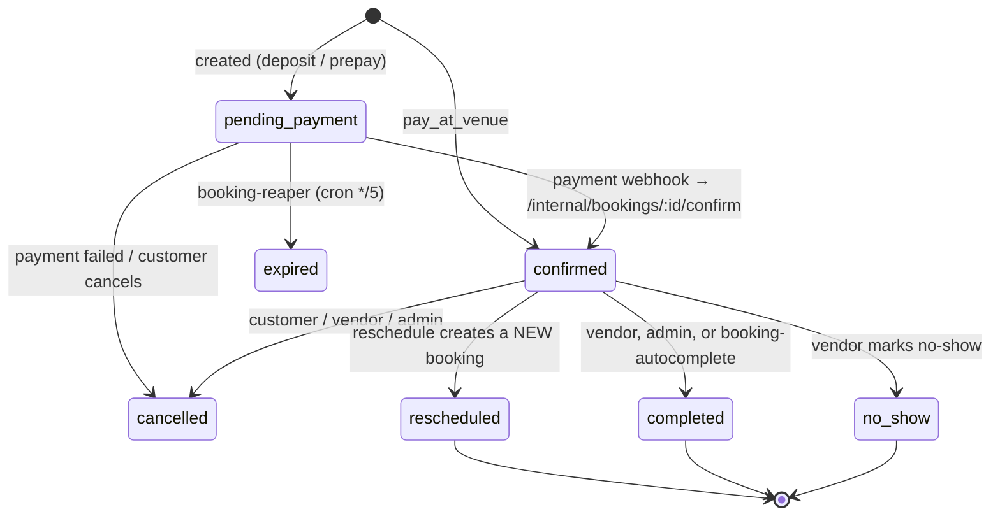

# 14 — booking-service

Port **3009**. Appointment booking for services (salons, home visits). It owns availability,
staff, engagements, bookings, calendars and service reviews.

It owns **no money**. Every Stripe interaction is delegated to order-service over
`/internal/booking-payment/*`, and the `payments` and `commissions` rows for a booking live in
order-service's tables.

The catalogue side — `service_offerings` — is owned by **product-service**.

## Domain map

```
apps/booking-service/src/domain/
├── availability/   availability.service, interval-math (pure), availability-cache
├── booking/        booking.service (the central transaction), status, hold, completion,
│                   cancel, reschedule, no-show, strikes, commission snapshot, reaper,
│                   auth job, autocomplete job, booking-policy (pure), booking-money
├── staff/          staff CRUD, staff↔location, staff↔offering eligibility
├── working-hours/  weekly rules + time off
├── location/       vendor branches + home-visit service areas
├── manage/         the vendor "front desk": manual bookings, blocks, calendar, memberships
├── calendar/       iCal export (signed feed) + iCal import (subscriptions)
├── reminders/      T-24h / T-1h reminder scheduling
├── engagement/     the staff-time ledger
└── reviews/        service reviews + rating aggregates
```

## Core model

```
service_offerings (product-service)
        │
        ├── staff_members ──< staff_working_hours, staff_time_off
        │        │
        │        └──< staff_engagements   ← the single time ledger, GiST EXCLUDE
        │
        ├── vendor_locations (branches) + service_areas (home visit)
        └── bookings ──> staff_engagement
```

**`staff_engagements` is the one table that decides whether a staff member is busy.** Every
consumption of time — a marketplace booking, a walk-in, a phone booking, an imported external
calendar event, a manual block, a break — is a row with an `EngagementKind`. A GiST `EXCLUDE`
constraint over `(staff_member_id, time range)` prevents overlap across *all* kinds at once, so
double-booking is impossible at the database level.

Engagement statuses: `held`, `confirmed`, `released`, `cancelled`, `conflicted`. Only `held` and
`confirmed` are inside the EXCLUDE predicate — `conflicted` is deliberately outside it so an
iCal import can land an overlapping external event and *surface* the collision rather than
silently dropping it.

A `23P01` (exclusion violation) surfaces as a `ConflictError` from
`EngagementService.reserve`, mapped by the pg error code, not by message text.

## Availability

`GET /services/:slug/availability` — public. (The gateway routes this one path to
booking-service via an explicit regex, because `/services/*` otherwise belongs to
product-service.)

`AvailabilityService.getAvailability()` composes:

1. eligible staff for the offering (`resolveEligibleStaff` — staff↔offering links, location
   membership, active status);
2. each staff member's weekly working hours minus time off, vendor holidays and existing
   engagements;
3. slot generation at the offering's duration + buffers;
4. a minimum-notice window.

All the interval arithmetic lives in `interval-math.ts`, which is **pure** — no DB, no Redis, no
`Date.now()` — so it unit-tests without Postgres.

Results are cached per **staff/day** in Redis for `config.cache.availabilityTtl` (300 s).
Write paths (working hours, time off, holidays, bookings, blocks) invalidate; the short TTL caps
staleness if an invalidation is ever missed.

`GET /booking/offerings/:id/staff` (public) lists the eligible staff for a booking UI.

## Holds

Before a customer pays, the slot is held in Redis so two people cannot check out the same slot.

`BookingHoldService`:

- `hold(staffId, slotRange)` → an opaque token, via a Lua script (atomic set-if-absent + TTL).
- `release(token)`.
- `assertHeld(token)` — is this token still live?
- **`assertHeldFor(token, staffId, range)`** — is it bound to *exactly* this staff member and
  slot? This is the one `create()` uses; merely holding "some" live token is not enough.

`POST /bookings/hold` returns `{ holdToken, expiresInSeconds, staffMemberId, allowedPaymentModes }`.

## Booking creation

```mermaid
sequenceDiagram
    autonumber
    participant C as Customer
    participant B as booking-service
    participant R as Redis
    participant DB as Postgres
    participant O as order-service
    participant ST as Stripe

    C->>B: POST /bookings/hold {offeringId, startsAt, endsAt, staffMemberId?, locationId?}
    B->>B: resolve offering + eligible/free staff via AvailabilityService
    B->>R: hold(staffId, range)
    B-->>C: holdToken + allowedPaymentModes

    C->>B: POST /bookings {…, holdToken}
    B->>B: assertHeldFor(holdToken, staffId, range)
    B->>B: StrikeService — is pay_at_venue still allowed for this customer?
    Note over DB: BEGIN
    B->>DB: INSERT staff_engagements (held)   ← EXCLUDE enforces no overlap
    B->>DB: INSERT bookings (pending_payment) with full price/VAT/deposit/policy/commission snapshot
    Note over DB: COMMIT
    B->>R: release(holdToken)   (also released on ANY failure)

    alt payment_mode = deposit
        B->>O: POST /internal/booking-payment/intent  (capture-now PaymentIntent)
        O->>ST: paymentIntents.create {metadata.booking_id}
        B-->>C: clientSecret
    else payment_mode = prepay
        B->>O: POST /internal/booking-payment/setup   (SetupIntent — verify + save the card)
        O->>ST: setupIntents.create {metadata.booking_id}
        B-->>C: clientSecret
    else payment_mode = pay_at_venue
        B->>B: confirmPayAtVenue — immediately confirmed, nothing to pay now
    end

    ST->>O: webhook (payment_intent.succeeded | setup_intent.succeeded)
    O->>B: POST /internal/bookings/:id/confirm
    B->>B: engagement held → confirmed; schedule auth / autocomplete / reminder jobs
```

The booking row snapshots **everything the customer agreed to**: price, VAT, deposit amount and
type, the cancellation policy (`cancellation_window_hours`, `cancellation_refund_policy`,
`cancellation_penalty_percent`), and the commission rate/amount. A later vendor edit cannot
change an existing deal.

Booking numbers are `BK<base36 timestamp><random>`, capped at 30 chars.

## Payment modes

| Mode | At booking | At completion |
|---|---|---|
| `pay_at_venue` | nothing — confirmed immediately | vendor collects cash; commission accrues on completion |
| `deposit` | capture-now PaymentIntent for `deposit_fils` | remainder collected at the venue |
| `prepay` | SetupIntent verifies and saves the card (no money moves) | off-session authorization then capture |

`DepositType` is `percent`, `fixed` or `none`.

### Prepay: the authorization job

Because a card authorization expires, prepay does not authorize at booking time. `booking-auth`
(`booking-auth.job.ts` / `booking-auth.service.ts`) schedules an **off-session authorization** so
the auth is still valid when the service happens.

`AUTO_COMPLETE_DELAY_HOURS` in `booking-auth.service.ts` **hardcodes the same 24 hours** as
`config.bookings.autoCompleteGraceHours`. Changing the env var without updating that constant can
let an authorization expire before auto-complete captures it. Do not change one without the other.

### Auto-complete

`booking-autocomplete` fires at `ends_at + autoCompleteGraceHours` (default 24 h): the booking is
marked `completed`, the payment captured, and the commission accrued.

## Booking status machine



`rescheduled` is a **transient marker on the old row**; the new booking and engagement carry the
live state forward. `transitionThroughRescheduled` writes the audit trail
`confirmed → rescheduled → confirmed` across the pair.

`BookingStatusService.transition()` also fires the post-transition hooks — schedule or remove the
auth / autocomplete / reminder jobs (`fireDelayedJobCleanup`), notify the vendor, invalidate the
availability cache.

`confirm()` is **idempotent on any non-`pending_payment` status**, which is what makes a
redelivered Stripe webhook safe.

## Cancellation, no-show and strikes

`booking-policy.ts` is pure and holds all the money-decision maths:

```
withinWindow = (startsAt − now) ≥ cancellation_window_hours

forfeit =
  withinWindow                  → 0                        (in-window always refunds in full)
  policy = full                 → 0
  policy = deposit_forfeit      → deposit_fils
  policy = percent              → round(amountPaid × penalty%)
  …then clamped to [0, amountPaid]

refund = amountPaid − forfeit
```

A no-show has no window concept, so it applies the same per-policy forfeit an out-of-window
cancellation would.

`isWithinRescheduleWindow(now, startsAt, hours)` gates **customer** self-reschedule; vendor and
admin actors bypass it at the service layer.

### No-show strikes

`StrikeService` never stores a counter — it counts
`bookings WHERE status='no_show' AND customer_user_id=… [AND vendor_id=…]` on demand.

| Threshold | Env | Default | Effect |
|---|---|---|---|
| per vendor | `BOOKING_NOSHOW_VENDOR_STRIKE_THRESHOLD` | 3 | `pay_at_venue` revoked **at that vendor** |
| platform-wide | `BOOKING_NOSHOW_PLATFORM_STRIKE_THRESHOLD` | 8 | `pay_at_venue` revoked **everywhere** |

`POST /bookings/hold` reflects this in `allowedPaymentModes`; `create()` still enforces it with a
`422 pay_at_venue_unavailable` backstop.

## The reaper

`booking-reaper.job.ts`, cron `*/5 * * * *` — expires `pending_payment` bookings older than
`BOOKING_PENDING_EXPIRY_MINUTES` (default 60), releases their engagement, and voids the Stripe
intent through order-service. It resolves a deposit's `gateway_payment_id` with a **direct DB
read** of order-service's `payments` table (the two services share one Postgres).

## Money delegation — `BookingPaymentClient`

Every call is a signed internal JWT (`iss: "booking-service"`, verified by `internalServiceAuth`)
to order-service:

| Client method | Route | Purpose |
|---|---|---|
| `setup` | `POST /internal/booking-payment/setup` | SetupIntent (prepay) |
| `authorize` | `…/authorize` | off-session authorization |
| `intent` | `…/intent` | capture-now PaymentIntent (deposit) |
| `capture` | `…/capture` | capture an authorization |
| `void` | `…/void` | void an authorization |
| `refund` | `…/refund` | refund |
| `complete` | `…/complete` | capture **and** accrue the commission, in one transaction |

`/complete` is the important one: order-service runs the capture and
`CommissionService.createForBookingInTx` inside a single transaction, so a booking can never be
captured without its commission (or vice versa). The commission is inserted `held` with
`settle_after = now + settlement window`, matching the order path
(see [09](09-commissions-and-payouts.md#booking-commissions)).

`CommissionSnapshotService.resolve()` computes the rate at booking time using the same
priority chain and rounding convention as order-service's `CommissionService`.

## Calendars

### Outbound — signed iCal feed

`GET /calendar/staff/:id/feed.ics?token=…`

- Public at the JWT layer, authenticated by an **HMAC token** (`ical-feed-token.ts`) signed with
  `config.bookings.icalFeedSecret`.
- The token is **long-lived by design** — a subscribed calendar app polls indefinitely and cannot
  send a bearer token. Revocation is a **global secret rotation** only; per-staff revocation is
  not implemented.
- `icalFeedSecret` is a lazy getter so a missing `BOOKING_ICAL_FEED_SECRET` fails only in
  booking-service rather than crash-looping all ten services.
- The public bypass in `jwt-auth.ts` is narrowed to GET/HEAD on the exact `.../feed.ics` shape.

`POST /manage/staff/:id/calendar-feed-url` issues the URL.

### Inbound — external calendar subscriptions

`PUT/GET/DELETE /manage/staff/:id/calendar-subscription` registers an external iCal URL.
`ical-import.job.ts` (cron `*/15 * * * *`) fetches and parses it
(`ical-parse.ts`, `ical-recurrence.ts` for RRULE expansion) and lands each event as a
`staff_engagements` row of kind `external_import`. An event overlapping an existing engagement is
inserted as `conflicted` rather than rejected, so the vendor sees the clash.

`ical-fetch-guard.ts` bounds the fetch (size, timeout, redirects).

## The vendor front desk — `/manage`

| Route | Purpose |
|---|---|
| `POST /manage/bookings` | manual walk-in / phone booking |
| `POST /manage/bookings/:id/complete` · `/no-show` · `/reschedule` | actions on any booking |
| `POST/GET/DELETE /manage/blocks[/:id]` | block time / breaks |
| `GET /manage/calendar` | the day/week view |
| `GET /manage/my-location-memberships` · `/locations/:id/members` (GET/POST/DELETE) | who works where |

`/manage` actions delegate to the **same** services the customer routes use
(`bookingStatusService.completeBooking`, `noShowService`, `rescheduleService`) with an
authorization layer in front — there is no parallel implementation.

## Staff, working hours, locations

| Route | Purpose |
|---|---|
| `POST/GET/PATCH /vendor/booking/staff[/:id]` | staff CRUD |
| `GET /vendor/booking/staff/eligible` | staff eligible for an offering |
| `GET/POST/DELETE /vendor/booking/staff/:id/locations[/:locationId]` | branch assignment |
| `GET/POST/DELETE /vendor/booking/staff/:id/services[/:offeringId]` | which services they perform |
| `POST/GET/DELETE /vendor/booking/staff/:id/working-hours[/:ruleId]` | weekly rules |
| `POST/GET/DELETE /vendor/booking/staff/:id/time-off[/:offId]` | time off |
| `POST/GET/PATCH /vendor/booking/locations[/:id]` | branches |
| `POST/GET/DELETE /vendor/booking/service-areas[/:id]` | home-visit coverage |
| `GET /booking/vendors/:id/locations` | **public** — a vendor's active branches |

## Reviews

`service_reviews` is owned here and deliberately kept separate from product-service's `reviews`
— sharing one Postgres enum type would couple the two schemas across a service boundary.

| Route | Actor |
|---|---|
| `POST /bookings/:id/review` | customer, after completion |
| `POST /vendor/booking/reviews/:id/reply` | vendor |

`service-review-rating.service.ts` maintains the offering's rating aggregate, which
product-service's service-search index reads.

## Reminders

`ReminderScheduler` schedules two delayed jobs at confirm time — **T-24 h** and **T-1 h** before
`starts_at` — on the `booking-reminder` queue. Each carries a stable `event_id` per
(booking, offset, slot) that becomes the notification-dispatch `jobId`, so a replayed source job
is a no-op instead of a duplicate email. Reschedule and cancel re-time or remove them.

## Endpoints (customer & admin)

| Method | Path | Actor |
|---|---|---|
| POST | `/bookings/hold` · `/bookings` | customer |
| GET | `/bookings/:id` · `/me/bookings` | customer |
| POST | `/bookings/:id/reschedule` · `/cancel` · `/review` | customer |
| POST | `/bookings/:id/no-show` | vendor |
| GET | `/admin/bookings` · `/admin/bookings/:id` | admin |
| POST | `/admin/bookings/:id/complete` | admin |
| POST | `/internal/bookings/:id/confirm` · `/payment-failed` | order-service |
| GET | `/services/:slug/availability` · `/booking/offerings/:id/staff` · `/booking/vendors/:id/locations` | public |
| GET | `/calendar/staff/:id/feed.ics` | token-signed |
