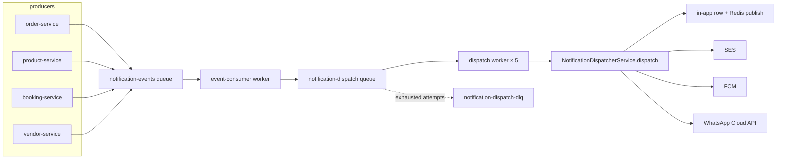
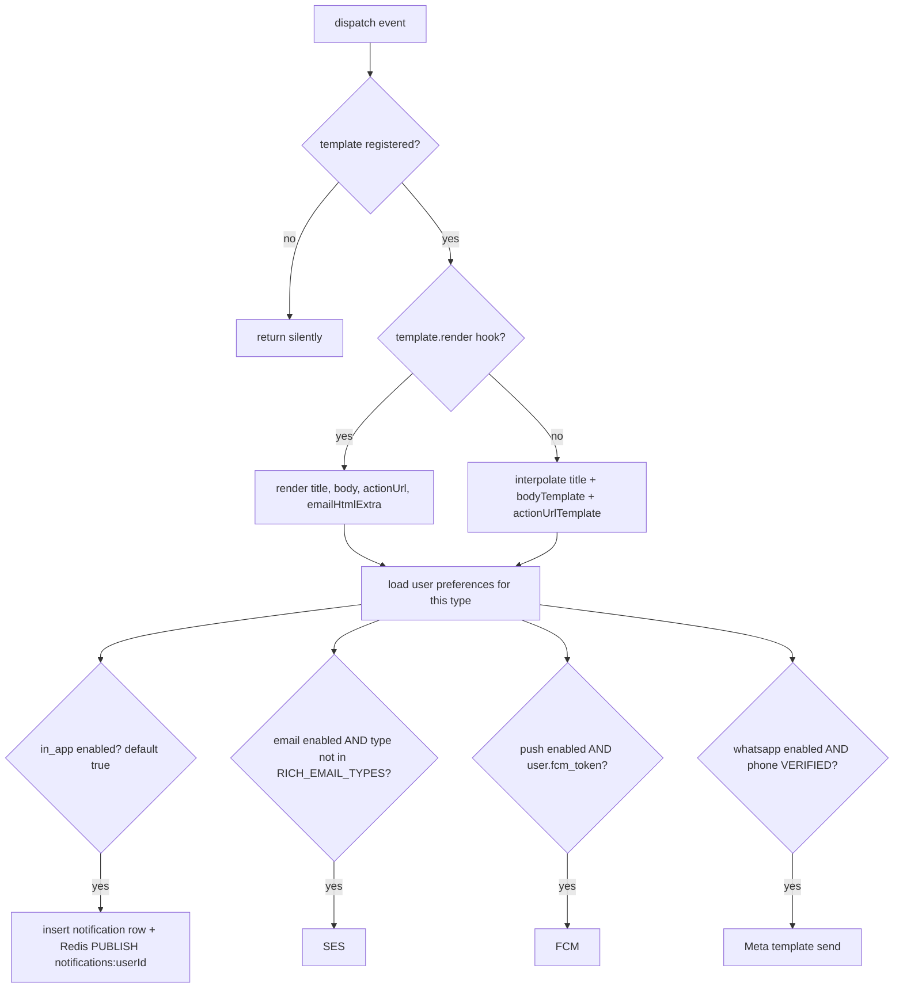

# 15 — notification-service

Port **3005**. Turns domain events into messages across four channels — in-app, email, push and
WhatsApp — honouring per-user, per-type, per-channel preferences. Also owns the newsletter.

## Files

```
apps/notification-service/src/
├── app.ts, index.ts, container.ts
├── routes/       notification · notification-preference · newsletter · whatsapp-webhook
├── controllers/  thin
├── services/
│   ├── notification.service.ts             # the notifications table
│   ├── notification-dispatcher.service.ts   # the fan-out decision
│   ├── notification-preference.service.ts
│   ├── email-dispatcher.ts                 # SES
│   ├── push-dispatcher.ts                  # FCM
│   ├── whatsapp-dispatcher.ts              # Meta Cloud API (+ a stub)
│   ├── order-email.service.ts              # rich transactional order emails
│   ├── newsletter.service.ts
│   └── partition-maintenance.service.ts    # notifications table partitions, every 24 h
├── domain/
│   ├── templates.ts                        # the notification-type registry
│   ├── order-email-templates.ts
│   └── whatsapp-templates.ts               # type → approved Meta template
├── repositories/
└── jobs/
    ├── event-consumer.job.ts               # notification-events → dispatch jobs
    └── notification-dispatch.job.ts        # notification-dispatch (+ DLQ)
```

## The pipeline



Two queues, deliberately: `notification-events` carries **domain** events (an order changed
status); `notification-dispatch` carries **per-user delivery** jobs. One domain event fans out to
many dispatch jobs.

Retry policy: dispatch jobs get 3 attempts with exponential backoff from 5 s, concurrency 5, then
land in `notification-dispatch-dlq`.

## Event consumer

`jobs/event-consumer.job.ts` handles three event shapes:

### 1. `order.status.changed`

Maps the new order status to a notification type:

| Order status | Notification type |
|---|---|
| `confirmed` | `order_confirmed` |
| `shipped` | `order_shipped` |
| `delivered` | `order_delivered` |
| `refund_requested` | `return_requested` |
| `disputed` | `dispute_opened` |

Anything else is ignored.

On `confirmed` it additionally does two things:

- **`OrderEmailService.sendForConfirmedOrder(orderId)`** — the rich transactional emails
  (customer confirmation + a per-vendor new-order alert), sent **directly via SES**, independent
  of preferences and address-based so vendor team members without user accounts still receive
  them. Wrapped in `.catch()` — a failure here must never retry the job and re-send the in-app
  copy.
- A preference-aware `vendor_new_order` dispatch to every **active** vendor member with a linked
  user account whose role is `owner`, `manager` or `staff`, with a deterministic
  `jobId: dispatch_vendor_new_order_<vendorOrderId>_<userId>` so a retried source job cannot
  duplicate it.

### 2. `order.items_cancelled`

Calls `OrderEmailService.sendForItemsCancelled(cancellationId)`; best-effort, never throws.

### 3. Generic `{ userId, notificationType, variables, data, eventId? }`

Any producer can emit this shape. When `eventId` is present it becomes the dispatch job's
`jobId` (`dispatch_<eventId>`), making an at-least-once producer safe — booking-service's
reminder scheduler relies on this.

## The dispatcher

`NotificationDispatcherService.dispatch(event)`:



Key behaviours:

- **In-app defaults to enabled**; email, push and WhatsApp default to **disabled**.
- `RICH_EMAIL_TYPES = { order_confirmed, vendor_new_order }` are excluded from the generic email
  path because `OrderEmailService` already sends a richer one — otherwise the recipient gets two.
  Booking types are deliberately **not** in this set: nothing else sends their email, so removing
  them from the generic pipeline would silence it entirely.
- Templates may provide a `render(variables, data)` hook for conditional content (e.g.
  `booking_cancelled`'s void-vs-refund wording). A `render`-supplied `actionUrl` wins over
  `actionUrlTemplate`.
- `emailHtmlExtra` (e.g. `booking_reminder`'s `.ics` link) is appended to the **email** body only,
  never shown in-app.
- WhatsApp requires a **verified** phone (`auth-service`'s `/auth/me/verified-phones` flow) —
  business messages must never go to an unproven number. It is the last step and best-effort, so
  a WhatsApp failure does not undo the in-app row or the email.

## Template registry

`domain/templates.ts` maps a notification type to `{ title, bodyTemplate, actionUrlTemplate?,
render? }`. Registered types:

```
order_confirmed      order_shipped        order_delivered     payment_received
payout_sent          vendor_new_order     new_review          low_stock
vendor_approved      return_requested     dispute_opened      dispute_resolved
booking_confirmed    vendor_new_booking   booking_completed   booking_review_request
booking_rescheduled  booking_cancelled    vendor_booking_cancelled
booking_no_show      booking_payment_failed  vendor_booking_conflict  booking_reminder
```

An unregistered type is **silently dropped** by `dispatch()` — adding a producer without adding a
template produces no error anywhere.

`domain/whatsapp-templates.ts` maps a type to a pre-approved Meta template. Meta requires
approved templates for business-initiated messages outside the 24-hour service window, so the
WhatsApp dispatcher never sends free-form text. A type with no mapping returns `false` (a silent
skip, not a failure); a genuine send failure throws so the BullMQ retry/DLQ semantics apply.

## Real-time delivery

In-app notifications are pushed over SSE:

- `GET /notifications/stream` — the SSE endpoint.
- The dispatcher `PUBLISH`es to the Redis channel `notifications:<userId>` after inserting the
  row.

> **Gap — this does not work today.** `routes/notification.routes.ts:50-75` opens a
> `ReadableStream` that emits a heartbeat every 30 s and nothing else
> (`// TODO: Redis Pub/Sub subscription will be wired in container task`). The `PUBLISH` happens;
> there is no subscriber. Clients must poll `GET /notifications`.

## Channels

| Channel | Transport | Config |
|---|---|---|
| in-app | `notifications` table + Redis pub/sub | — |
| email | AWS SES (`libs/utils/src/email.service.ts`) | `config.aws.sesRegion` — SES identities are region-scoped, so this has its own knob separate from `AWS_REGION` |
| push | FCM, using `users.fcm_token` | |
| WhatsApp | Meta Cloud API (`libs/utils/src/whatsapp.service.ts`) | `config.whatsapp.*` — all optional; blank `accessToken`/`phoneNumberId` disables the channel and consumers fall back to `StubWhatsAppDispatcher` |

`config.whatsapp` deliberately never uses `requireEnv` — a missing WhatsApp secret must not crash
the nine other services that import the same config object.

## WhatsApp webhook

| Method | Path | Purpose |
|---|---|---|
| GET | `/webhooks/whatsapp` | Meta's subscription verification challenge (`WHATSAPP_WEBHOOK_VERIFY_TOKEN`) |
| POST | `/webhooks/whatsapp` | inbound messages and delivery statuses, verified with `WHATSAPP_APP_SECRET` |

## Preferences

`notification_preferences(user_id, type, channel, enabled)`.

| Method | Path |
|---|---|
| GET | `/notifications/preferences` |
| PATCH | `/notifications/preferences` · `/preferences/:type/:channel` |
| POST | `/notifications/preferences/seed` · `/seed-internal` |

Seeding creates the default rows for a user; `/seed-internal` is the service-to-service variant.

## Notifications API

| Method | Path |
|---|---|
| GET | `/notifications` (paginated, unread filter) |
| GET | `/notifications/stream` (SSE) |
| POST | `/notifications/send` (admin) · `/send-internal` (service-to-service) |
| PATCH | `/notifications/:id/read` · `/read-all` |
| GET | `/notifications/health` |

## Newsletter

| Method | Path | Auth |
|---|---|---|
| POST | `/newsletter/subscribe` | **optional** — a token stamps `user_id` for attribution; guests still subscribe |
| GET | `/newsletter/status` | optional |
| GET | `/newsletter/unsubscribe` | **public** — the tokenised link in marketing emails |
| GET | `/newsletter/health` | public |

`/newsletter/subscribe` is deliberately optional-auth rather than public: listing it as public
would short-circuit `user` to `null` and silently break logged-in attribution.

## Partition maintenance

The `notifications` table is partitioned. `PartitionMaintenanceService.start()` runs on boot and
then every 24 hours, calling two Postgres functions:

```sql
SELECT create_next_notification_partition();
SELECT drop_old_notification_partitions();
```

Note this is a plain `setInterval` in-process, **not** a BullMQ cron — so every replica runs it,
and the functions must be idempotent. If the service is down for long enough, inserts eventually
fail for want of a partition.
