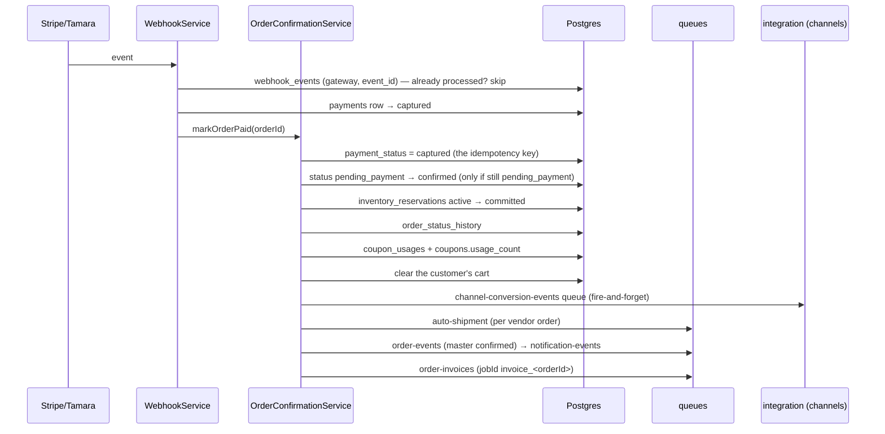
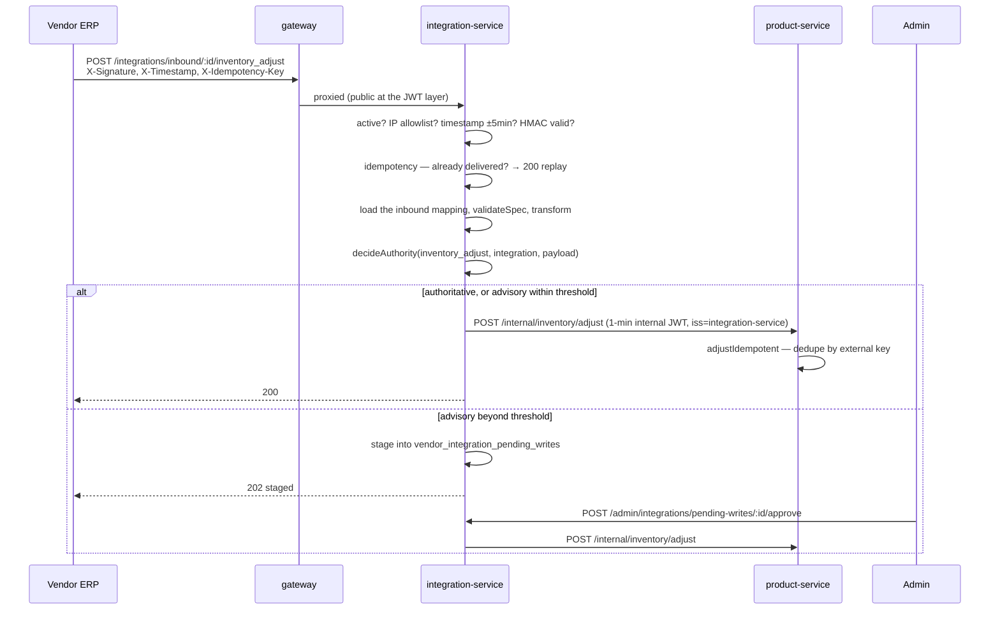
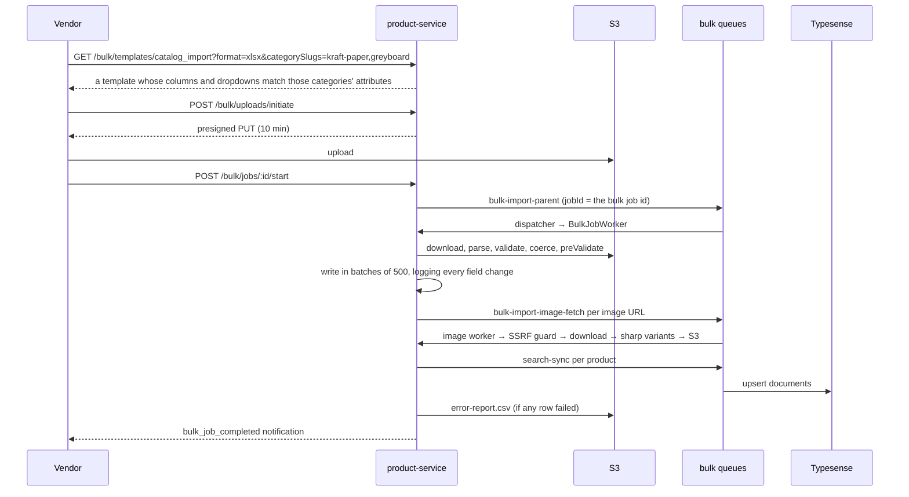
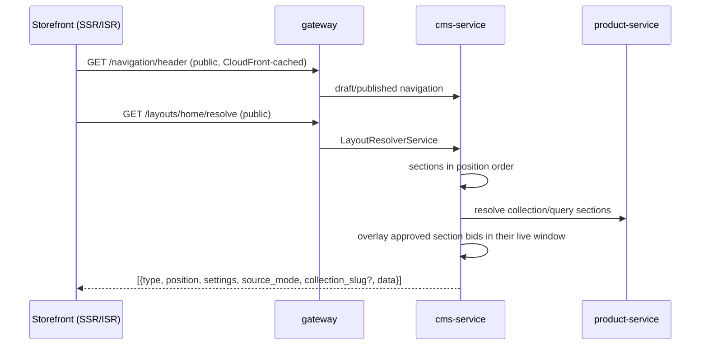
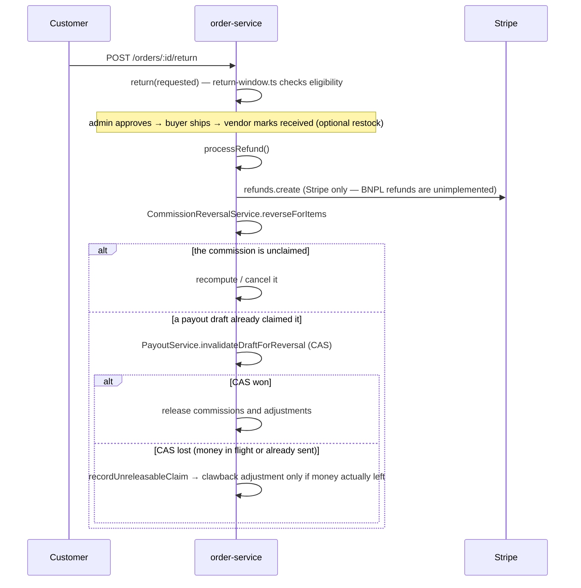

# 16 — Cross-service flows

End-to-end sequences that span more than one service. Each names the files involved so you can
follow it in the code.

---

## 1. Guest browses → registers → buys → gets paid out

The full commercial arc, compressed.

```mermaid
sequenceDiagram
    autonumber
    participant C as Customer
    participant GW as gateway
    participant A as auth
    participant P as product
    participant O as order
    participant N as notification
    participant V as vendor
    participant ST as Stripe

    C->>GW: GET /products?category=…            (public)
    GW->>P: search via Typesense
    C->>GW: POST /cart/items                    (optional auth, x-guest-session)
    GW->>O: cart row + Redis mirror
    C->>GW: POST /auth/register
    GW->>A: user + session; access JWT + refresh cookie
    C->>GW: POST /cart/merge
    GW->>O: CartMergeService folds the guest cart in
    C->>GW: GET /checkout/quote
    GW->>O: totals, delivery groups, quote_token
    C->>GW: POST /checkout/initiate + quote_token
    GW->>O: order (pending_payment) + vendor_orders (confirmed) + commissions (held) + reservations
    C->>GW: POST /checkout/payment-intent
    GW->>O: Stripe PaymentIntent (metadata.order_id)
    C->>ST: confirms payment
    ST->>GW: POST /webhooks/stripe
    GW->>O: markOrderPaid → captured, reservations committed, cart cleared
    O->>O: auto-shipment queue
    O->>N: order-events → notification-events
    N->>C: order confirmation email + in-app
    N->>V: per-vendor new-order alert
    Note over O: vendor ships → carrier webhook → delivered
    O->>O: settle_after stamped on the commissions
    Note over O: cron 5 * * * * → commissions become pending
    Note over O: cron 30 2 * * * → payout draft created, commissions claimed
    Note over O: admin approves (rail = stripe_connect)
    O->>ST: transfers.create → vendor's connected account
```

---

## 2. Payment webhook → order confirmation

The single most important cross-cutting path. `apps/order-service/src/domain/checkout/webhook.service.ts`
→ `order-confirmation.service.ts`.



Everything after the DB writes is best-effort: a failure in a publish is logged and swallowed, so
a downstream outage can never fail a payment that Stripe has already captured.

---

## 3. Vendor onboarding → first payout

```mermaid
sequenceDiagram
    participant U as User
    participant V as vendor-service
    participant A as admin
    participant O as order-service
    participant ST as Stripe

    U->>V: POST /vendors/apply (+ KYC documents)
    V->>V: vendors(pending) + vendor_members(owner, pending) + vendor_documents
    A->>V: PATCH /admin/vendors/:id/documents/:docId/verify
    A->>V: PATCH /admin/vendors/:id/approve
    V->>V: status=approved, verified_at, owner membership → active
    V->>V: bumpTokenVersion(owner) — next JWT carries the vm claim
    V->>V: create the default warehouse
    U->>V: POST /vendors/me/bank-accounts (encrypted, is_primary)
    U->>V: POST /vendors/me/connect
    V->>ST: accounts.create (express) + accountLinks.create
    U->>ST: completes onboarding
    ST->>V: POST /webhooks/stripe/connect (account.updated)
    V->>V: charges_enabled / payouts_enabled persisted
    Note over O: the vendor now satisfies both payout preconditions
    Note over O: draft cron builds a draft; admin approves on the Stripe rail
```

A vendor **without** `stripe_account_id` can still be paid — the admin picks
`manual_bank_transfer` and later records a bank reference.

---

## 4. Vendor's ERP pushes an inventory change (inbound integration)



The same shape carries `order.accept` / `order.reject` / `shipment.create` /
`shipment.update_status` to order-service, and `product.update_price` /
`product.update_attribute` to product-service. See
[11 — DomainDispatch](11-integration-service.md#domaindispatch--how-an-inbound-event-becomes-a-write).

---

## 5. Order status change fans out to a vendor's ERP (outbound integration)

```mermaid
sequenceDiagram
    participant O as order-service
    participant SS as site_settings
    participant Q as integration-events
    participant W as dispatcher.worker
    participant E as Vendor ERP

    O->>SS: emitIfEnabled checks vendor_integrations_outbound_enabled
    O->>Q: {event_type, vendor_id, payload, source_ref, schema_version}
    Q->>W: job
    W->>W: integration active? circuit closed? enabled outbound mapping?
    W->>W: transform(spec, payload)
    W->>E: POST outbound_url with X-Signature / X-Timestamp / X-Idempotency-Key
    alt 2xx
        W->>W: delivery=delivered, clear failure set, clear degraded_until
    else retryable (408/429/5xx/network)
        W->>W: record failure; ≥20 failures in 5 min → degraded_until set
        W->>Q: rethrow → BullMQ retry; final attempt → delivery=dlq
    end
```

---

## 6. Bulk catalogue import



---

## 7. Home page render



---

## 8. Refund path (return → money back → commission clawback)



The asymmetry is deliberate: a clawback is written **only** when the payout demonstrably sent
money (`processing`/`paid`). For a `failed` payout nothing left the platform, so charging the
vendor would take the same money twice.

---

## Cross-service call inventory

Every synchronous service-to-service call in the system:

| Caller | Callee | Route | Auth |
|---|---|---|---|
| integration-service | order-service | `POST /internal/vendor-orders/:id/transition` | internal JWT |
| integration-service | order-service | `POST /internal/shipments`, `/:id/transition` | internal JWT |
| integration-service | product-service | `POST /internal/inventory/adjust` | internal JWT |
| integration-service | product-service | `POST /internal/products/:id/patch` | internal JWT |
| any service | notification-service | `POST /notifications/send-internal`, `/preferences/seed-internal` | internal secret |
| gateway | all | proxy | pass-through |

Everything else crosses services through **BullMQ queues** or through **shared Postgres tables**.
